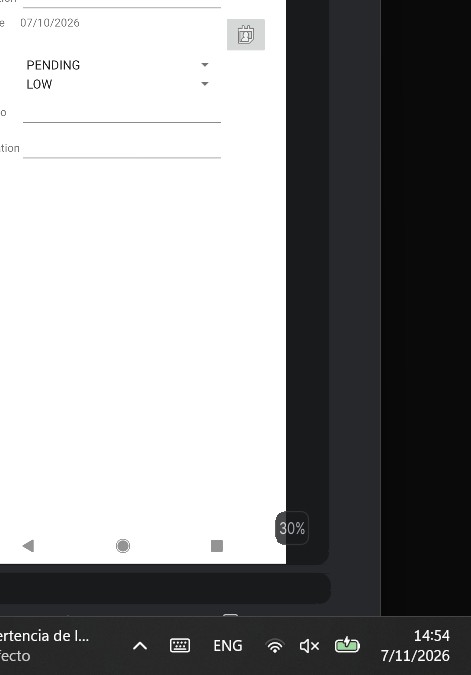
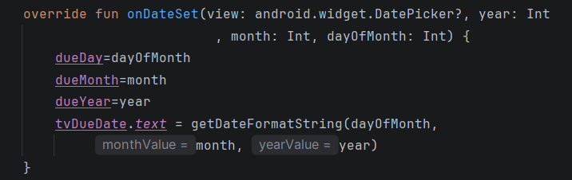
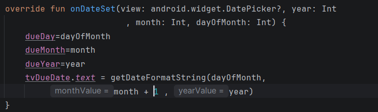
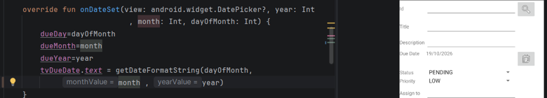
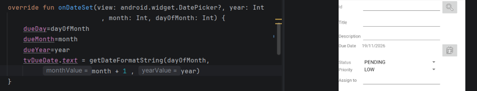
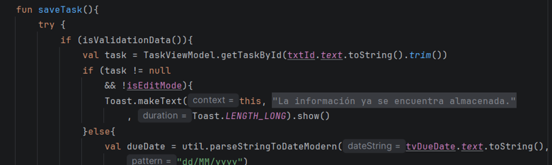
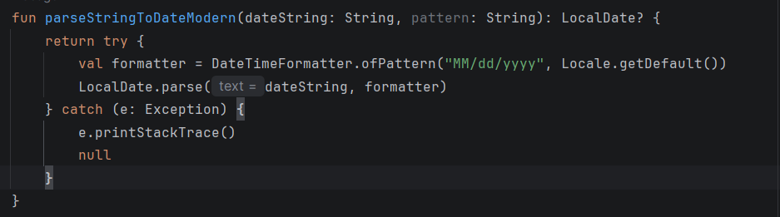
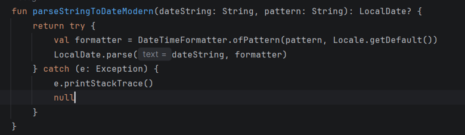

# Fase 0: Documentación de la solución de errores intencionales (Debugging)
Fase de solución de los errores intencionales, se identificaron y corrigieron en el proyecto. 

---

## 1. Error en la visualización del mes
Al seleccionar una fecha, el mes mostrado no correspondía con el mes seleccionado en el calendario.

En el método `onDateSet` se agregó `+ 1` al valor del mes (`monthValue`), ya que el formato lo evaluaba con un numero menos, haciendo que se mostrara un mes erróneo al elegido.

**Evidencia:**  

**Cambio en el método:**  

***Antes:***  

*Después:*  

---

## 2. Formateo incorrecto en el código de almacenamiento
Se identificó una inconsistencia en el formato utilizado para almacenar la información entre `TaskActivity` y `util.kt`.

Se corrigió el patrón en `util.kt` para que coincidiera con el utilizado en `TaskActivity`, manteniendo un mismo formato en ambos archivos.

**Evidencia:**
**En TaskActivity está de esta forma:**  

**Y en Util de esta forma:**  

**Se corrigió por el patrón, para que copie el mismo de TaskActivity.**  

---

## 3. Error en la visualización de tareas duplicadas
Al mostrar las tareas almacenadas, se producía una duplicación de la primera tarea.

El problema se encontraba en el uso de `- 1` al calcular la posición de los elementos ccuando la posición es mayor a 0, haciendo que se muestre duplicada la primera tarea.

**Evidencia:**

---

## 4. Visualización incorrecta del icono de eliminar
El icono de eliminar (basurero) continuaba mostrándose, después de que se haya almacenado una tarea, así haciendo que no haya nada que eliminar.

Se modificó el valor de `isEditMode` a `false` así evita que el icono se eliminar se siga mostrando después de almacenar la información 

**Evidencia:**

---
