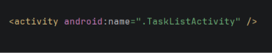

Etapa 0 

1. Primer error encontrado: 
El error se da cuando intento ver una tarea en la pantalla de "Task List" 
Lo encontre ya que preciono el boton y no se abre ninguna pantalla
Muestra donde vi el error:
[Error01](Errores/Error01.png)
La solución se da llamando a la pantalla en el AndroidManifest con el siguiente código

2. Segundo error encontrado, primero de fecha: 
Error: A la hora de elejir la fecha pone un mes atrasado puse diciembre y me pone 11
[Error](Errores/Error2-1.png)
Como lo encontre: Debuguie el codigo y la variable dueMonth comienza en 0
[Error](Errores/Error02.png)
Como se soluciono? Se le puso la suma de un valor a la variable para que aumentara y tambien a la hora de mostrarlo
[Error](Errores/Error2-2.png)

2.1 tercer error encontrado, segundo de fecha: 
Error: Elijo una fecha y vuelvo abrir el calendario y lo abre un mes adelante
[Error](Errores/Error4.1.png)

Como lo encontre: Abriendo el calendario y en el debug mostraba un mes adelantado
[Error](Errores/Error4.png)
Como se soluciono? Se soluciono restandole un valor a la variable (-1) ya que inicia en 0 pero con el más uno queda adelantado
[Error](Errores/Error4.3.png)

2.3 cuarto error encontrado, tercero de fecha: 
Error: A la hora de poner el formato de la fecha no se utiliza el parametro pattern sino que se utiliza uno establecido MM/dd/yyyy
[Error](Errores/error04.png)

Como lo encontre: Abriendo el calendario las fechas no se mostraban correctamente y revise el codigo y eso estaba mal
[Error](Errores/error04.png)
Como se soluciono? Se solucionó modificando la función parseStringToDateModern cambiando el formato fijo "MM/dd/yyyy" por el parámetro pattern
[Error](Errores/error04Solucionado.png)

2.4 Quinto error encontrado, cuarto de fecha: 
Error: A la hora de devolver el mes del calendario devuelve un mes antes, ejemplo si es en noviembre va a devolver el 10
[Error](Errores/Error2.4.png)

Como lo encontre: debugueando vi que el valor devuelto no es el correcto
Como se soluciono? Se solucionó sumandole un (+1) para que devolviera el valor correcto 
[Error](Errores/2.4solucion.png)

3. tercer error encontrado: 
Error:A la hora de enviar una tarea está enviando un tittle y no un ID
[Error](Errores/Error3.png)
Como lo encontre:Cuando entro a enviarla me dice "information not found" y envia un texto entonces en el debugueo se manda un Texto
[Error](Errores/Error3.2.png)
Como se soluciono? Se soluciono enviando un ID y no un title
[Error](Errores/Error3.3.png)

4. cuarto error encontrado: 
Error:Cuando se guarda, cancela o elimina una tarea, la variable clean screen siempre queda en modo true y lo que pasa es que sigue en modo edicion y no se ejecuta lo que uno necesita 
[Error](Errores/error05.png)
Como lo encontre:después de guardar, cancelar o eliminar una tarea, la pantalla no regresaba correctamente a su estado inicial.

Como se soluciono? Simplemente pasando la variable a false para restablecer el estado de la pantalla
[Error](Errores/error05Solucionado.png)

5. Quinto error encontrado: 
Error:Cuando veo las tareas primera y segunda tarea aparecen repetidas en la lista y la última no se muestra
[Error](Errores/error06.png)
Como lo encontre: Vi en el codigo que se estaba restando 1 a la posición de los elementos, provocando que se mostraran tareas incorrectas.

Como se soluciono? Se eliminó la condición que restaba 1 a la posición y utilizando directamente tasks[position]
[Error](Errores/error06solucionado.png)

6. sexto error encontrado: 
Error: En el memory manager si se recibe un id con espacios por los lados aunque sea el mismo valor no va aser igual
[Error](Errores/error6.png)
Como lo encontre: 

Como se soluciono? Se le agrego trim() para quitar los espacios en blanco 
[Error](Errores/6solucionado.png)

