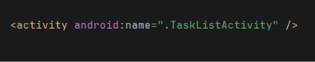

Etapa 0 

1. Primer error encontrado: 
El error se da cuando intento ver una tarea en la pantalla de "Task List" 
Lo encontre ya que preciono el boton y no se abre ninguna pantalla
Muestra donde vi el error:
[Error01](Errores/Error01.png)
La solución se da llamando a la pantalla en el AndroidManifest con el siguiente código

2. Segundo error encontrado: 
Error: A la hora de elejir la fecha pone un mes atrasado puse diciembre y me pone 11
[Error](Errores/Error2-1.png)
Como lo encontre: Debuguie el codigo y la variable dueMonth comienza en 0
[Error](Errores/Error02.png)
Como se soluciono? Se le puso la suma de un valor a la variable para que aumentara y tambien a la hora de mostrarlo
[Error](Errores/Error2-2.png)

3. Segundo error encontrado: 
Error:A la hora de enviar una tarea está enviando un tittle y no un ID
[Error](Errores/Error3.png)
Como lo encontre:Cuando entro a enviarla me dice "information not found" y envia un texto entonces en el debugueo se manda un Texto
[Error](Errores/Error3.2.png)
Como se soluciono? Se soluciono enviando un ID y no un title
[Error](Errores/Error3.3.png)

4. segundo error encontrado: 
Error: Elijo una fecha y vuelvo abrir el calendario y lo abre un mes adelante
[Error](Errores/Error4.1.png)

Como lo encontre: Abriendo el calendario y en el debug mostraba un mes adelantado
[Error](Errores/Error4.png)
Como se soluciono? Se soluciono restandole un valor a la variable (-1) ya que inicia en 0 pero con el más uno queda adelantado
[Error](Errores/Error4.3.png)