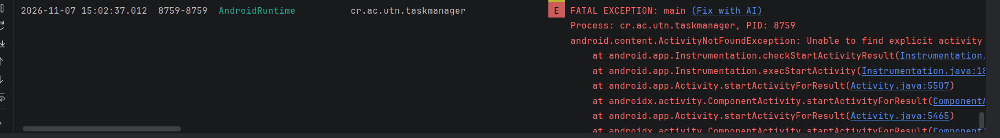
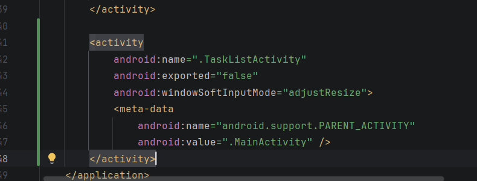
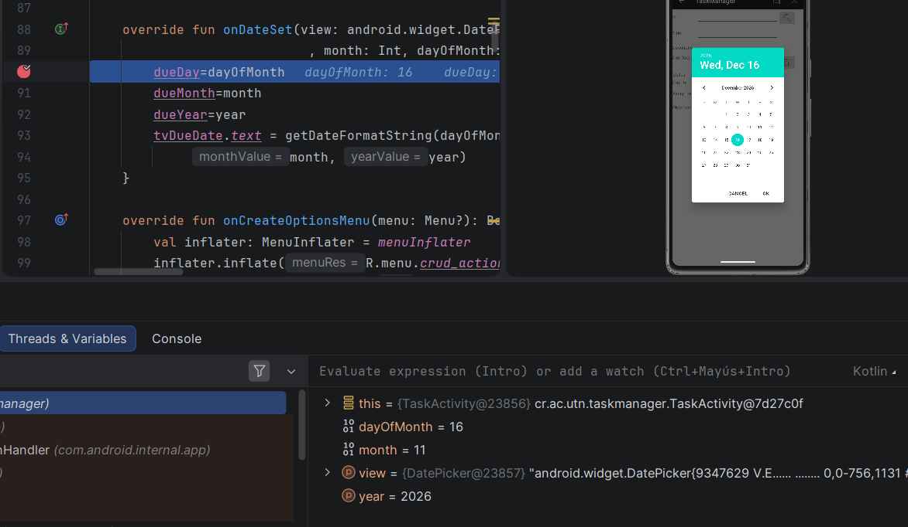
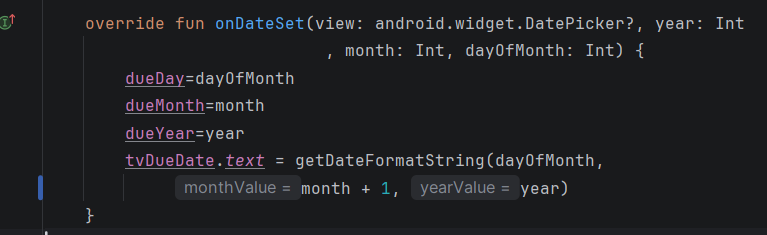
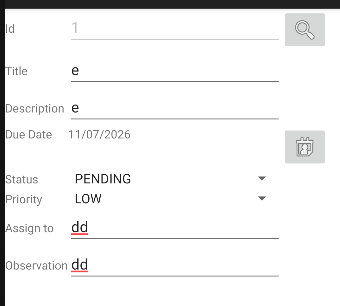
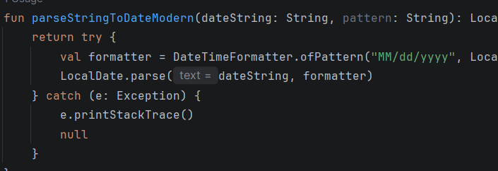
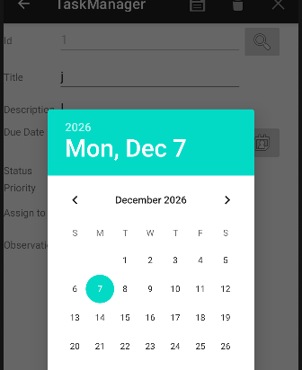
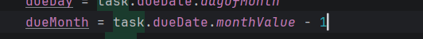

Error 1 

No se puede abrir la taskListActivity
El error fue encontrado al probar la aplicación.
y en el debbugeo aparece el siguiente error

el cual indica que la actividad no está registrada en el adroid manifest.
Para solucionarlo de agregó la activity.

Error 2 Item fecha

Siempre que se guarda un mes aparece el anterior, además que enero empieza en 0 y febrero en 1.

En las variables se puede apreciar como están incorrectas.
Para solucionarlo se le sumó uno.

Al buscar una tarea para editarla aparece el formato de la fecha incorrecto.
![alt text]errors/image-4.png)

El error está en util.

Para solucionarlo sólo se cambió el orden.

Al editar la fecha de una tarea aunque se seleccione la misma fecha el mes aparece de forma incorrecta.

Para solucionarlo se realizó lo siguiente.

