Error 1 

No se puede abrir la taskListActivity
El error fue encontrado al probar la aplicación.
y en el debbugeo aparece el siguiente error
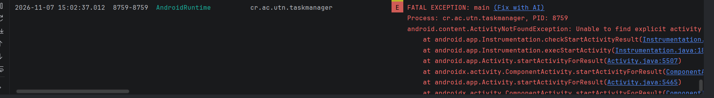
el cual indica que la actividad no está registrada en el adroid manifest.
Para solucionarlo de agregó la activity.
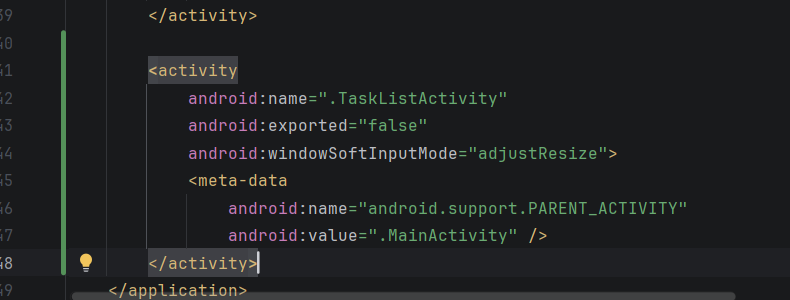

Error 2 Item fecha

Siempre que se guarda un mes aparece el anterior, además que enero empieza en 0 y febrero en 1.
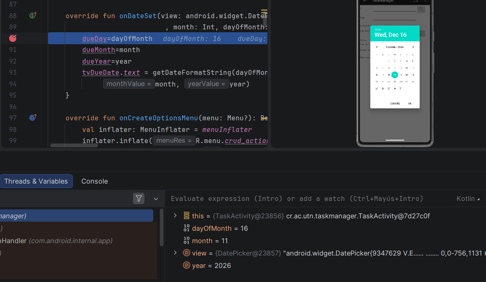
En las variables se puede apreciar como están incorrectas.
Para solucionarlo se le sumó uno.
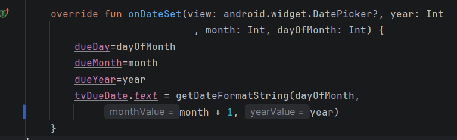

Al buscar una tarea para editarla aparece el formato de la fecha incorrecto.
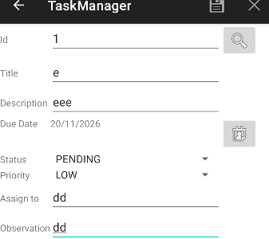
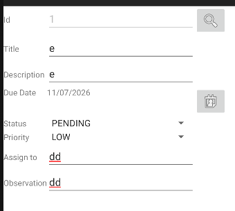
El error está en util.
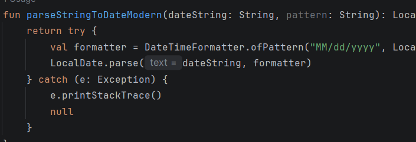
Para solucionarlo sólo se cambió el orden.

Al editar la fecha de una tarea aunque se seleccione la misma fecha el mes aparece de forma incorrecta.
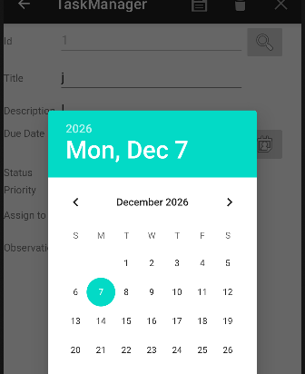
Para solucionarlo se realizó lo siguiente.
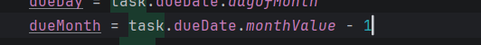

Error 3
Al editar una tarea ya creada desde la lista aparece en vez del id el título.
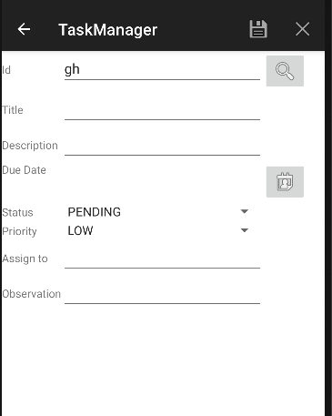
El error se encuentra acá.
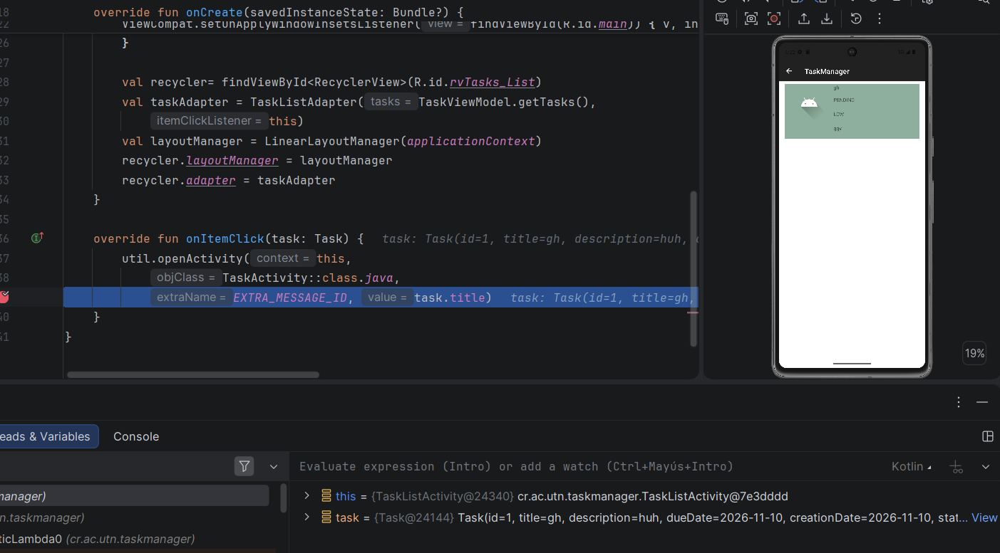
Para solucionarlo se realizó lo siguiente.
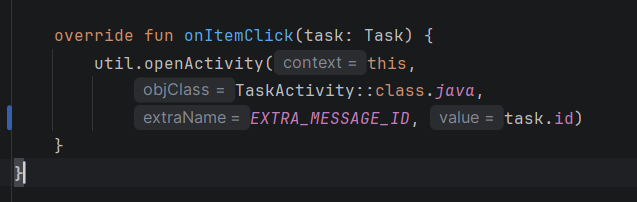

Error 4
Si se registran más de tres tareas la primera aparece dos veces, la segunda aparece en la tercera posición y la tercera no aparece.
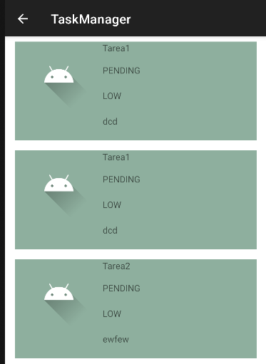
El error ocurre en el método onBindViewHolder() de TaskListAdapter.kt, que se encarga de asignar los datos de cada tarea a su posición en el RecyclerView. El problema es que se utilizaba position - 1, por lo que, cuando el RecyclerView solicitaba mostrar la tarea de la posición 1, el código obtenía la tarea de la posición 0. Esto provocaba que se repitieran tareas y que la última no apareciera. 
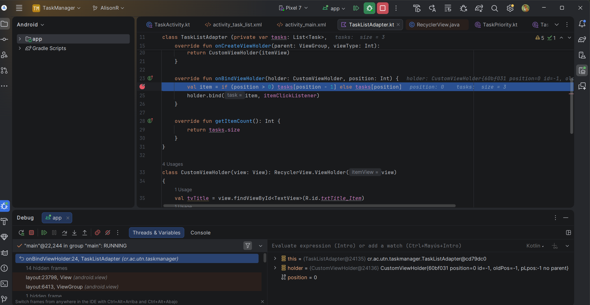
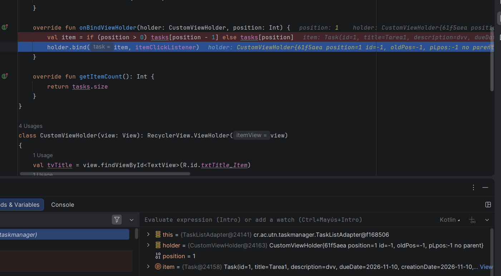
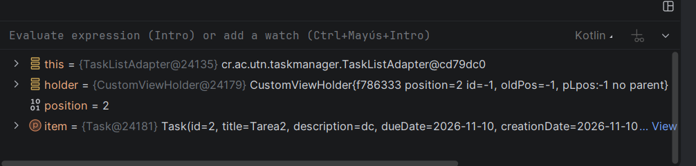
Para solucionarlo se realizó lo siguiente.
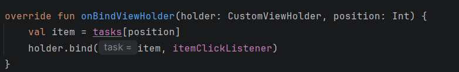

Error 5
Al presionar el botón de limpiar la pantalla y poner un id igual a una tarea ya registrada e intentar guardarla en vez de mostrar que los datos están repetidos, actualiza la tarea.
El error se encuentra acá, al aparecer erroneamente isEditMode=true.
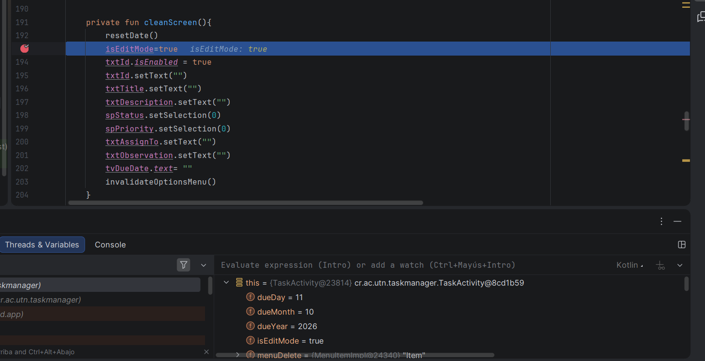
Para solucionarlo se realizó lo siguiente.

Error 6
Al presionar el botón de borrar aunque no tenga datos aparece eliminado exitosamente.
esto se debe a que el método removeTask del TaskViewModel no posee una validación del id.
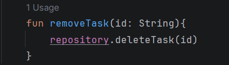
Para solucionarlo se realizó lo siguiente.
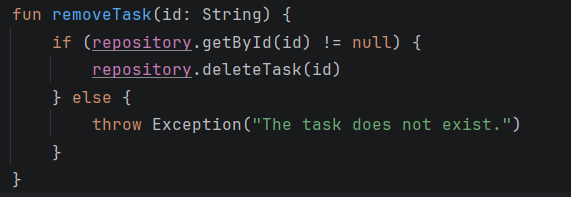

Error 7 
El método saveTask() en TaskViewModel puede permitir guardar ids repetidos.
Al intentar registrar una tarea con un identificador existente, la aplicación mostró el mensaje "The information is already stored", impidiendo realizar el registro duplicado. Durante la revisión del código se identificó que esta validación se encuentra implementada en TaskActivity.kt, pero no directamente en TaskViewModel.kt. Esto representa una debilidad en la lógica de negocio, ya que otros componentes podrían invocar el método del ViewModel sin realizar la misma validación.
Para que este quede solucionado lo mejor sería dejar el código así.
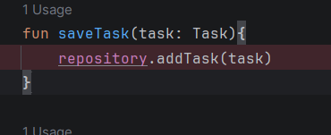
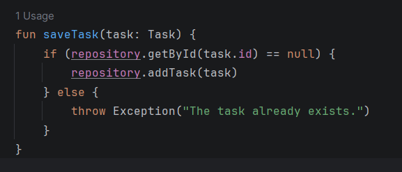

Error 8
El método updateTask en TaskViewModel no posee la validación correspondiente con el id así que podría terminar guardando una tarea que vamos a editar como una nueva.
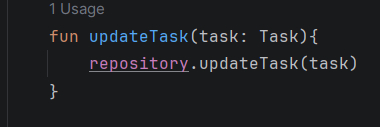
Para solucionarlo se realizó lo siguiente.
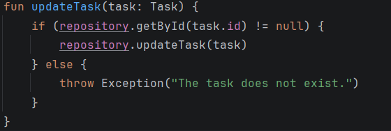