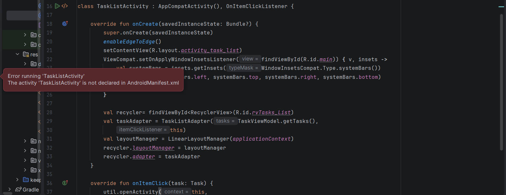
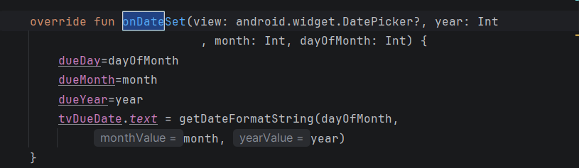
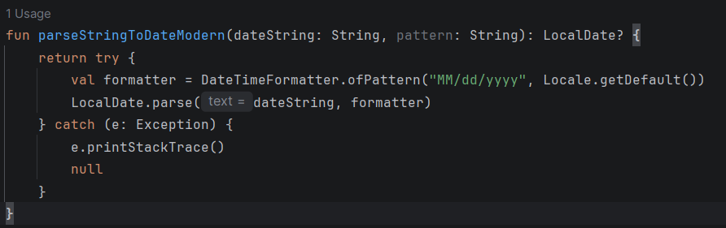
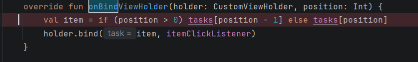
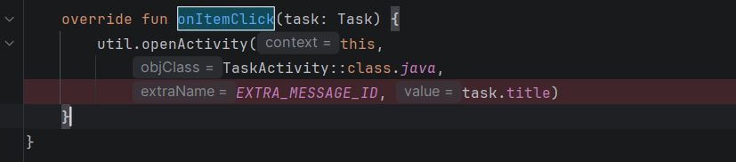
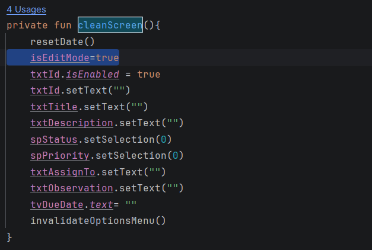
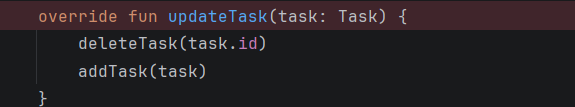
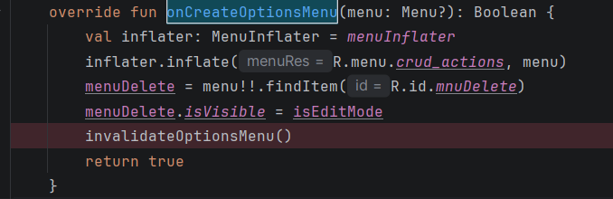
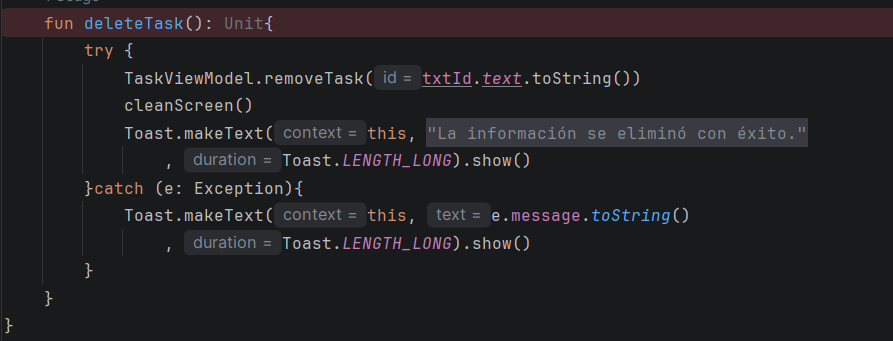

# Práctica de Laboratorio – TaskManager

## Descripción general

En esta práctica de laboratorio se utiliza como base el proyecto **TaskManager**, una aplicación móvil orientada a la gestión de tareas personales. A partir de este proyecto, se ponen en práctica y fortalecen los conocimientos sobre depuración de código (*debugging*), arquitectura de software en Android (MVVM), desarrollo e interacción con interfaces de usuario (UI), así como la manipulación de colecciones y el filtrado de datos mediante Kotlin.

˙ . ꒷🪼 . 𖦹˙— ⊹ ࣪˖᯽݁˖· ‎ꫂ᭪݁ ·˖݁᯽˖࣪ ⊹ 𓆝 ˚₊·—̳͟͞͞♡ ━━━━━━━━━━━━━━━━━━━━━━━━━━━━━━━━━⋆｡𖦹°‧🫧⋆.ೃ࿔*:･

## Objetivos de aprendizaje

1. **Depuración de aplicaciones Android:** Utilizar las herramientas de Android Studio, como Logcat, Breakpoints, Inspect Variables y Stack Trace, para identificar, diagnosticar y corregir errores de ejecución (*Runtime Exceptions*) y errores de lógica.

2. **Implementación de componentes de arquitectura:** Desarrollar nuevas actividades (*Activity*), gestionar la navegación mediante *Intents*, establecer la comunicación entre la capa de presentación y el *ViewModel*, e implementar componentes de interfaz como *AlertDialog* y *Spinner*.

3. **Manipulación de datos y colecciones:** Aplicar operaciones de transformación y filtrado dinámico sobre colecciones de Kotlin mediante funciones como `filter`, `count` y `map`.

˙ . ꒷🪼 . 𖦹˙— ⊹ ࣪˖᯽݁˖· ‎ꫂ᭪݁ ·˖݁᯽˖࣪ ⊹ 𓆝 ˚₊·—̳͟͞͞♡ ━━━━━━━━━━━━━━━━━━━━━━━━━━━━━━━━━⋆｡𖦹°‧🫧⋆.ೃ࿔*:･

## Fase 0: Identificación y corrección de errores intencionales (Debugging – 45 minutos)

El proyecto base contiene ocho errores intencionales que deben ser identificados y corregidos antes de continuar con las siguientes fases de la práctica. Para ello, se utilizan las herramientas de depuración disponibles en Android Studio.

A continuación, se documentan los errores identificados, las evidencias de su detección y las soluciones implementadas.

### 1. `TaskListActivity` no está declarada en el `AndroidManifest.xml`

Al depurar la clase `TaskListActivity`, se identificó que la actividad no se encontraba declarada en el archivo `AndroidManifest.xml`, lo que impedía su correcto reconocimiento dentro de la aplicación.

* **Evidencia del error:**

  

* **Solución:**

  Se agregó la declaración correspondiente en el manifiesto mediante el siguiente código:

  ```xml
  <activity
      android:name=".TaskListActivity"
      android:exported="true"
      android:windowSoftInputMode="adjustResize">
      <meta-data
          android:name="android.support.PARENT_ACTIVITY"
          android:value=".MainActivity" />
  </activity>
  ```

˙ . ꒷🪼 . 𖦹˙— ⊹ ࣪˖᯽݁˖· ‎ꫂ᭪݁ ·˖݁᯽˖࣪ ⊹ 𓆝 ˚₊·—̳͟͞͞♡ ━━━━━━━━━━━━━━━━━━━━━━━━━━━━━━━━━⋆｡𖦹°‧🫧⋆.ೃ࿔*:･

### 2. Declaración incorrecta de los parámetros en `onDateSet`

Se identificó un error en la asignación del valor de fecha al componente `tvDueDate`. La instrucción utilizaba los parámetros `dayOfMonth`, `month` y `year`, en lugar de las variables correspondientes a la fecha seleccionada: `dueDay`, `dueMonth` y `dueYear`.

* **Evidencia del error:**

  

* **Solución:**

  Se corrigió la asignación para utilizar las variables adecuadas y garantizar que se mostrara la fecha seleccionada correctamente.

#### 2.1. Corrección del formato de fecha mediante `pattern`

Se detectó que la variable `pattern`, definida para establecer el formato de fecha, no estaba siendo utilizada. En su lugar, se empleaba directamente el formato `"MM/dd/yyyy"`.

* **Evidencia del error:**

  

* **Solución:**

  Se modificó la implementación para utilizar la variable `pattern` en la definición del formato, aprovechando la configuración previamente establecida y evitando mantener un valor fijo.

#### 2.2. Corrección del desplazamiento del mes en la fecha

Se identificó que la fecha mostraba incorrectamente el mes, ya que enero aparecía representado como el mes `0`. Esto se debía a la diferencia entre la numeración utilizada por `DatePicker`, que comienza en cero, y la representación de los meses mediante `LocalDate`, que comienza en uno.

* **Evidencia del error:**

  

* **Solución:**

  Se modificó el método `onDateSet` para incrementar en uno el valor del mes al generar la fecha:

  ```kotlin
  override fun onDateSet(
      view: android.widget.DatePicker?,
      year: Int,
      month: Int,
      dayOfMonth: Int
  ) {
      dueDay = dayOfMonth
      dueMonth = month
      dueYear = year

      tvDueDate.text = getDateFormatString(
          dueDay,
          dueMonth + 1,
          dueYear
      )
  }
  ```

  Asimismo, en el método de búsqueda de tareas (*Search Task*), se ajustó la asignación de `dueMonth` para mantener la correspondencia entre ambos formatos de numeración:

  ```kotlin
  dueMonth = task.dueDate.monthValue - 1
  ```

˙ . ꒷🪼 . 𖦹˙— ⊹ ࣪˖᯽݁˖· ‎ꫂ᭪݁ ·˖݁᯽˖࣪ ⊹ 𓆝 ˚₊·—̳͟͞͞♡ ━━━━━━━━━━━━━━━━━━━━━━━━━━━━━━━━━⋆｡𖦹°‧🫧⋆.ೃ࿔*:･

### 3. Uso incorrecto de `position - 1` en `onBindViewHolder`

En el archivo `TaskListAdapter.kt`, se identificó que el método `onBindViewHolder` utilizaba la siguiente instrucción:

```kotlin
val item = if (position > 0) tasks[position - 1] else tasks[position]
```

Esta condición provocaba un desplazamiento en la selección de los elementos de la lista. Como consecuencia, la primera y segunda fila mostraban la misma tarea, mientras que el último elemento no se visualizaba.

* **Evidencia del error:**

  

* **Solución:**

  Se eliminó la condición y se accedió directamente al elemento correspondiente a la posición actual:

  ```kotlin
  val item = tasks[position]
  ```
  
˙ . ꒷🪼 . 𖦹˙— ⊹ ࣪˖᯽݁˖· ‎ꫂ᭪݁ ·˖݁᯽˖࣪ ⊹ 𓆝 ˚₊·—̳͟͞͞♡ ━━━━━━━━━━━━━━━━━━━━━━━━━━━━━━━━━⋆｡𖦹°‧🫧⋆.ೃ࿔*:･

### 4. `onItemClick` envía el título en lugar del identificador de la tarea

En el archivo `TaskListActivity.kt`, se detectó que el método `onItemClick` enviaba el título de la tarea como parámetro de navegación, cuando debía enviar su identificador único (`id`).

La instrucción original era:

```kotlin
util.openActivity(
    this,
    TaskActivity::class.java,
    EXTRA_MESSAGE_ID,
    task.title
)
```

* **Evidencia del error:**

  

* **Solución:**

  Se sustituyó `task.title` por `task.id`, garantizando que la actividad recibiera el identificador correcto para recuperar la información de la tarea seleccionada.

˙ . ꒷🪼 . 𖦹˙— ⊹ ࣪˖᯽݁˖· ‎ꫂ᭪݁ ·˖݁᯽˖࣪ ⊹ 𓆝 ˚₊·—̳͟͞͞♡ ━━━━━━━━━━━━━━━━━━━━━━━━━━━━━━━━━⋆｡𖦹°‧🫧⋆.ೃ࿔*:･

### 5. La pantalla permanece en modo edición después de guardar, cancelar o eliminar

Se identificó que la variable `cleanScreen` permanecía en `true` después de ejecutar las operaciones de guardar, cancelar o eliminar una tarea. Esto provocaba que la pantalla continuara en modo de edición y que las validaciones posteriores no se ejecutaran según lo esperado.

* **Evidencia del error:**

  

* **Solución:**

  Se modificó el valor de la variable `cleanScreen` a `false`, permitiendo restablecer el estado de la pantalla y ejecutar correctamente las validaciones correspondientes.

˙ . ꒷🪼 . 𖦹˙— ⊹ ࣪˖᯽݁˖· ‎ꫂ᭪݁ ·˖݁᯽˖࣪ ⊹ 𓆝 ˚₊·—̳͟͞͞♡ ━━━━━━━━━━━━━━━━━━━━━━━━━━━━━━━━━⋆｡𖦹°‧🫧⋆.ೃ࿔*:･

### 6. `updateTask` elimina y vuelve a agregar la tarea, y `getTasks` expone la lista interna

En `TaskMemoryManager.kt`, el método `updateTask` actualizaba una tarea borrándola y agregándola de nuevo:

```kotlin
override fun updateTask(task: Task) {
    deleteTask(task.id)
    addTask(task)
}
```

Como consecuencia, la tarea editada pasaba al final de la lista y cambiaba el orden que veía el usuario. Además, `getTasks()` devolvía directamente la lista mutable interna (`override fun getTasks() = tasks`), de modo que cualquier clase podía modificar los datos del repositorio sin pasar por él.

* **Evidencia del error:**

  

* **Solución:**

  Se reemplazó la tarea en su misma posición usando su índice:

  ```kotlin
  override fun updateTask(task: Task) {
      val index = tasks.indexOfFirst { it.id == task.id }
      if (index >= 0) tasks[index] = task else tasks.add(task)
  }
  ```

  Además, `getTasks()` ahora devuelve una copia de solo lectura:

  ```kotlin
  override fun getTasks(): List<Task> = tasks.toList()
  ```

  Como `getTasks()` ya no devuelve la lista viva, `TaskListActivity` refresca la lista en `onResume()` con `applyFilters()`. Así se ven los cambios al volver de editar una tarea.

˙ . ꒷🪼 . 𖦹˙— ⊹ ࣪˖᯽݁˖· ‎ꫂ᭪݁ ·˖݁᯽˖࣪ ⊹ 𓆝 ˚₊·—̳͟͞͞♡ ━━━━━━━━━━━━━━━━━━━━━━━━━━━━━━━━━⋆｡𖦹°‧🫧⋆.ೃ࿔*:･

### 7. `invalidateOptionsMenu()` dentro de `onCreateOptionsMenu`

En `TaskActivity.kt`, el método `onCreateOptionsMenu` llamaba a `invalidateOptionsMenu()` mientras construía el menú:

```kotlin
override fun onCreateOptionsMenu(menu: Menu?): Boolean {
    val inflater: MenuInflater = menuInflater
    inflater.inflate(R.menu.crud_actions, menu)
    menuDelete = menu!!.findItem(R.id.mnuDelete)
    menuDelete.isVisible = isEditMode
    invalidateOptionsMenu()
    return true
}
```

`invalidateOptionsMenu()` le pide a Android que reconstruya el menú, y reconstruirlo vuelve a llamar a `onCreateOptionsMenu`. Eso provoca un ciclo de reconstrucciones constantes. Además, el botón Eliminar quedaba atado a una variable `lateinit var menuDelete` que solo se inicializa dentro de ese método.

* **Evidencia del error:**

  

* **Solución:**

  `onCreateOptionsMenu` ahora solo infla el menú:

  ```kotlin
  override fun onCreateOptionsMenu(menu: Menu?): Boolean {
      menuInflater.inflate(R.menu.crud_actions, menu)
      return true
  }
  ```

  La visibilidad del botón Eliminar pasó a `onPrepareOptionsMenu`, que Android llama cada vez que se invalida el menú:

  ```kotlin
  override fun onPrepareOptionsMenu(menu: Menu?): Boolean {
      menu?.findItem(R.id.mnuDelete)?.isVisible = isEditMode
      return super.onPrepareOptionsMenu(menu)
  }
  ```

  Se eliminó la variable `lateinit var menuDelete`. Las llamadas a `invalidateOptionsMenu()` que ya existían en `searchTask()` y `cleanScreen()` siguen igual, y son las que activan `onPrepareOptionsMenu`.

˙ . ꒷🪼 . 𖦹˙— ⊹ ࣪˖᯽݁˖· ‎ꫂ᭪݁ ·˖݁᯽˖࣪ ⊹ 𓆝 ˚₊·—̳͟͞͞♡ ━━━━━━━━━━━━━━━━━━━━━━━━━━━━━━━━━⋆｡𖦹°‧🫧⋆.ೃ࿔*:･

### 8. `deleteTask` no valida que la tarea exista

En `TaskActivity.kt`, el método `deleteTask` eliminaba sin verificar nada:

```kotlin
fun deleteTask(): Unit {
    try {
        TaskViewModel.removeTask(txtId.text.toString())
        cleanScreen()
        Toast.makeText(this, getString(R.string.TextDeleteSuccess), Toast.LENGTH_LONG).show()
    } catch (e: Exception) { ... }
}
```

Si el Id estaba vacío o no existía, `removeTask` no hacía nada, pero la app igual mostraba "La información se eliminó con éxito". El usuario recibía un mensaje falso. Tampoco se hacía `trim()` al Id.

* **Evidencia del error:**

  

* **Solución:**

  Se limpia el Id y se comprueba que la tarea exista antes de eliminar. Si no existe, se muestra "La información no existe" y se sale del método:

  ```kotlin
  fun deleteTask(): Unit {
      try {
          val id = txtId.text.toString().trim()
          if (id.isBlank() || TaskViewModel.getTaskById(id) == null) {
              Toast.makeText(this, getString(R.string.TextDataNoFound), Toast.LENGTH_LONG).show()
              return
          }
          TaskViewModel.removeTask(id)
          cleanScreen()
          Toast.makeText(this, getString(R.string.TextDeleteSuccess), Toast.LENGTH_LONG).show()
      } catch (e: Exception) {
          Toast.makeText(this, e.message ?: getString(R.string.TextDataNoFound), Toast.LENGTH_LONG).show()
      }
  }
  ```

˙ . ꒷🪼 . 𖦹˙— ⊹ ࣪˖᯽݁˖· ‎ꫂ᭪݁ ·˖݁᯽˖࣪ ⊹ 𓆝 ˚₊·—̳͟͞͞♡ ━━━━━━━━━━━━━━━━━━━━━━━━━━━━━━━━━⋆｡𖦹°‧🫧⋆.ೃ࿔*:･
