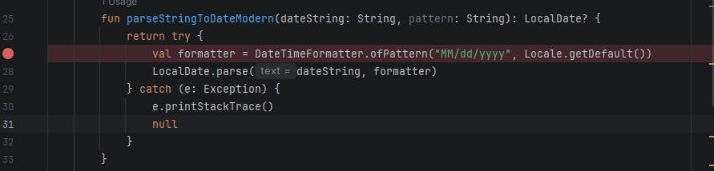
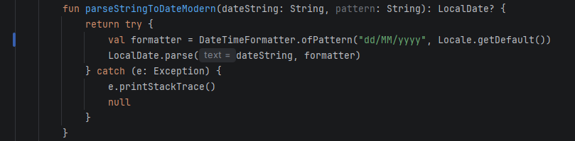
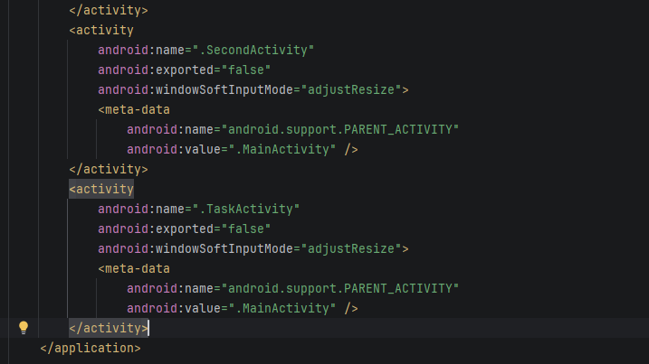
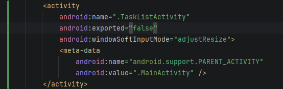

## Fase 0: Debugging 

**Problema 1:**
Error numero 1 en la linea 27 de la funcion parseStringToDateModern en util.kt, invierte la fechas y se arregla cambiandole el formato a la fecha correcta

**Problema 2:**
El boton de Task List en la MainActivity no abre y cierra el programa debido a que no esta en el Manifest 
nada mas para solucionarlo se le agrega la la funcion de activity en el manifest de la TaskListActivity

**Problema 3**

**Problema 4**

**Problema 5**

**Problema 6**

**Problema 7**

**Problema 8** 

