Error_01: El botón de task list cuando lo presiono me saca de la aplicación, el androidManifest.xml solo tiene declarado MainActivity, SecondActivity y TaskActivity.
Solución: Falta declarar la función TaskListActivity dentro del androidManifest.xml

Error_02: En el taskList las dos primeras filas muestran el mismo dato guardado:

Lo corregi modificando la funcion de onBindViewOlder y ahora si funcionaba correctamente

Error_03: En util el formato de fecha esta mal, no esta llamando bien el metodo

lo correcto es 

Ademas se estan contando los meses desde 0 en lugar de 1

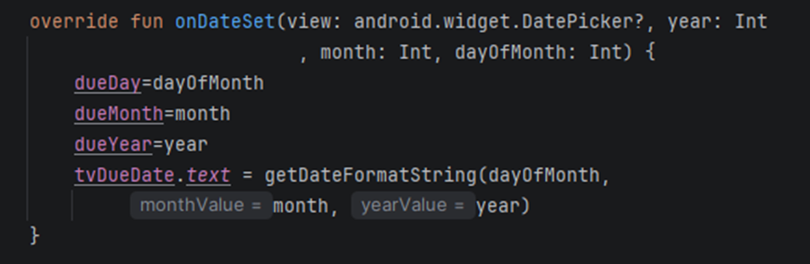

lo modifique asi agregando un +1

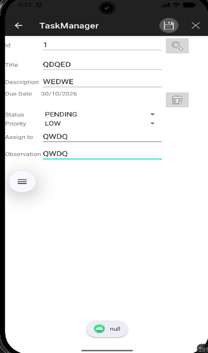

Error_04: En la funcion onItemClick se enviaba el titulo en vez de la Id

Lo correcto es ponerle el valor de Id para que ahora si devuelva la id en lugar del titulo

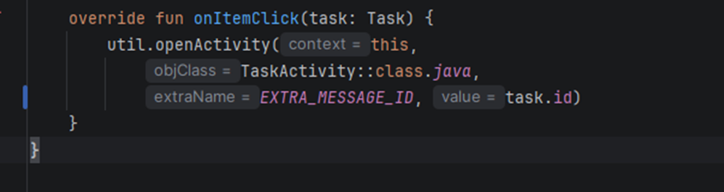

Error_05: La función cleanScreen deja el modo edición activo, cuando guarda isEditMode queda en true y una tarea nueva que agregue podria sobreescribir otra. 

La solución fue poner el valor en false.

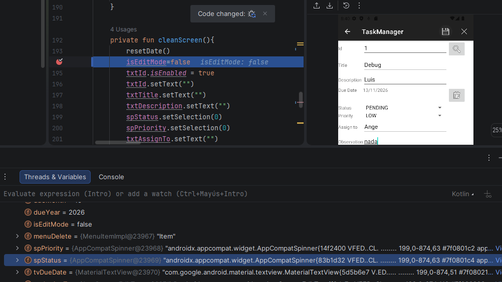

Error_06: En TaskMemoryManager.kt las funciones deleteTask y getById no validan el ID, entomces si pongo un id 1 con un espacio, no se podria encontrar la tarea guardada con un id 1 sin espacio.

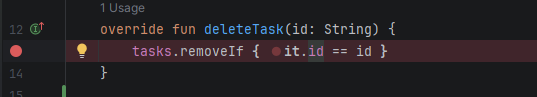

Le agregue un trim() para tener una mejor validacion

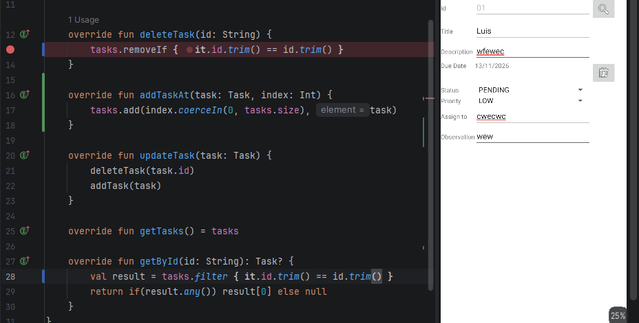

Error_07: En taskActivity.kt la función invalidateOptionsMenu() vuelve a ejecutar onCreateOptionsMenu, que la llamaba otra vez.

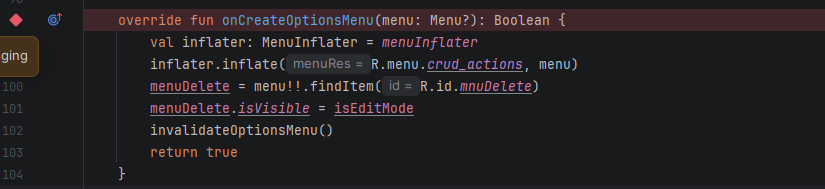

Borre ese llamado de la función invalidateOptionsMenu()

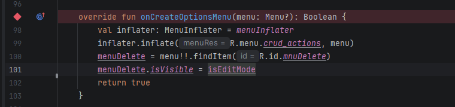

Error_08: En TaskMemoryManager.kt la función updateTask cambia de  una vez actualizada

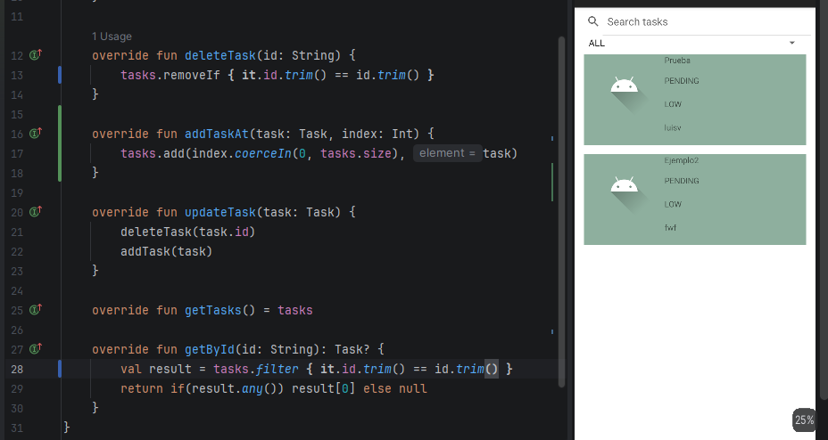

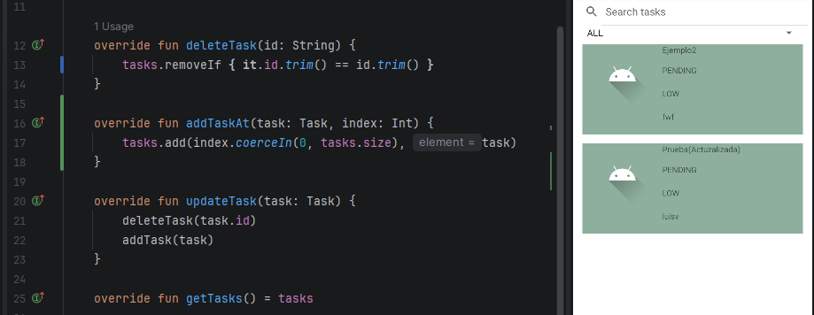

Entonces agregue esta modificación para que la tarea que edito no salte o cambie de posición

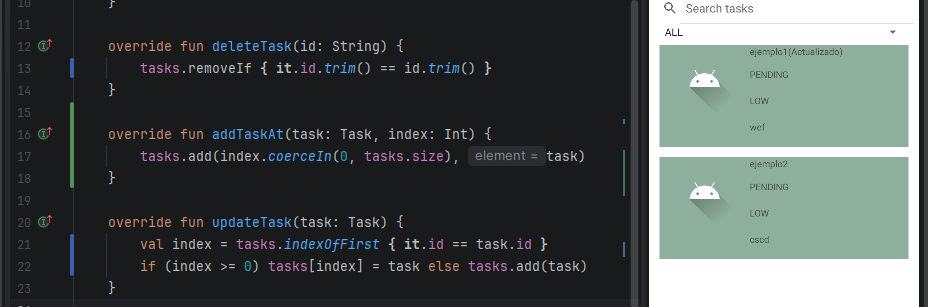
