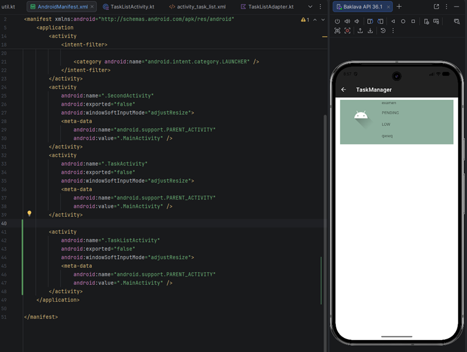
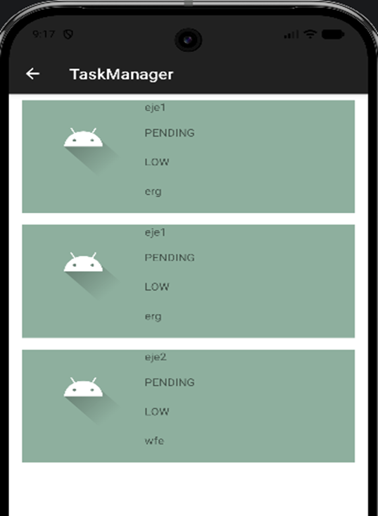
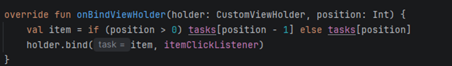
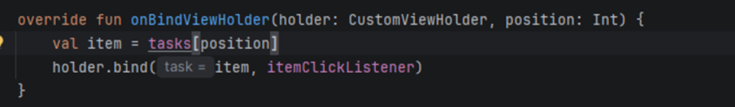
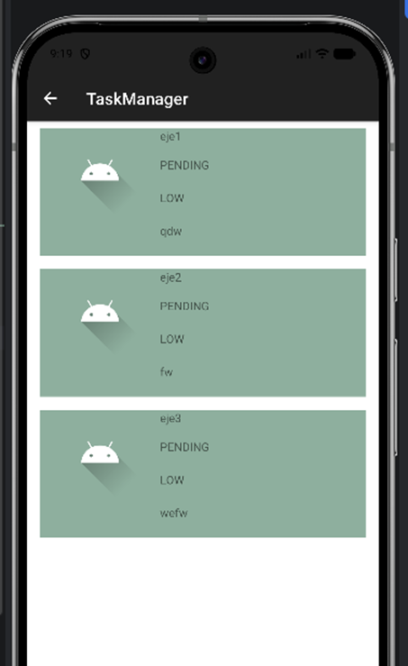
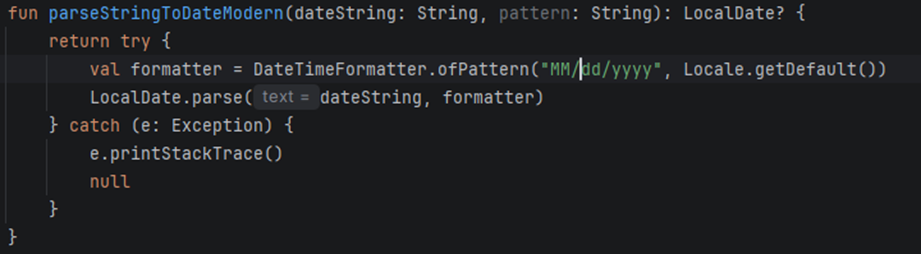
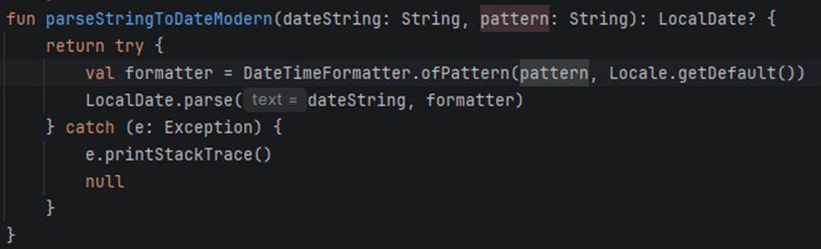
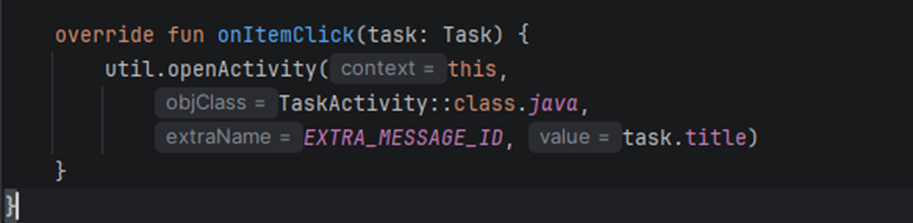
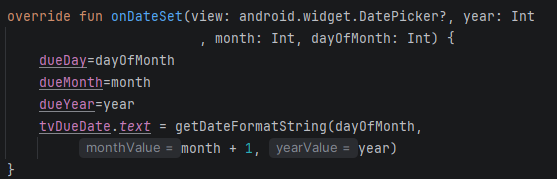
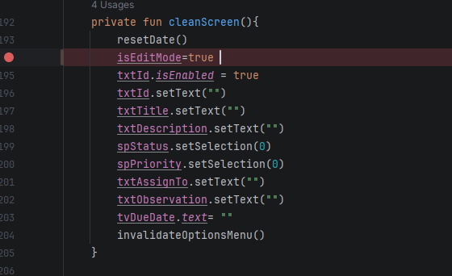

Error_01: El botón de task list cuando lo presiono me saca de la aplicación, el androidManifest.xml solo tiene declarado MainActivity, SecondActivity y TaskActivity.
Solución: Falta declarar la función TaskListActivity dentro del androidManifest.xml

Error_02: En el taskList las dos primeras filas muestran el mismo dato guardado:

Lo corregi modificando la funcion de onBindViewOlder y ahora si funcionaba correctamente

Error_03: En util el formato de fecha esta mal, no esta llamando bien el metodo

lo correcto es 

Ademas se estan contando los meses desde 0 en lugar de 1

lo modifique asi agregando un +1

Error_04: En la funcion onItemClick se enviaba el titulo en vez de la Id

Lo correcto es ponerle el valor de Id para que ahora si devuelva la id en lugar del titulo

