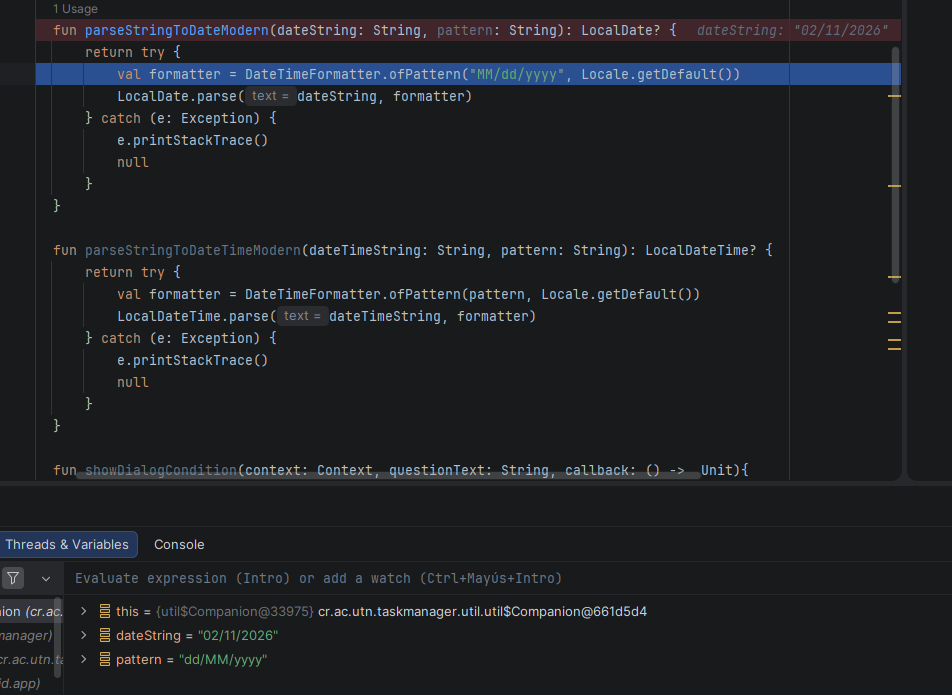
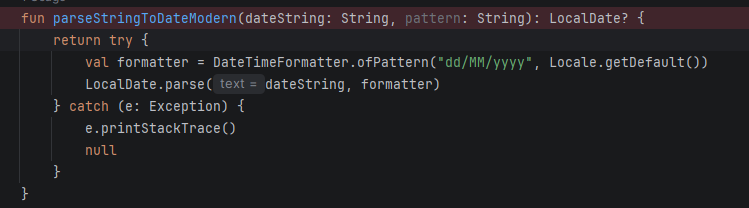
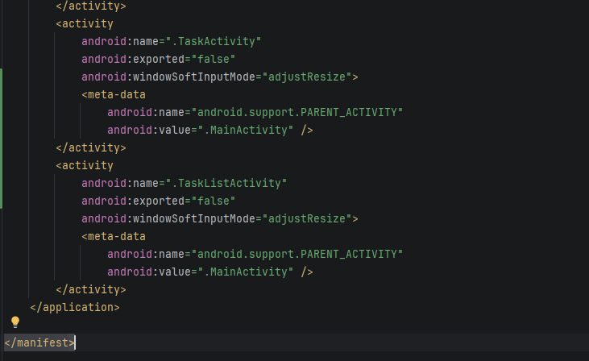
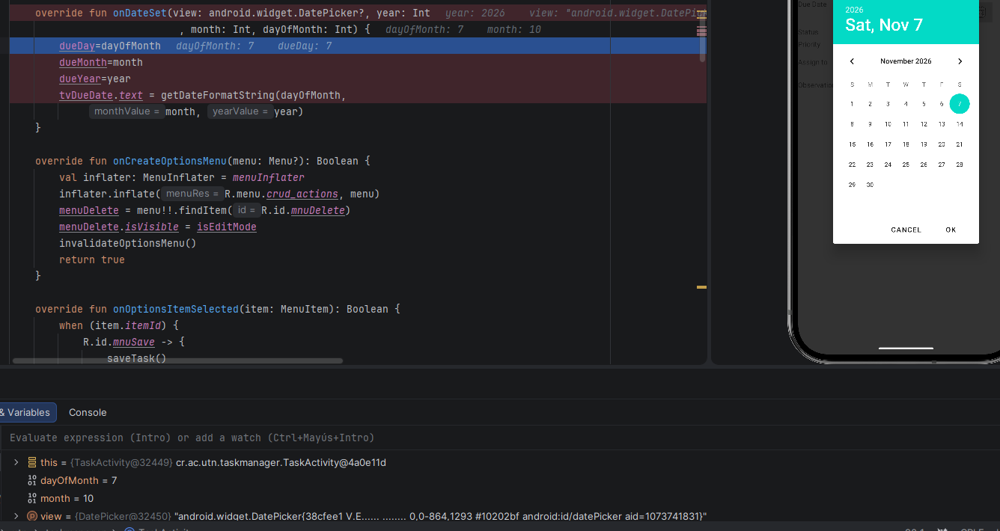
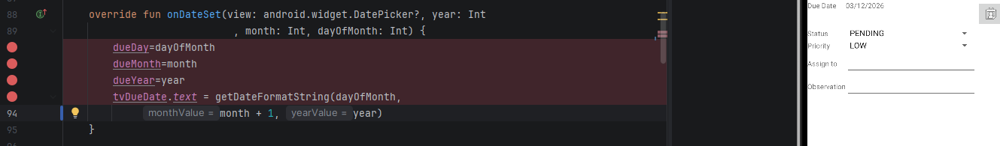
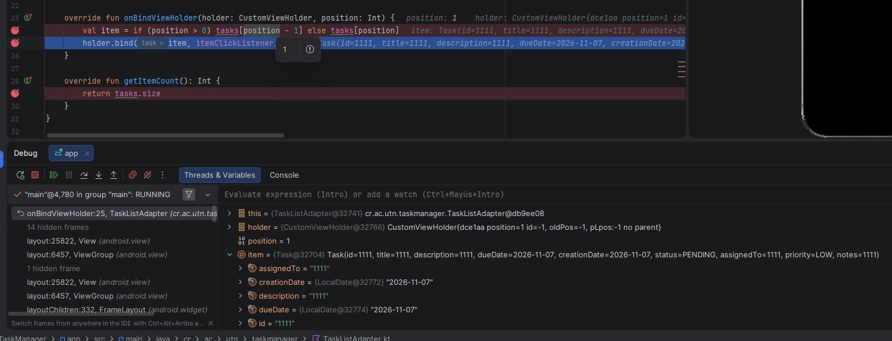
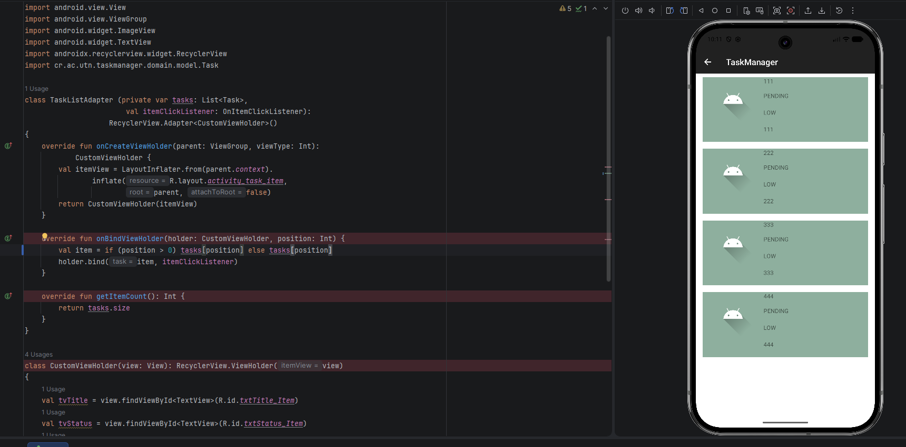
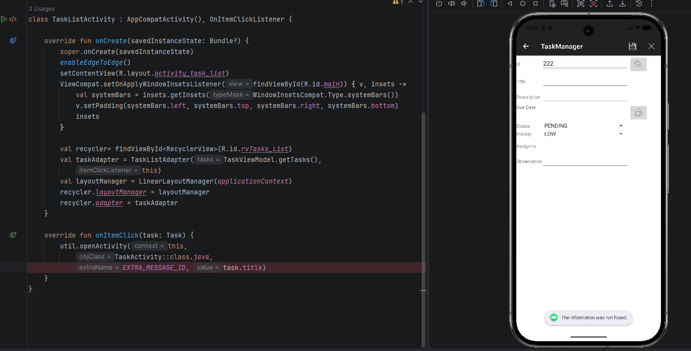
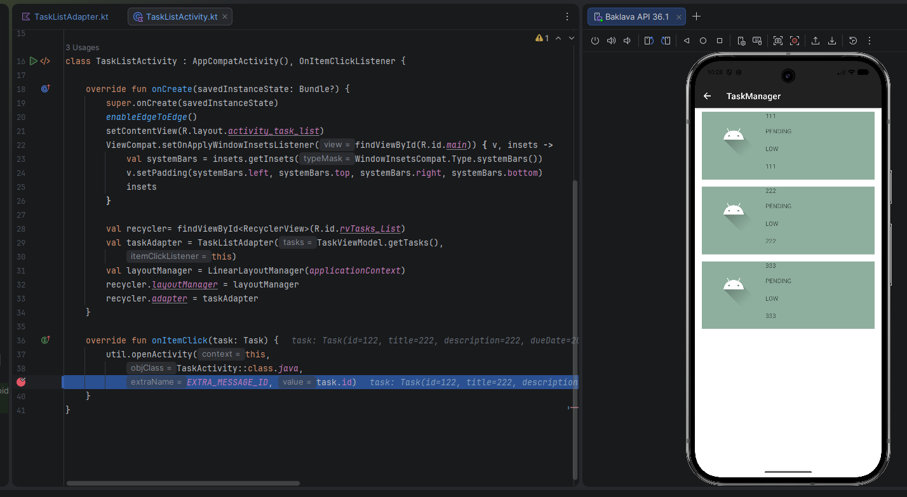
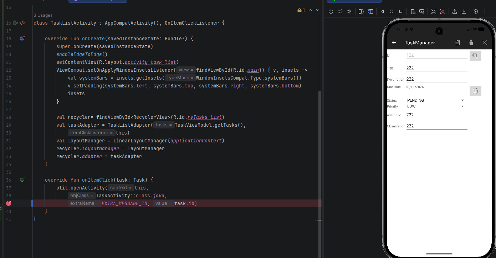

# Resoluciion-practica-< nombre >.md

## Fase 0 - Debugging
### Error 1:
El mes y el dia se invierten el la linea 27, util.kt y se corrigio cambiando el formato en que se recibe la fecha a dd/MM/yyyy

---

---

### **Error 2:**
El botón task list en MainActivity no podía abrir TaskListActivity porque no estaba declarada en el archivo AndroidManifest.xml
Para solucionarlo se agrego en la linea 40

---

---

### **Error 3:**
Se le resta un mes en la fecha seleccionada con el calendario en la linea 88 la función onDateSet guarda el mes con valor de 0-11 según los parámetros
esperados por calendar.MONTH en error se solucinaria en la linea 93 agregando un 1 al valor de mes cambiando de 0-11 -> 1-12

---

---

**Error 4:**
En TaskList el -1 en la linea 24 no permite cambiar a la siguiente task por lo que la primera task se anota 2 veces, esto
se cambia eliminando el -1 lo que soluciona el problema y permite agregar tasks indefinidamente de forma correcta

---

---

**Error 5:**
En la linea 39 en TaskListActivity.kt la función onItemClick abre las task según valor del nombre esto se corrige cambiando el valor
a task.id

---

---

**Error 6:**

**Error 7:**

**Error 8:**

