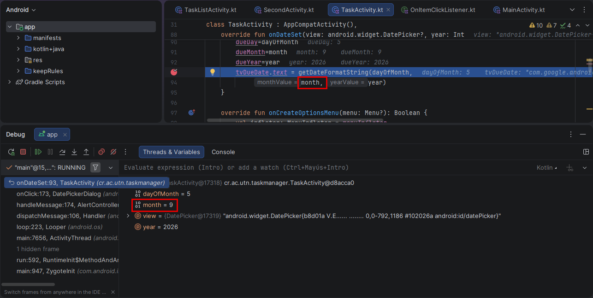
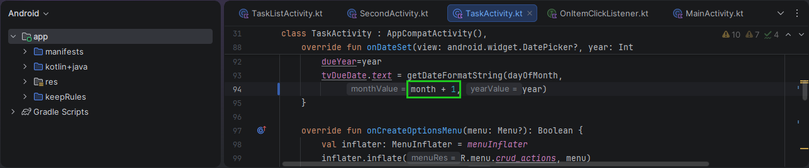
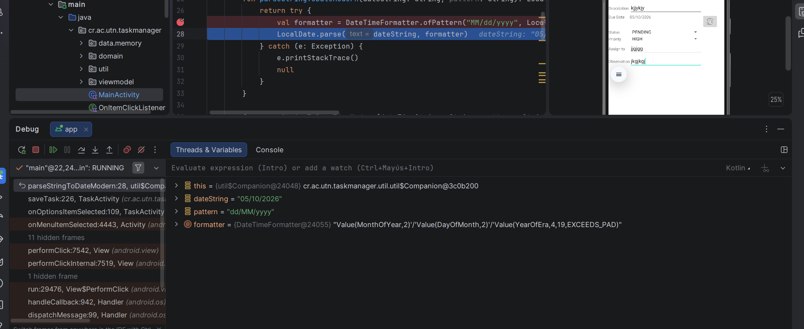
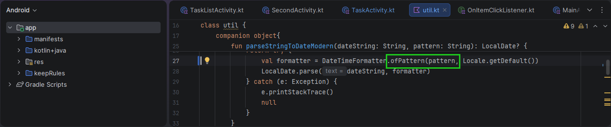
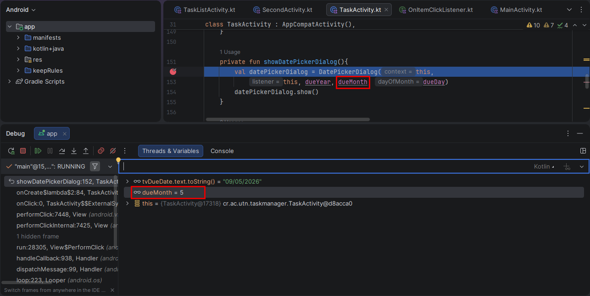
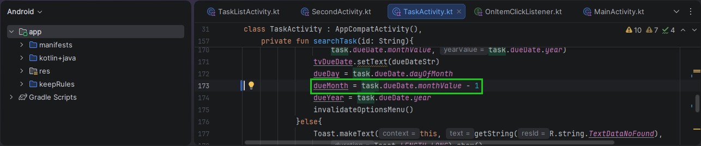
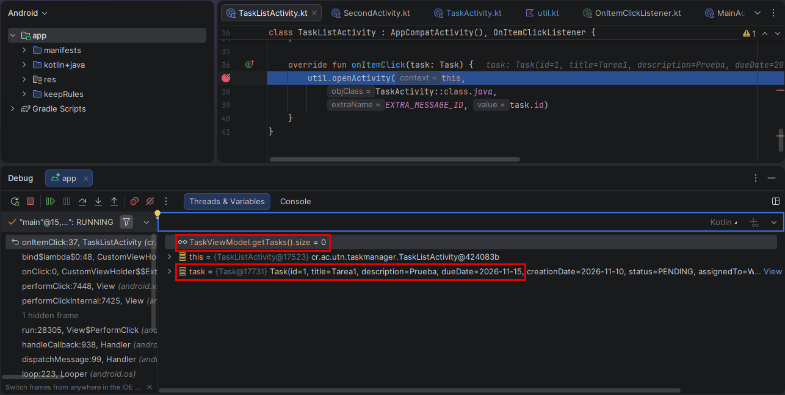
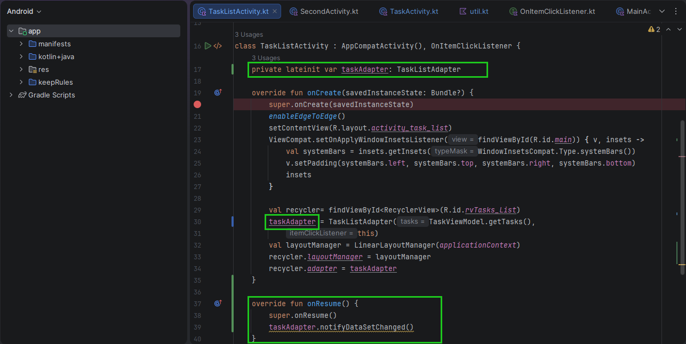

**Error 1: Activity no registrada**

Se colocó un Breakpoint en `MainActivity.kt`, en la llamada a `util.openActivity()` del botón Task List. Al ejecutar `context.startActivity(intent)`, el depurador mostró una excepción `ActivityNotFoundException`, indicando que `TaskListActivity` no estaba registrada en `AndroidManifest.xml`.

**Solución:** Se agregó `TaskListActivity` en `AndroidManifest.xml`.

**Error 2: La lista repite la primera tarea y nunca muestra la última**

Se colocó un Breakpoint en `TaskListAdapter.kt`, dentro de `onBindViewHolder()`. Al inspeccionar las variables `position` e `item`, el depurador mostró que en la posición 0 y 1 se cargaba la misma tarea, porque la condición `if (position > 0) tasks[position - 1]` restaba una posición al índice.

**Solución:** Se eliminó la condición y se usa directamente `tasks[position]`.

**Error 3: Al tocar una tarea de la lista dice "La información no existe"**

Se colocó un Breakpoint en `TaskActivity.kt`, dentro de `searchTask()`. Al inspeccionar la variable `id`, el depurador mostró que contenía el título de la tarea y no su id, por lo que `getTaskById()` retornaba `null`. El origen estaba en `onItemClick()` de `TaskListActivity.kt`, que enviaba `task.title` en el Intent.

**Solución:** Se cambió `task.title` por `task.id` en `onItemClick()`.

**Error 4: El mes de la fecha sale uno menos**

Se colocó un Breakpoint en `TaskActivity.kt`, dentro de `onDateSet()`. Al seleccionar una fecha de octubre e inspeccionar la variable `month`, el depurador mostró que valía `9`, porque el `DatePicker` maneja los meses de 0 a 11 y el valor se enviaba sin sumarle 1 a `getDateFormatString()`.

**Solución:** Se cambió `month` por `month + 1` al llamar `getDateFormatString()` en `onDateSet()`.

**Error 5: Guardar falla con un Toast que dice "null", o guarda una fecha equivocada**

Se colocó un Breakpoint en `util.kt`, dentro de `parseStringToDateModern()`. Al inspeccionar las variables, el depurador mostró que `dateString` era `"05/10/2026"` y `pattern` era `"dd/MM/yyyy"`, pero el `formatter` se creaba con `"MM/dd/yyyy"` escrito directamente, ignorando el parámetro `pattern`. Por eso el día y el mes se invertían, y cuando el día era mayor a 12 el parseo fallaba, retornaba `null` y `saveTask()` mostraba el Toast "null".

**Solución:** Se cambió `"MM/dd/yyyy"` por el parámetro `pattern` en `DateTimeFormatter.ofPattern()`.

**Error 6: Al editar una tarea, el calendario abre un mes adelante**

Se colocó un Breakpoint en `TaskActivity.kt`, dentro de `showDatePickerDialog()`. Al buscar una tarea con vencimiento `09/05/2026` (mayo) e inspeccionar la variable `dueMonth`, el depurador mostró que valía `5`, porque en `searchTask()` se asignaba `task.dueDate.monthValue` (de 1 a 12) y el `DatePicker` espera los meses de 0 a 11, por lo que el calendario abría en junio.

**Solución:** Se cambió `dueMonth = task.dueDate.monthValue` por `dueMonth = task.dueDate.monthValue - 1` en `searchTask()`.

**Error 7: Después de guardar o cancelar, la pantalla queda en modo edición**

Se colocó un Breakpoint en `TaskActivity.kt`, dentro de `cleanScreen()`. Al inspeccionar la variable `isEditMode` después de guardar o cancelar, el depurador mostró que seguía en `true`, por lo que la opción Eliminar seguía visible y las tareas nuevas se actualizaban en lugar de guardarse.

**Solución:** Se cambió `isEditMode=true` por `isEditMode=false` en `cleanScreen()`.

**Error 8: La lista no se actualiza al regresar después de eliminar o editar una tarea**

Se colocó un Breakpoint en `TaskListActivity.kt`, dentro de `onItemClick()`. Después de eliminar una tarea y regresar a la lista, la tarea seguía apareciendo. Al tocarla, el depurador mostró que la variable `task` contenía la tarea eliminada (`Tarea1`), mientras que `TaskViewModel.getTasks().size` era `0`. El adapter solo se creaba en `onCreate()` y nunca se refrescaba al volver a la pantalla.

**Solución:** Se guardó el adapter como atributo de la clase (`taskAdapter`) y se agregó `onResume()` con `taskAdapter.notifyDataSetChanged()` para refrescar la lista cada vez que se regresa a la pantalla.

 
 !Una Aclaracion Puse 8 errores en el readme pero el de las fechas cuenta por 3 Entonces en total fueron 5 errores encontrados pero uno por buena practuca puso los 8 lo cual no es lo correcto!