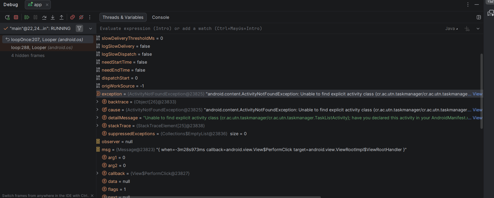
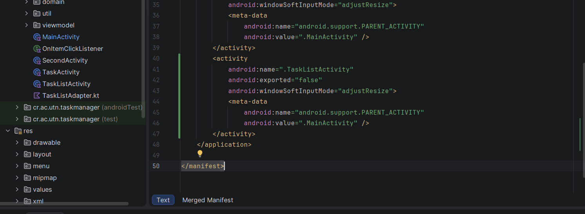
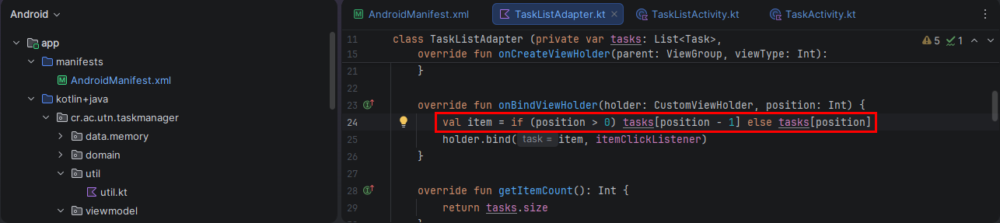
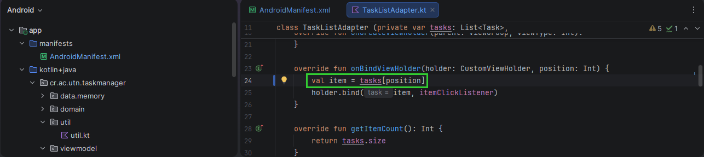
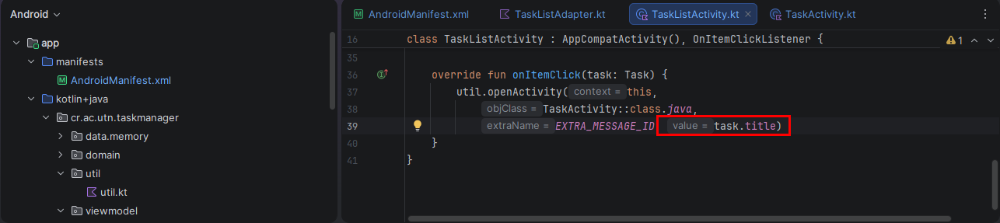
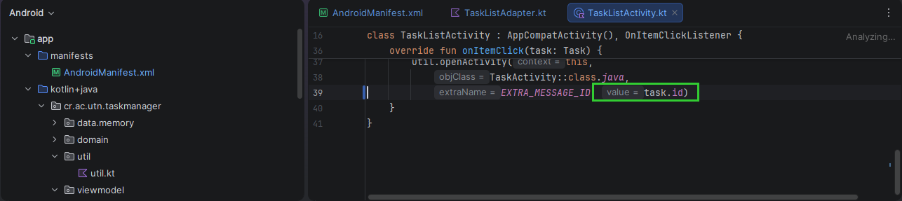
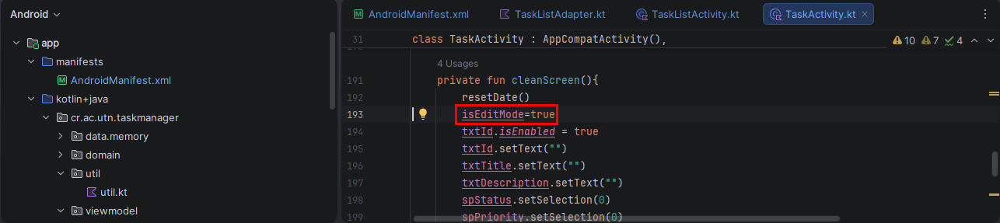
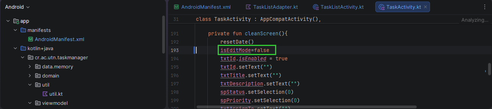

**Error 1: Activity no registrada**

Se colocó un Breakpoint en `MainActivity.kt`, en la llamada a `util.openActivity()` del botón Task List. Al ejecutar `context.startActivity(intent)`, el depurador mostró una excepción `ActivityNotFoundException`, indicando que `TaskListActivity` no estaba registrada en `AndroidManifest.xml`.

**Solución:** Se agregó `TaskListActivity` en `AndroidManifest.xml`.

**Error 2: La lista repite la primera tarea y nunca muestra la última**

Se colocó un Breakpoint en `TaskListAdapter.kt`, dentro de `onBindViewHolder()`. Al inspeccionar las variables `position` e `item`, el depurador mostró que en la posición 0 y 1 se cargaba la misma tarea, porque la condición `if (position > 0) tasks[position - 1]` restaba una posición al índice.

**Solución:** Se eliminó la condición y se usa directamente `tasks[position]`.

**Error 3: Al tocar una tarea de la lista dice "La información no existe"**

Se colocó un Breakpoint en `TaskActivity.kt`, dentro de `searchTask()`. Al inspeccionar la variable `id`, el depurador mostró que contenía el título de la tarea y no su id, por lo que `getTaskById()` retornaba `null`. El origen estaba en `onItemClick()` de `TaskListActivity.kt`, que enviaba `task.title` en el Intent.

**Solución:** Se cambió `task.title` por `task.id` en `onItemClick()`.

**Error 7: Después de guardar o cancelar, la pantalla queda en modo edición**

Se colocó un Breakpoint en `TaskActivity.kt`, dentro de `cleanScreen()`. Al inspeccionar la variable `isEditMode` después de guardar o cancelar, el depurador mostró que seguía en `true`, por lo que la opción Eliminar seguía visible y las tareas nuevas se actualizaban en lugar de guardarse.

**Solución:** Se cambió `isEditMode=true` por `isEditMode=false` en `cleanScreen()`.

