1.util tiene los formatos de la forma incorrecta, a la hora de poner un dato mayor el savetask no se completa debido a que nosotros enviamos dd/MM/yyyy y este recibe MM/dd/yyyy por ende a la hora de enviar un valor superior a 12 el calendario da null la solución es poner el formato correcto en util 

 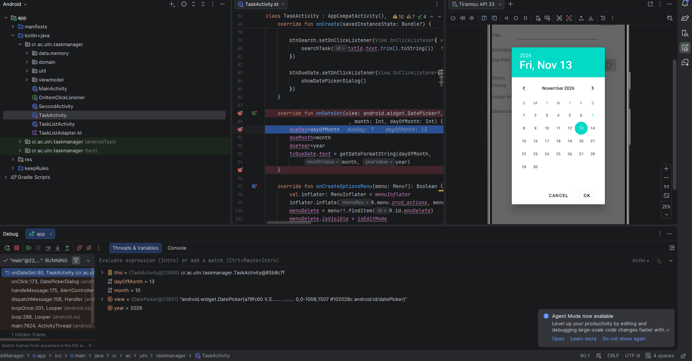
 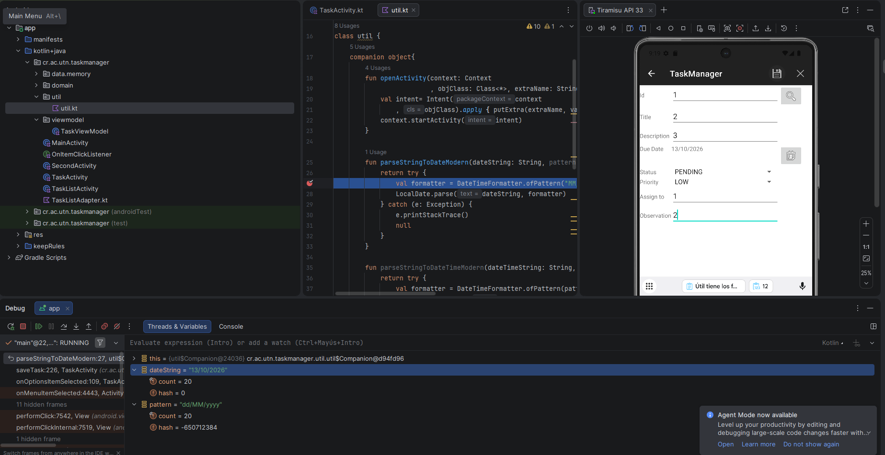

 
Solucion de error:

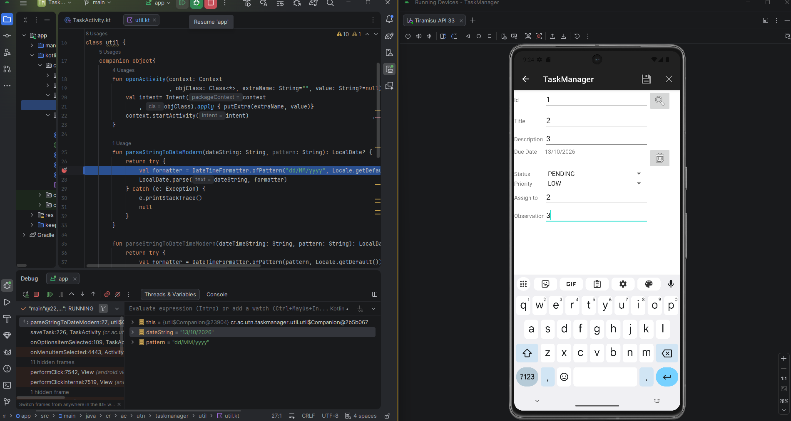
 
1.1.al poner una fecha mayor a diciembre da una fecha incorrecta por ejemplo si pones enero de 2027 da ejem: 01/00/2027 en vez de 01/01/2027, el problema se encuentra en onDateSet, básicamente lo que sucede es un error de conversión el cual causa que al iniciar un mes este inicie en 00 en vez de 01 lo cual hace que suceda esto:
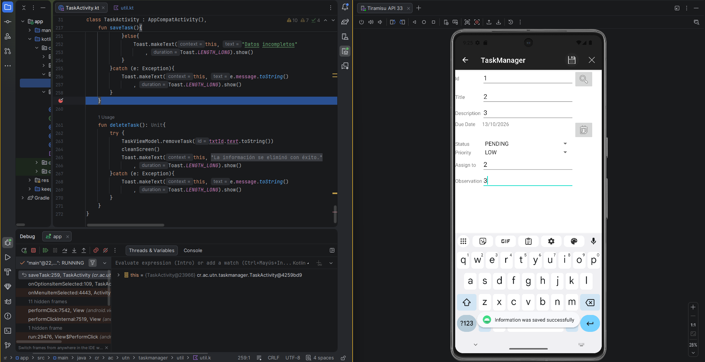

La solución del error fue la siguiente: poner +1 en month value el cual permite este inicie en 01 en vez de 00

 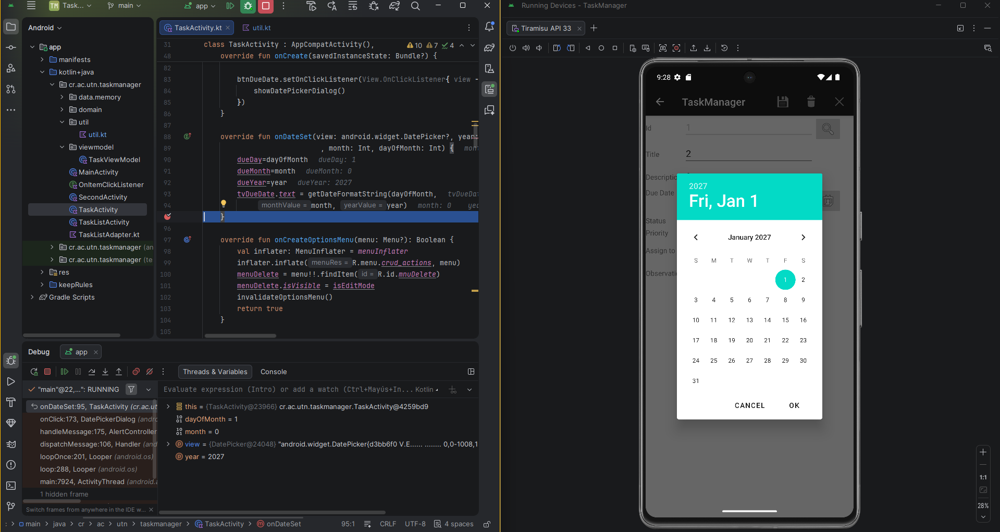

Aunque ahí se vea en month = 0 a la hora de continuar muestra 01/01/2027

 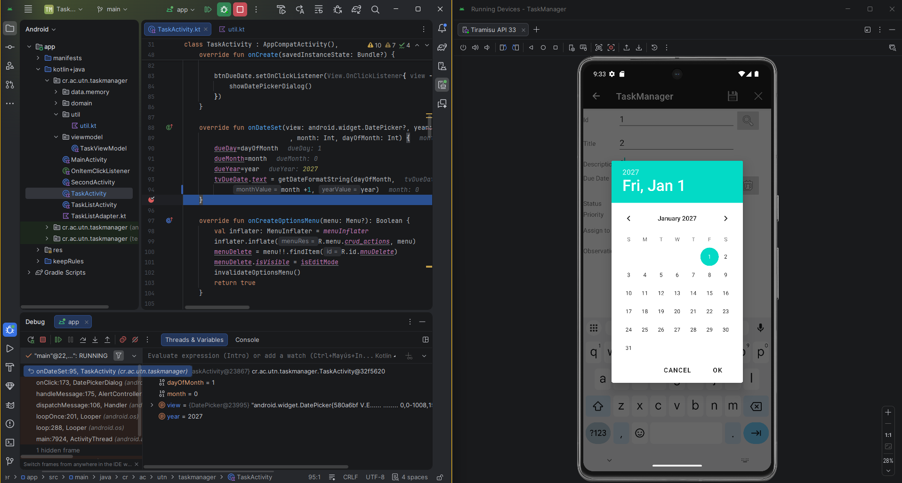

2.En androidManifest.xml no esta el tasklistactivity lo cual provoca que al tocar el botón de task list la aplicación falla y crashea, en androidManifest se debe de agregar en tasklistactivity en androidManifest:
 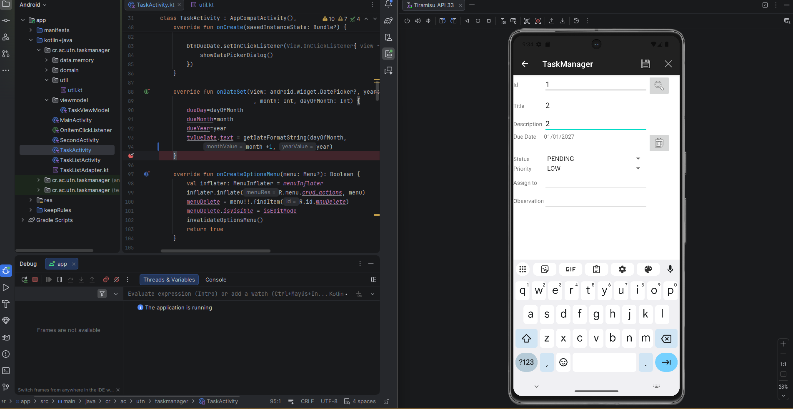
Ahora corregido funciona correctamente:  
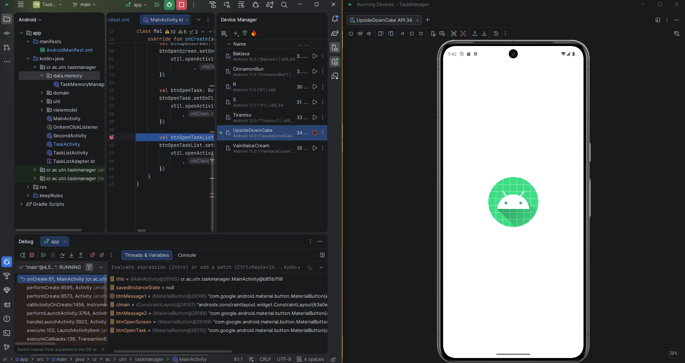

3.Duplicados en task list activity, esto sucede en tasklistAdapter ya que en onBindViewHolder este tiene una funcion predefinida lo cual causa duplicados la primera vez
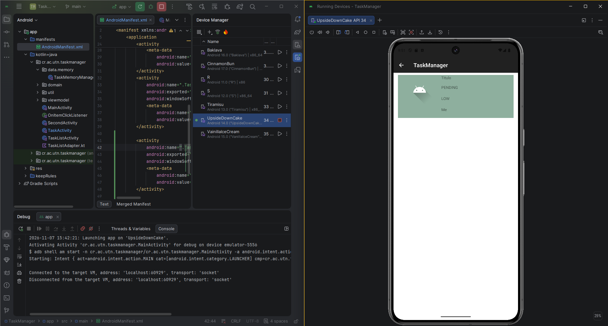
 
La solución es remover lo siguiente: if (position > 0) tasks[position - 1] else pues es esta función la causa el duplicado la primera vez
 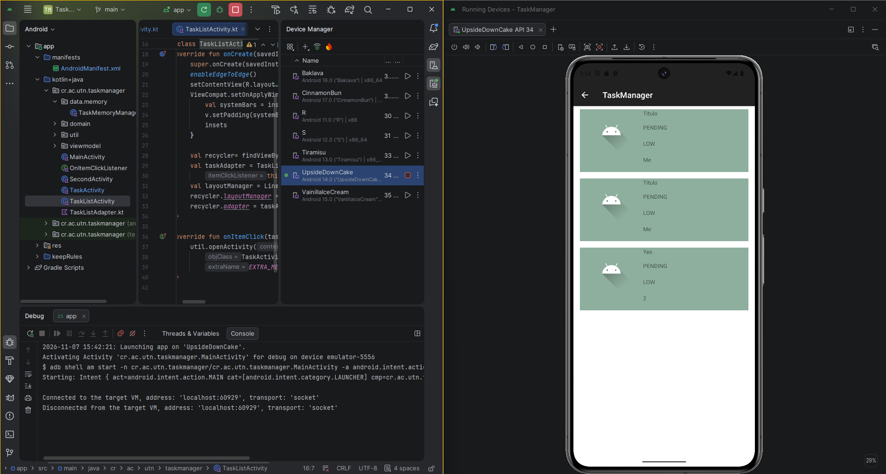

4.Tasklist con title en vez de id, el error es que en onItemClick tiene task.title en vez de task.id, a la hora de tocarlo recuperaba el title y daba error ya al tocarlo  pues recuperaba la información del titulo en vez del id
 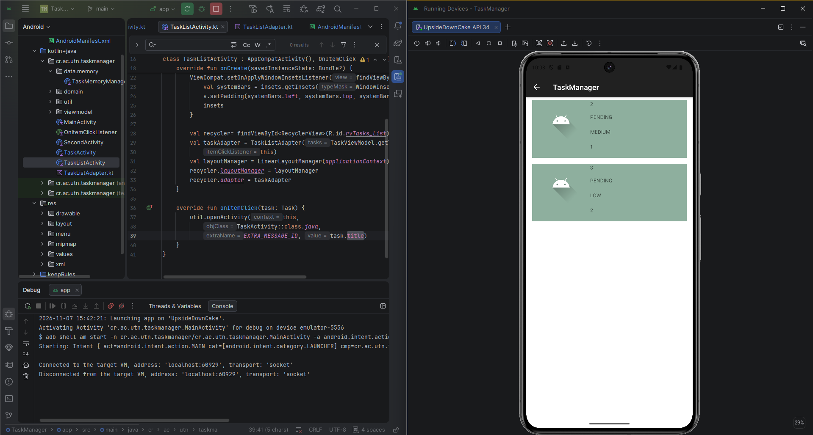

Una vez corregido:  
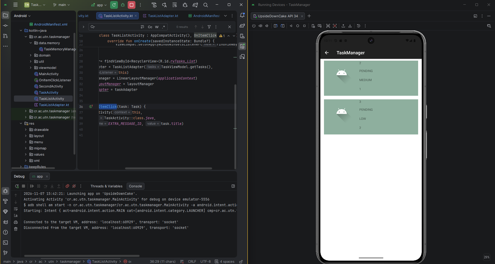

5.El error se encontraba en la función cleanScreen() de TaskActivity.kt, donde la variable isEditMode permanecía en true después de crear un tarea, haciendo que la aplicación siguiera en modo edición.
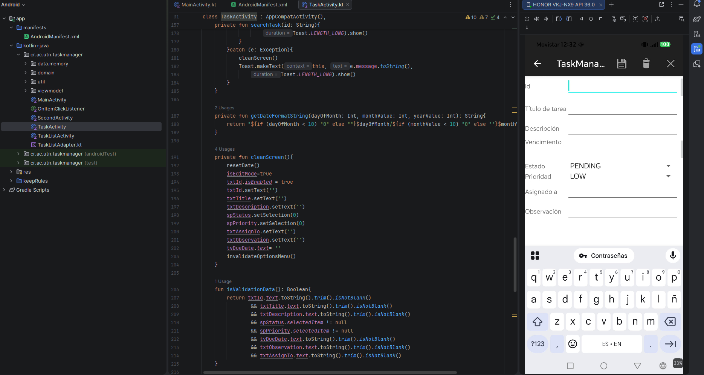

Solución: Se cambió el valor de isEditMode a false para restablecer el modo de creación y permitir registrar nuevas tareas correctamente.

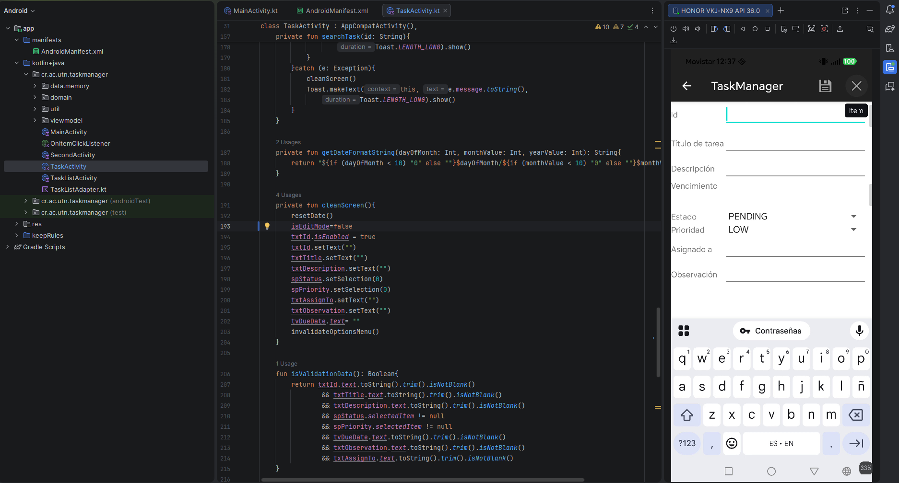
 

6.El error se encontraba en el archivo TaskViewModel.kt, donde la función removeTask eliminaba tareas sin validar previamente si existían, permitiendo realizar operaciones incorrectas sin mostrar ningún error por ejemplo borrar un 2 con espacio que no existe pero que igual recogia los datos del id 2.
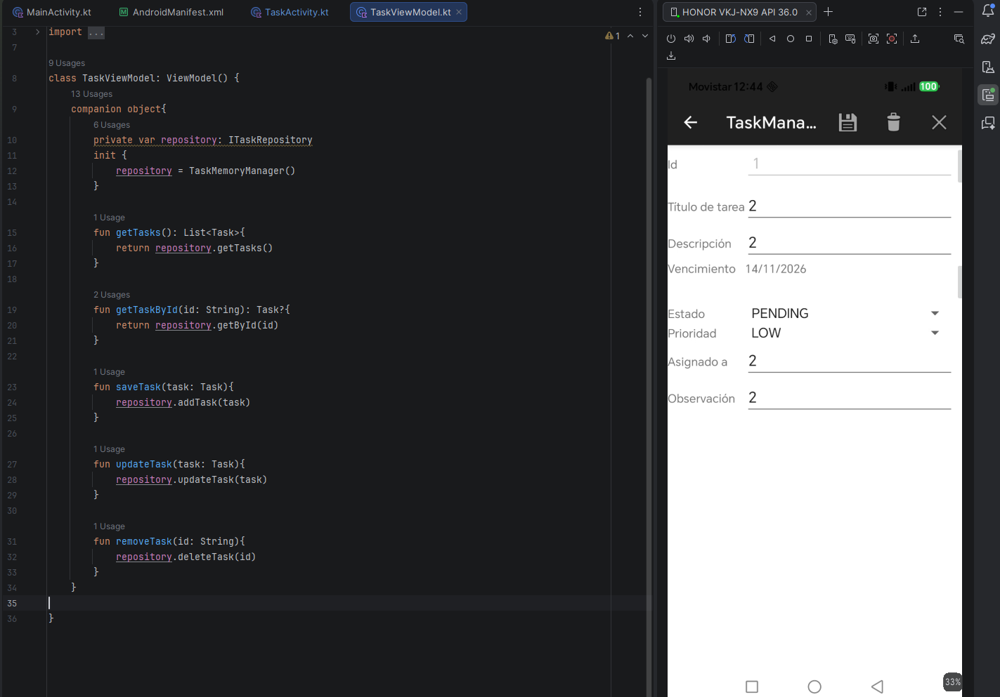

Solución: Se agregaron validaciones para comprobar la existencia de la tarea y lanzar un mensaje de error cuando la operación no sea válida.
s
7.El error se encontraba en el archivo TaskMemoryManager.kt, donde las funciones deleteTask y getById no reconocían correctamente los ID que contenían espacios al inicio o al final, provocando que las tareas no se encontraran o eliminaran correctamente.

Solución: Se agregó trim() a ambos lados de la comparación de los ID para eliminar los espacios y permitir que las tareas se encuentren y eliminen correctamente sin importar que.
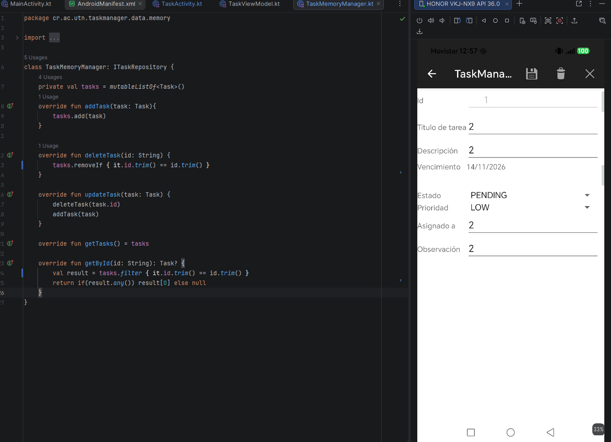

8.El error se encontrab en el archivo MainActivity.kt y en ambos archivos strings.xml, donde el mensaje "Cancelled action" estaba escrito directamente en el código, provocando que se mostrara en inglés independientemente del idioma del dispositivo.
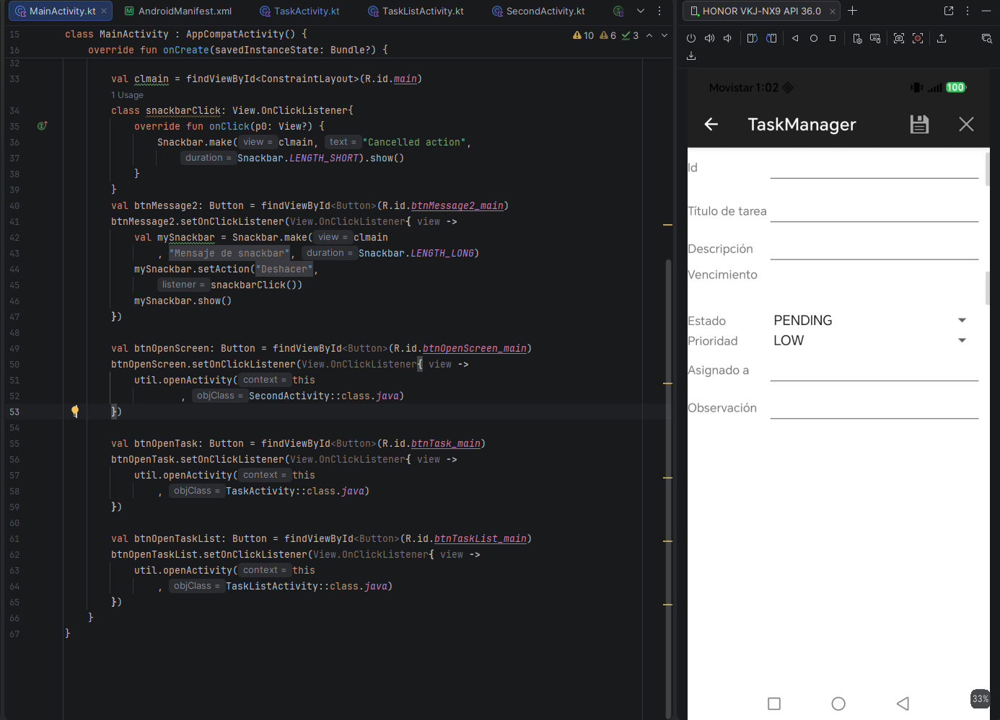

Solución: Se agregó el mensaje a los archivos strings.xml en español e inglés y se modificó MainActivity.kt para utilizar el texto correspondiente al idioma del dispositivo.
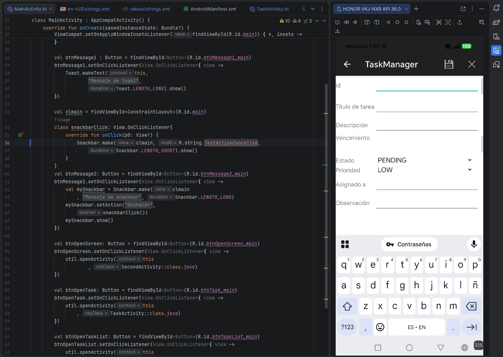