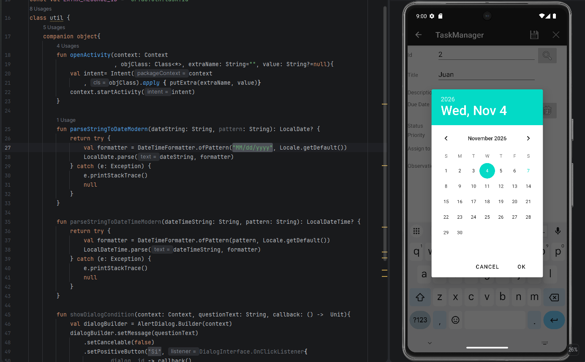
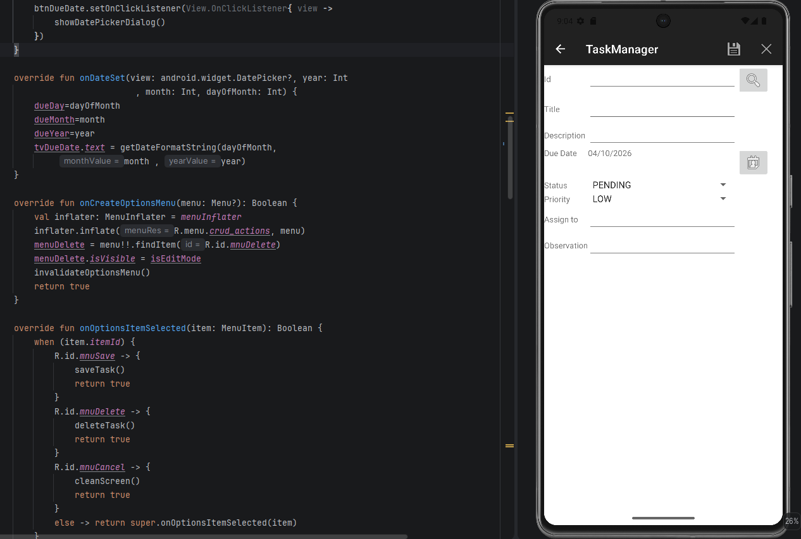
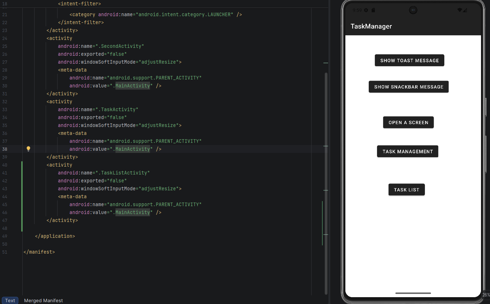
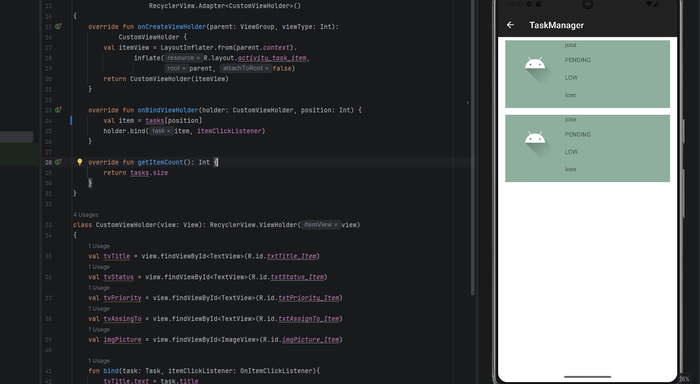
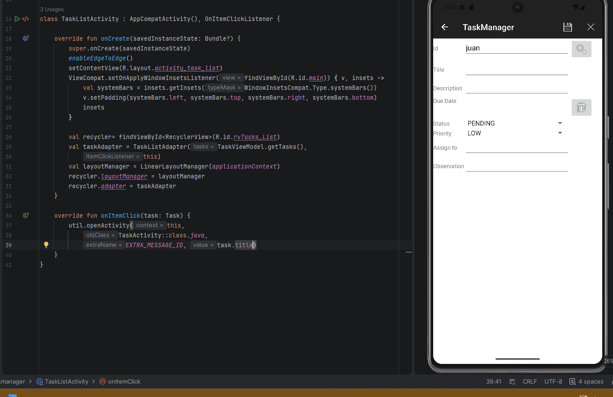
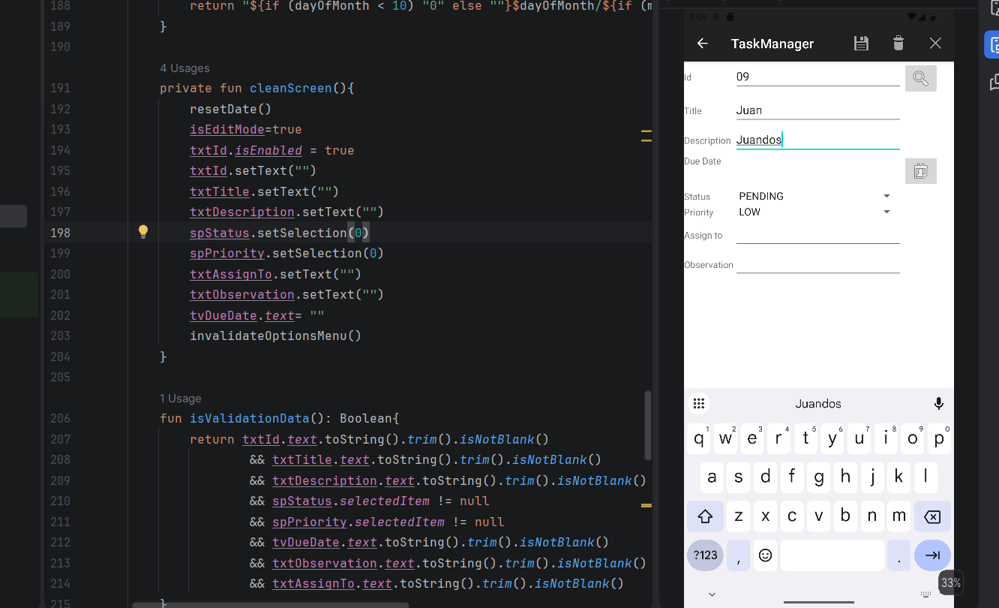
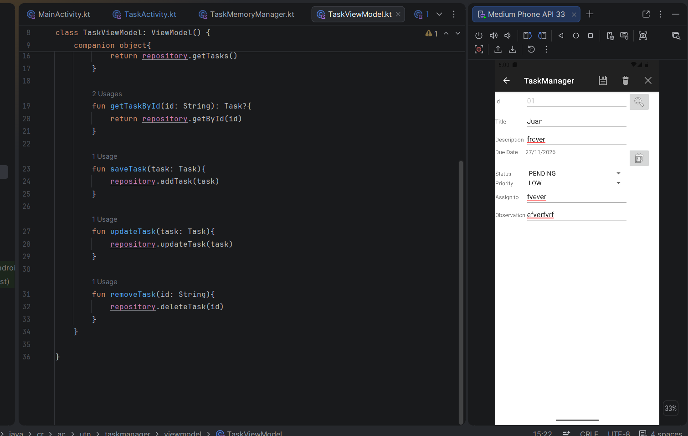
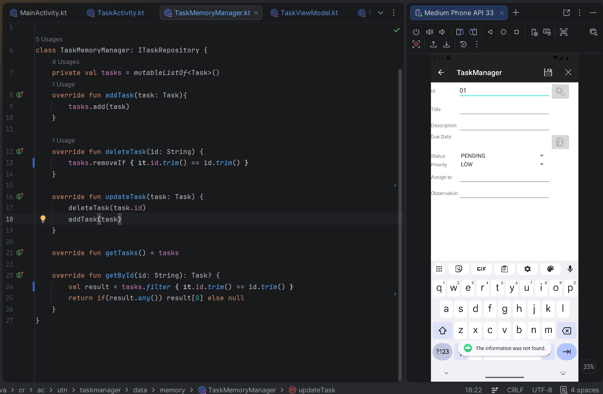
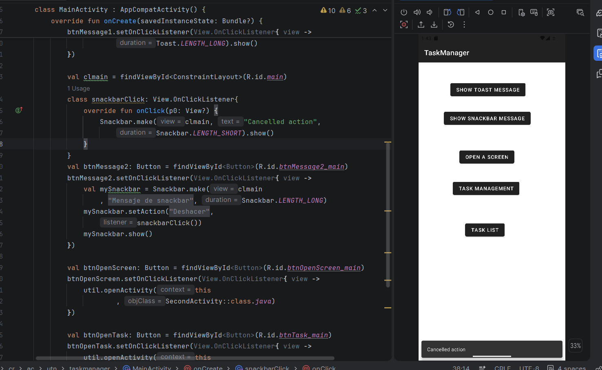
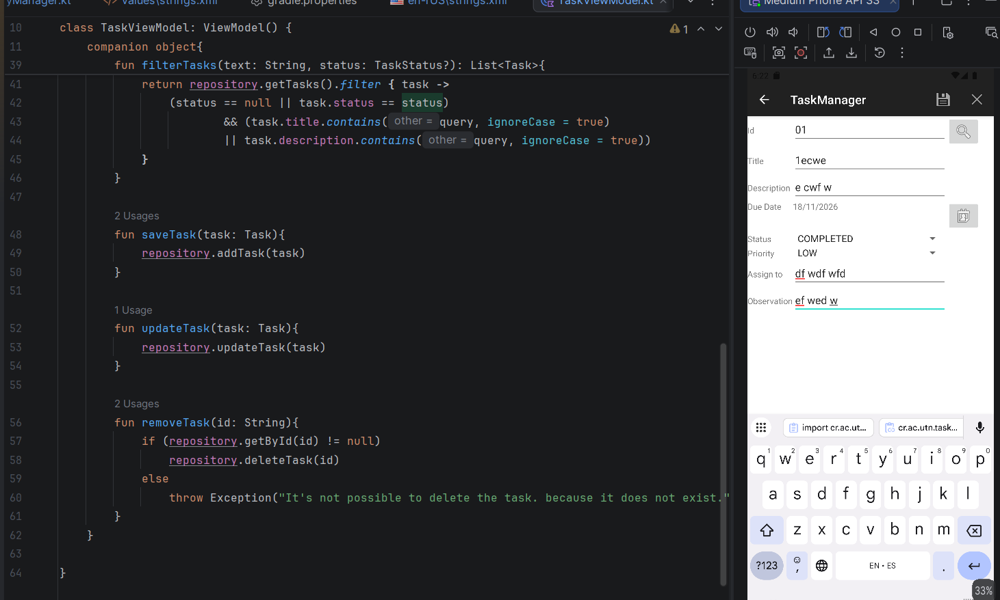

1- Archivo útil con formato incorrecto de fecha.
La aplicación muestra y envía las fechas con el formato dd/MM/yyyy, así que con una fecha como 20/11/2026 el formateador toma 20 como mes, falla y la función devuelve null

se corrigio usando el pattern como se pide en la función, en lugar del formato que estaba escrito manualmente.

1.1 - TaskActivity con formato de fecha mal 
Esto ocurre porque Android comienza a contar los meses desde cero, mientras que nuestra aplicación los cuenta desde uno. Esto provoca que las fechas mostraran un mes antes del que se digita por ejemplo si se digita mes 11, aparece con el mes 10.

Como se solucionó: en la función OnDateSet se debe poner en la variable month  el formato + 1 para que Android comience desde 1 a 12 y no de 0 a 11 como sucedía anteriormente

2- En el Manifest no se llama a la clase TaskListActivity 
Al tocar la opción Task List te saca de la app por que esta llamado en el manifest.

Solución: llamar la clase TaskListActivity en el manifest para que lo lleve a la ventana correcta

3- TaskListAdapter se repiten las tareas al crear nuevas
Este error se debe a que el programa está restando 1 a la posición de los elementos cuando la posición es mayor que cero.

Solución: Eliminar el if junto al else

4- En el TaskListActivity el valor de id mal
El id en TaskListActivity el id devuelve el titulo y no su valor original por eso al tocar la opción Task List las tareas salen con valores nulos y en el id sale el nombre del titulo
Solución: Corregir el valor que debe devolver id para que no devuelva el valor del título y devuelva su id correcto.

Error 5:

El error 5 se encontraba en la función cleanScreen () del archivo TaskActivity.kt, donde la variable isEditMode estaba en true. Esto provocaba que después de crear una tarea la aplicación considerara que estaba en modo edición. 

Solucion:  Se cambió el valor la variable a isEditMode = false, permitiendo que la aplicación se restablezca correctamente en el modo de creación y permita distinguir entre registrar una tarea nueva y modificar una existente.

Error 6: 

En el archivo TaskViewModel.kt el ViewModel no valida antes de usar la función removeTask llama directamente al repositorio sin comprobar nada. 
Esto permite eliminar una tarea que no existe sin que la app muestre ningún error.
Ejemplo crear una tarea id=”1” y guardarla, volver a buscar esa tarea, pero con un espacio id=” 1” y te devuelve esa tarea y se puede borrar, pero si volvemos a buscar ese mismo id la tarea sigue estando ahí, se borra algo que no existe.

Solución: Agregar validaciones y que lancé una excepción con un mensaje claro cuando la operación no sea válida o no exista esa tarea.

Error 7:

El archivo TaskMemoryManager.kt las funciones deleteTask y getById comparaban los ids con it.id == id por lo cual si el id tenía un espacio al inicio o al final (" 1"), no coincidía con el id guardado ("1"), así que la tarea no se encuentra ni se elimina.

Solución:  Comparar los ids después de aplicar trim() a ambos lados.

Error 8: 

Texto fijo en el Snackbar del archivo MainActivity.kt y ambos strings.xml, al pulsar Deshacer en el Snackbar, el mensaje estaba escrito directamente en el código y dice ("Cancelled action") en lugar de leerse de los archivos strings.xml,esto hacía que en cualquier dispositivo ya fuera con idioma español siempre se lea en inglés.

Solución:
Agregar el texto a strings.xml en los dos idiomas y usarlo desde MainActivity.kt

Error 9:
 
No se valida SaveTask dentro del archivo TaskViewModel de forma que se pueden guardar tareas en estado COMPLETED y no deberia ser asi solo debe permitir guardar en estado PENDING.

Solución: 
Validar en la funcion SaveTask que solo se puedan guardar tareas con estado PENDING.

