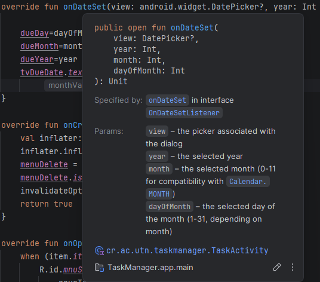
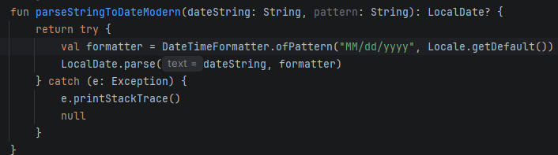
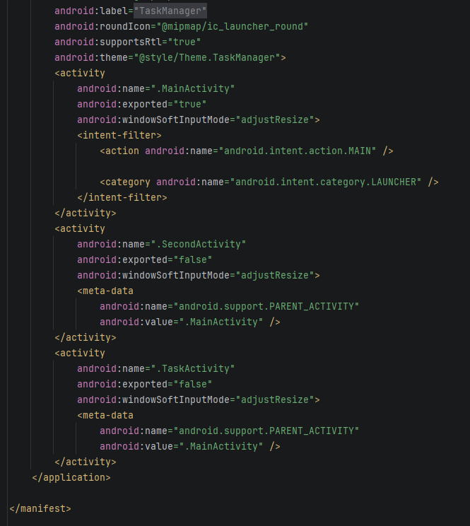
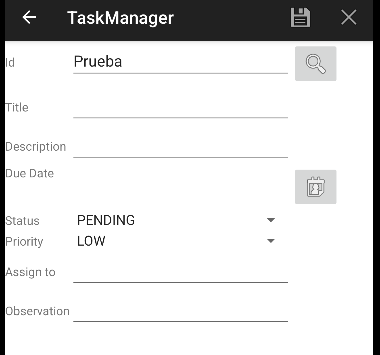
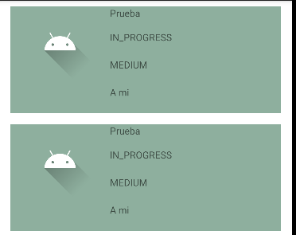
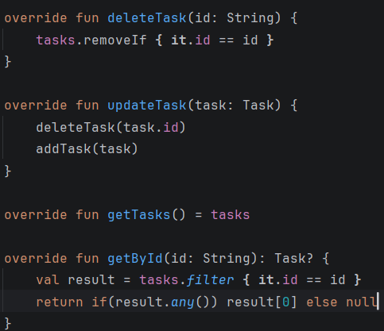
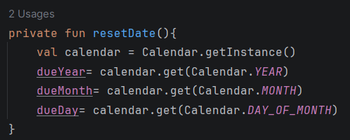
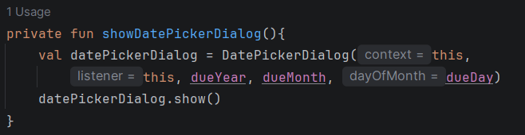
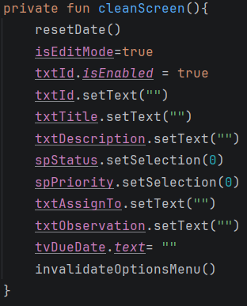

Errores de la Fase 0:

1-	La fecha se guarda como un mes antes de la que se pone.

El limitante de el mes dice que empieza en 0 y termina en 11 por lo que si ponemos por ejemplo el mes de noviembre nos salía el de Octubre se arregla al agregar un +1 frente al month del getDateFormat

2-	al volver a lo hecho por ID se cambian entre el día y el mes.

Es debido a que en el formato a la hora de guardar dice mes/día/año en vez de día/mes/año

3-	Al intentar abrir la task list se cierra todo el proyecto (se detiene el run del proyecto).

Simplemente se crea en el apartado de manifests un activity para el TaskList

4-	Cuando guardamos un Task nuevo no se busca por el ID si no por el nombre asi que borra todo lo que tiene

se modifica al cambiar en el TaskListActivity en la parte de onItemClick cambiando el "task.tilte" de el final de la funcion por "task.id"

5-	Cuando se guardan dos Tasks la segunda no se puede guardar porque la primera le cae encima y la borra

Para modificarlo hay que eliminar el -1 que se encuetra en TaskListAdapter.kt y ya no se duplican las task.

6- En la parte de TaskMemoryManager los id de todos las funciones estan sin el "trim" por lo que no se limpiaban los espacios en blanco

7- En la parte de resetDay cuando se reiniciaba esta debia de quedarse reiniciada en el mes que se esta pero como se modifico antes para otras soluciones este aparese como uno menos por lo que se le agrego un +1 al dueMonth

8- Em la parte de "showDatePickerDialog" cuando se va a mostrar lo que es la fecha otra ves por errores corregidos antes a este se le suma un mes a la hora de mostrar por lo que se le agrega un -1

9- En el "cleanScreen" la parte de "isEditMode" esta marcado como true por lo que hay que cambiarlo a flase para que no se pueda editar al haber selecciondo la opcion de cancelar todo
