Error uno se encontro un proble ma en el formato de las fechas ya que por ejemplo seleccionaba el mes de diciembre que es 12 me lo ponía como 11 y cuando seleccionaba el mes enero que es el 1 me lo ponía como porq Android studio inicia desde 0 y mes no hay ninguno que inicie en 0 

1.
Antes
 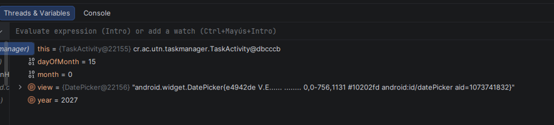
 
Solocionado
  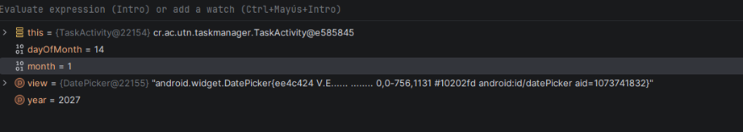

En este erro se encontró un problema de formato en el archivo Util.kt donde no se podía poner fechas mayor a la actula no guardara los datos

Antes
  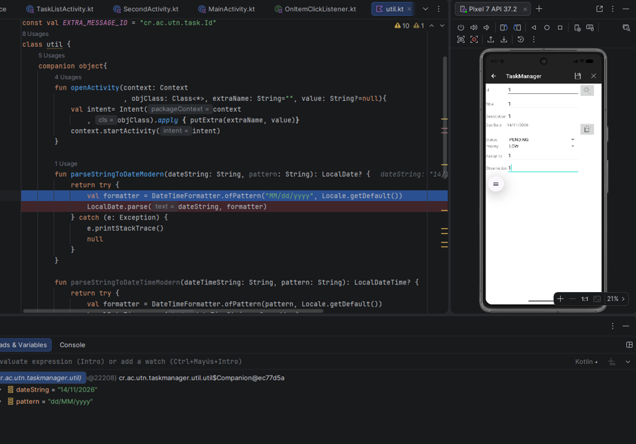
   

 
Solucionado
  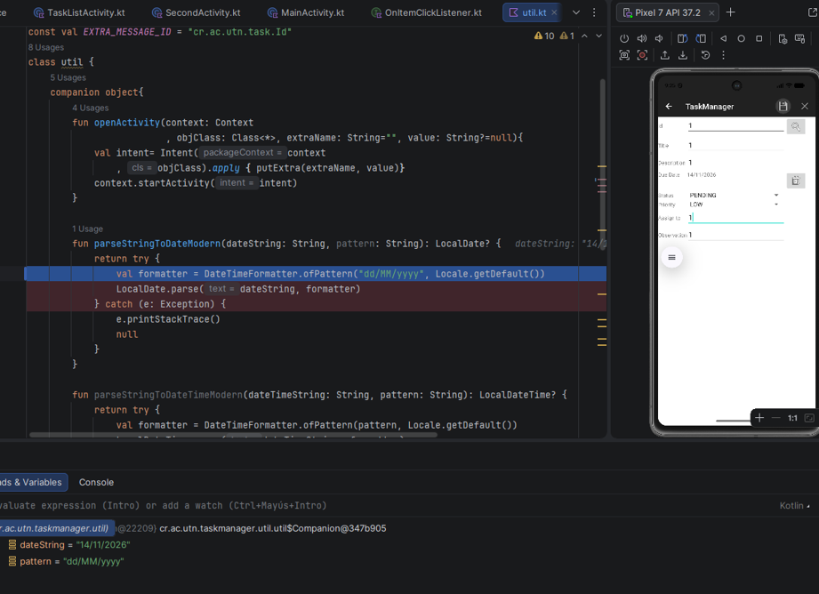
   
 

El siguiente erroer es que  cuando se guarda una task y se va al a task list no refleja nada entocws vamos a el archivo  de Androidmanifest y no se encuentra  la activiti la solocione s copiar la task activity  la pegamos abajo y le cambiamos el nombre por TaskListActivity ys ya guardaría los cambios
2
Antes
  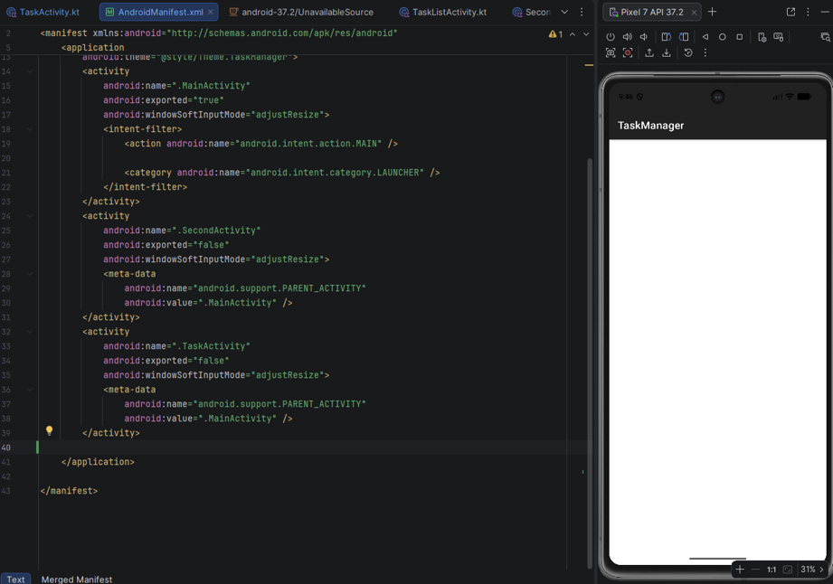
  
Solucionado
  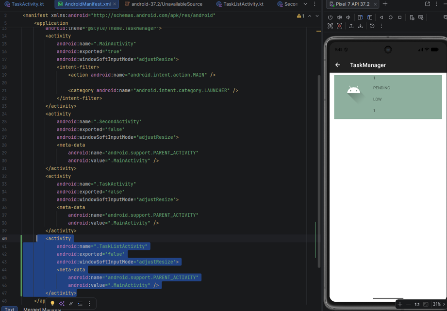

El otro error es que a la hora de hacer un segundo guardado se duplica tira los mismos datos se duplica el primero la solución que se encontró fue  en tasklistActivity hay que eliminar el if
3
Antes
  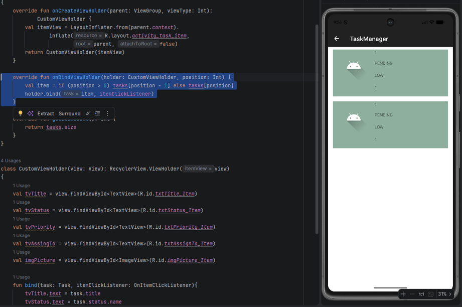
Solucion
  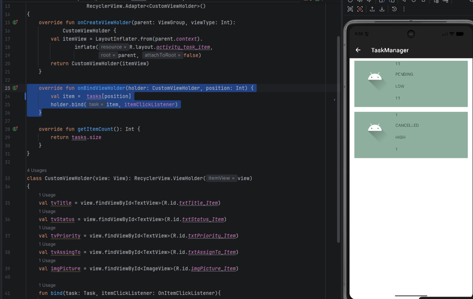

El error 5 se encontraba en la función cleanScreen () del archivo TaskActivity.kt, donde la variable isEditMode estaba en true. Esto provocaba que después de crear una tarea la aplicación considerara que estaba en modo edición. 

Solucion:  Se cambió el valor la variable a isEditMode = false, permitiendo que la aplicación se restablezca correctamente en el modo de creación y permita distinguir entre registrar una tarea nueva y modificar una existente.

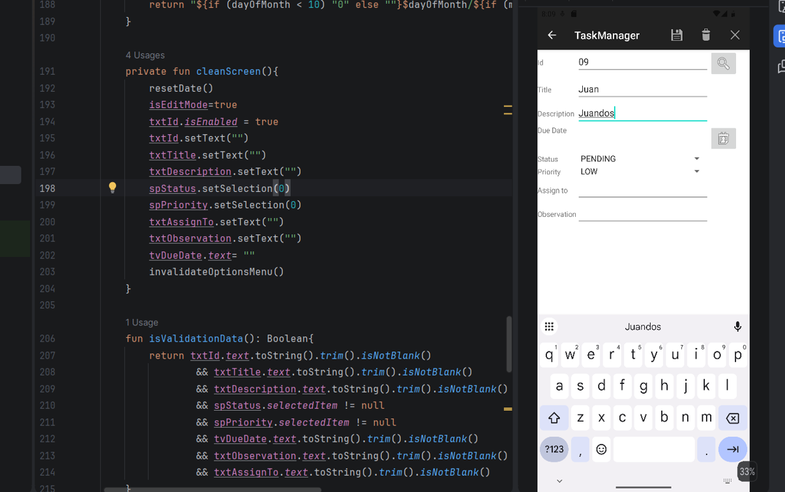

	

Error 6: 
En el archivo TaskViewModel.kt el ViewModel no valida antes de usar la función removeTask llama directamente al repositorio sin comprobar nada. 
Esto permite eliminar una tarea que no existe sin que la app muestre ningún error.
Ejemplo crear una tarea id=”1” y guardarla, volver a buscar esa tarea, pero con un espacio id=” 1” y te devuelve esa tarea y se puede borrar, pero si volvemos a buscar ese mismo id la tarea sigue estando ahí, se borra algo que no existe.

Solución: Agregar validaciones y que lancé una excepción con un mensaje claro cuando la operación no sea válida o no exista esa tarea.

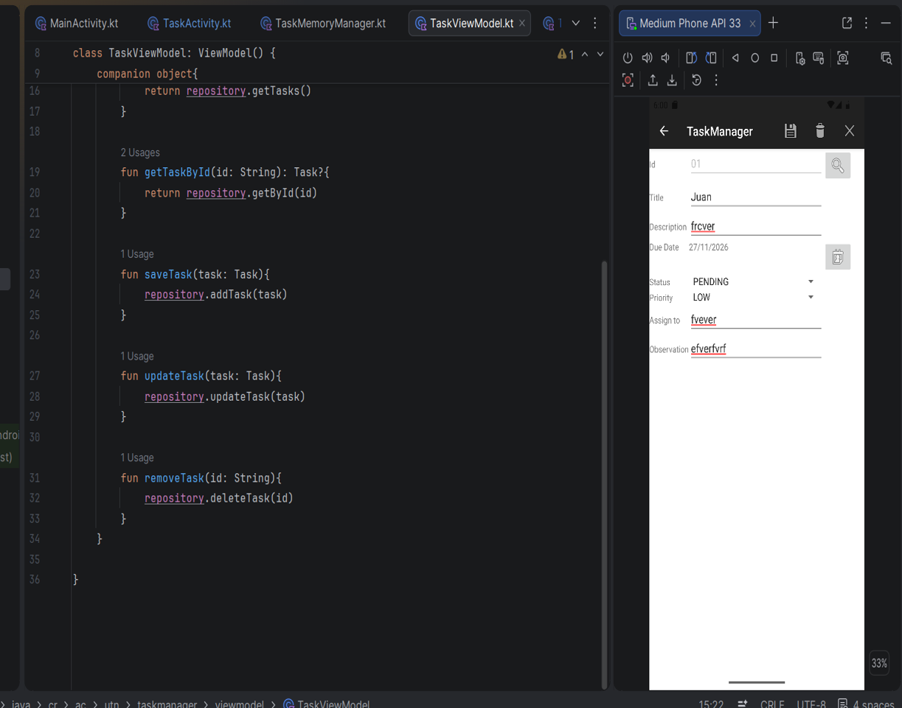

Error 7:
El archivo TaskMemoryManager.kt las funciones deleteTask y getById comparaban los ids con it.id == id por lo cual si el id tenía un espacio al inicio o al final (" 1"), no coincidía con el id guardado ("1"), así que la tarea no se encuentra ni se elimina.
Solución:  Comparar los ids después de aplicar trim() a ambos lados.

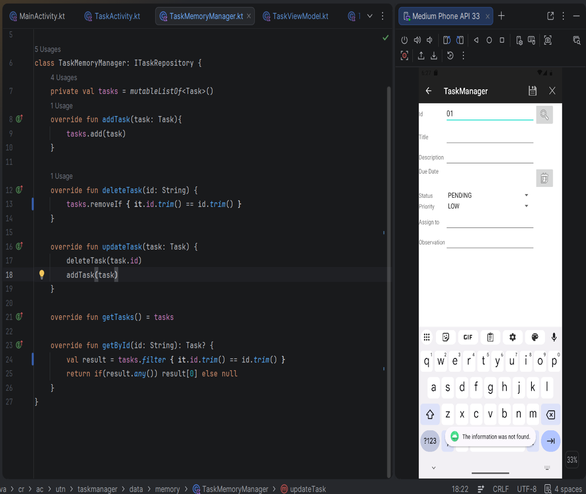

