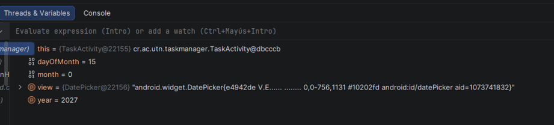
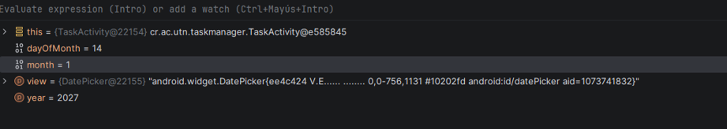
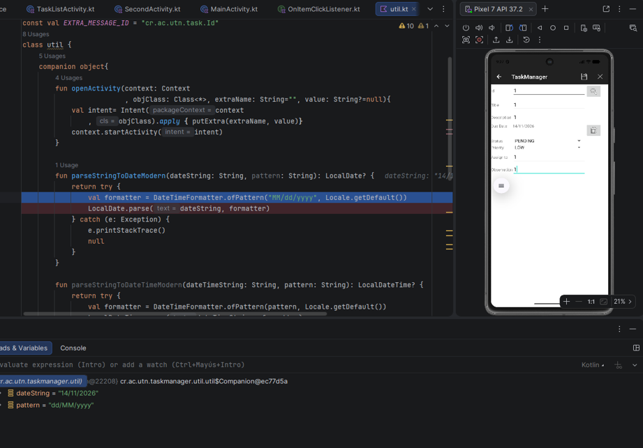
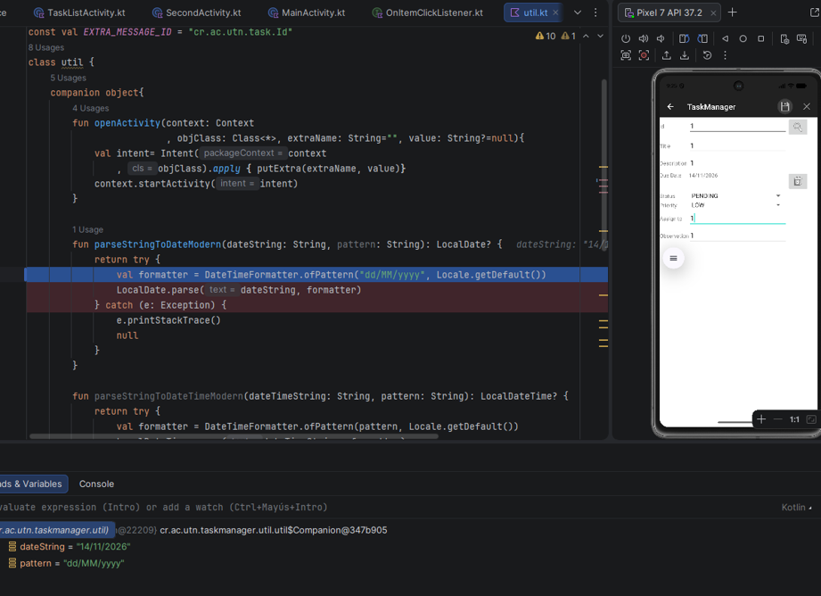
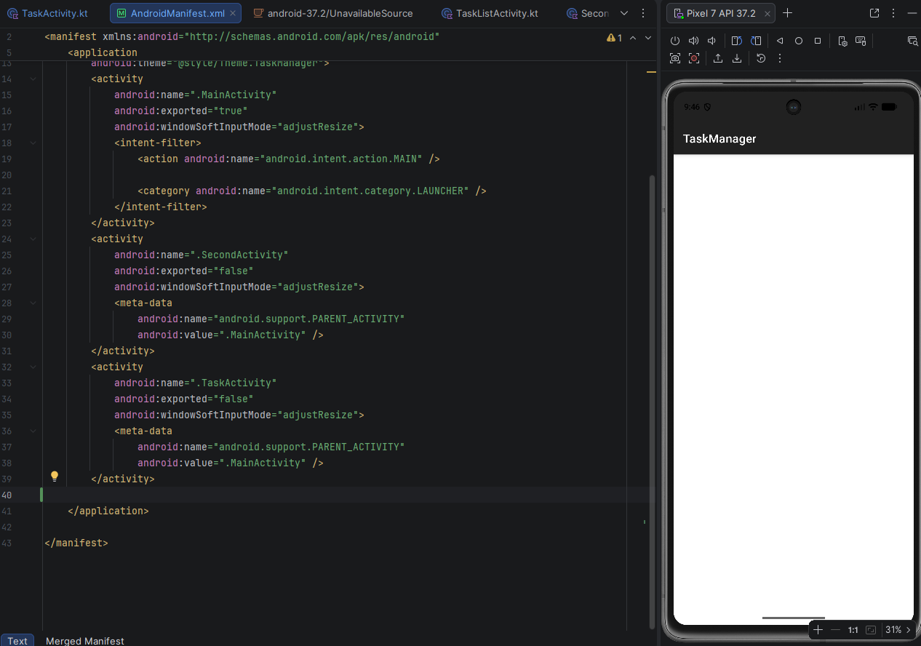
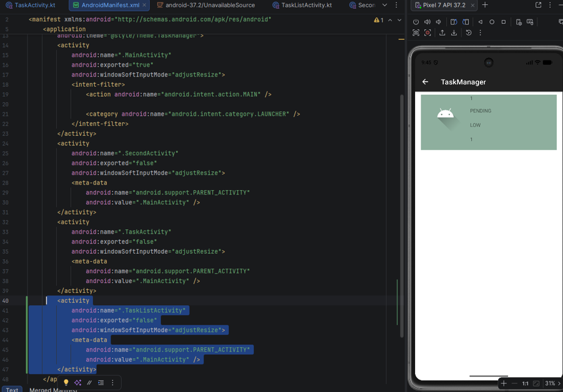
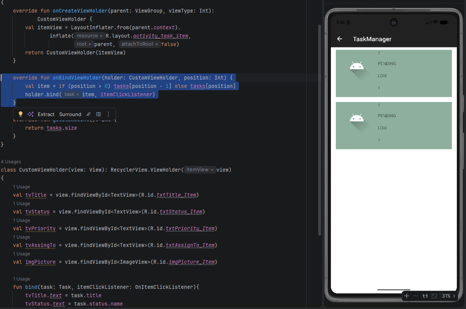
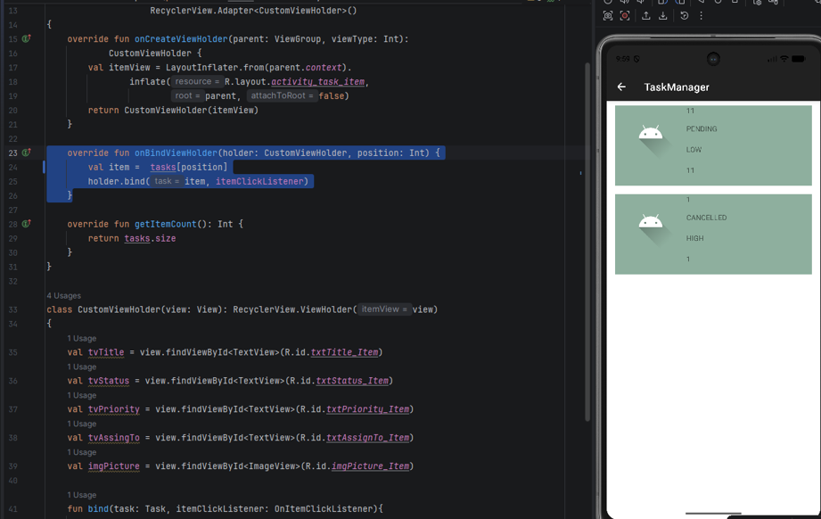

Error uno se encontro un proble ma en el formato de las fechas ya que por ejemplo seleccionaba el mes de diciembre que es 12 me lo ponía como 11 y cuando seleccionaba el mes enero que es el 1 me lo ponía como porq Android studio inicia desde 0 y mes no hay ninguno que inicie en 0 

1.
Antes
 
 
Solocionado
  

En este erro se encontró un problema de formato en el archivo Util.kt donde no se podía poner fechas mayor a la actula no guardara los datos

Antes
  
   

 
Solucionado
  
   
 

El siguiente erroer es que  cuando se guarda una task y se va al a task list no refleja nada entocws vamos a el archivo  de Androidmanifest y no se encuentra  la activiti la solocione s copiar la task activity  la pegamos abajo y le cambiamos el nombre por TaskListActivity ys ya guardaría los cambios
2
Antes
  
  
Solucionado
  

El otro error es que a la hora de hacer un segundo guardado se duplica tira los mismos datos se duplica el primero la solución que se encontró fue  en tasklistActivity hay que eliminar el if
3
Antes
  
Solucion
  

