**Error 1: Activity no registrada**

Se colocó un Breakpoint en `MainActivity.kt`, en la llamada a `util.openActivity()` del botón Task List. Al ejecutar `context.startActivity(intent)`, el depurador mostró una excepción `ActivityNotFoundException`, indicando que `TaskListActivity` no estaba registrada en `AndroidManifest.xml`.

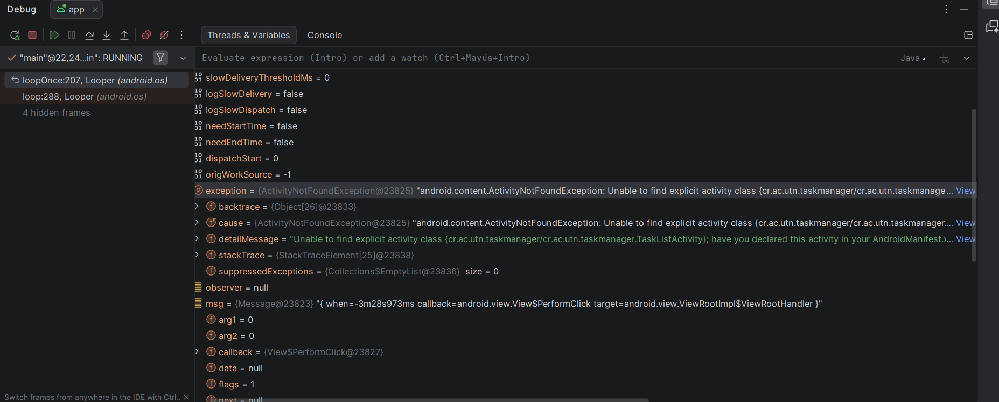

**Solución:** Se agregó `TaskListActivity` en `AndroidManifest.xml`.

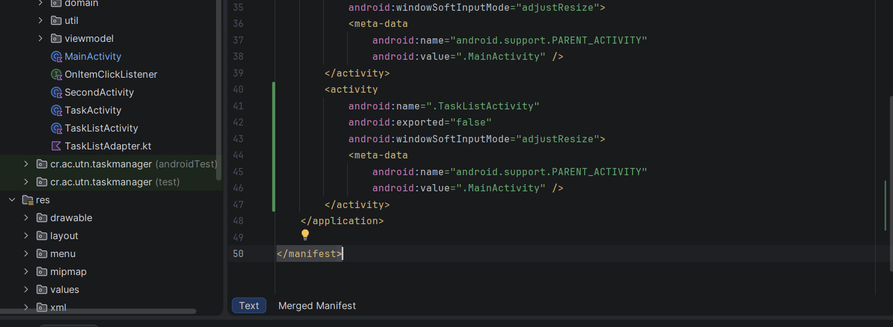

**Error 2: Formato de fecha incorrecto**

Se colocó un Breakpoint en `TaskActivity.kt`, en la llamada a `parseStringToDateModern()` del método `saveTask()`. Al depurar, se identificó que el método recibía el formato `dd/MM/yyyy`, pero utilizaba `MM/dd/yyyy`, provocando una interpretación incorrecta de la fecha.

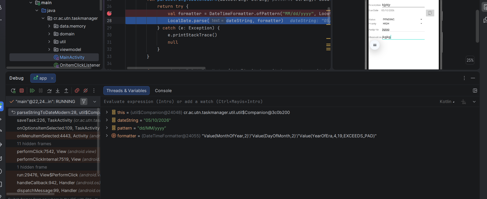

**Solución:** Se reemplazó `"MM/dd/yyyy"` por `pattern` en el método `parseStringToDateModern()`.

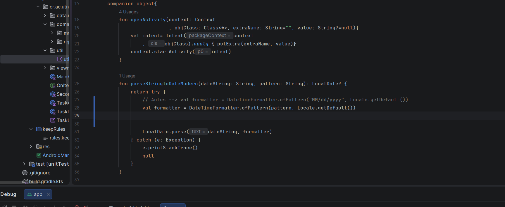

**Error 2.1: Mes incorrecto al seleccionar una fecha**

Se colocó un Breakpoint en `TaskActivity.kt`, dentro del método `onDateSet()`. Al depurar, se identificó que `month` recibía el valor `10` para noviembre, provocando que `getDateFormatString()` mostrara un mes anterior al seleccionado.

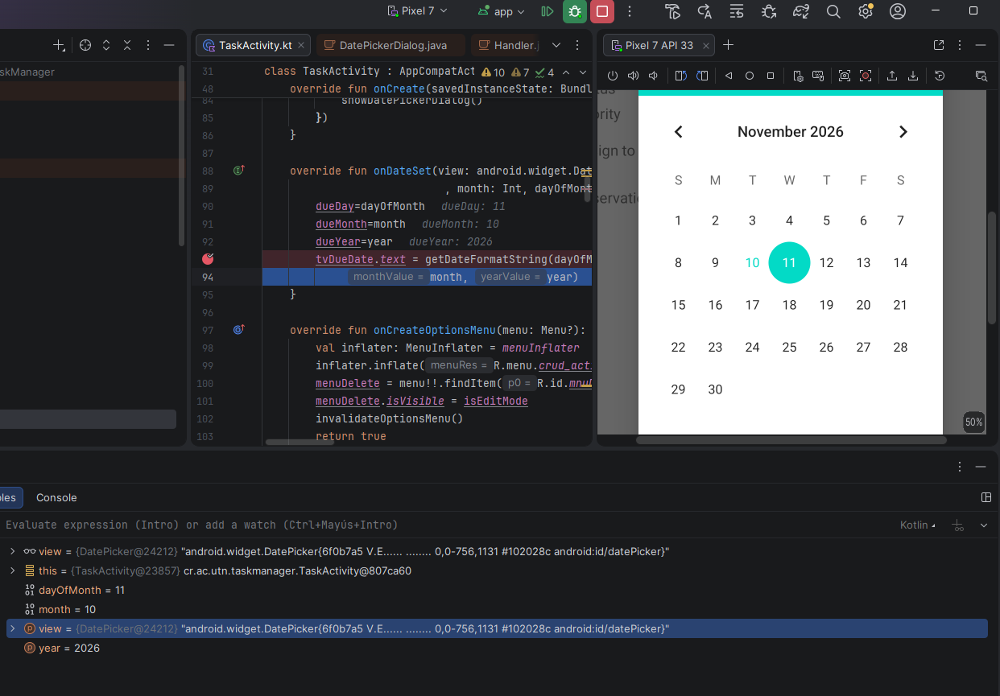

**Solución:** Se agregó `+1` a `month` al asignar el valor de `dueMonth` y se utilizó esta variable en `getDateFormatString()` para mostrar correctamente el mes seleccionado.

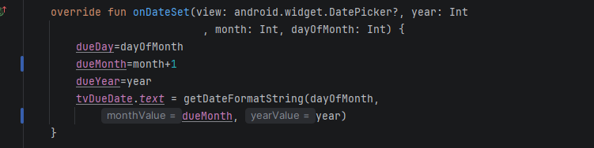

**Error 2.2: Mes incorrecto al editar una tarea**

Se colocó un Breakpoint en `showDatePickerDialog()` de `TaskActivity.kt`. Al depurar, se identificó que `dueMonth` recibía el valor `11` para noviembre desde `searchTask()`, pero `DatePickerDialog` lo interpretaba como diciembre.

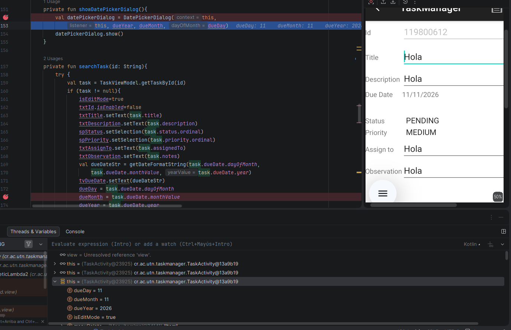

**Solución:** Se agregó `- 1` a `dueMonth` en el método `showDatePickerDialog()` para que `DatePickerDialog` muestre correctamente el mes correspondiente a la fecha de la tarea.

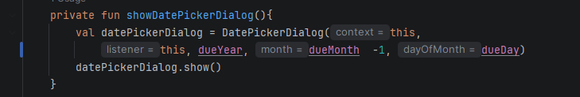

**Error 2.3: Mes incorrecto al restablecer la fecha**

Se colocó un Breakpoint en `TaskActivity.kt`, dentro del método `resetDate()`. Al depurar, se identificó que `Calendar.MONTH` devolvía el valor `10` para noviembre, provocando que `dueMonth` almacenara un mes menos del correspondiente.

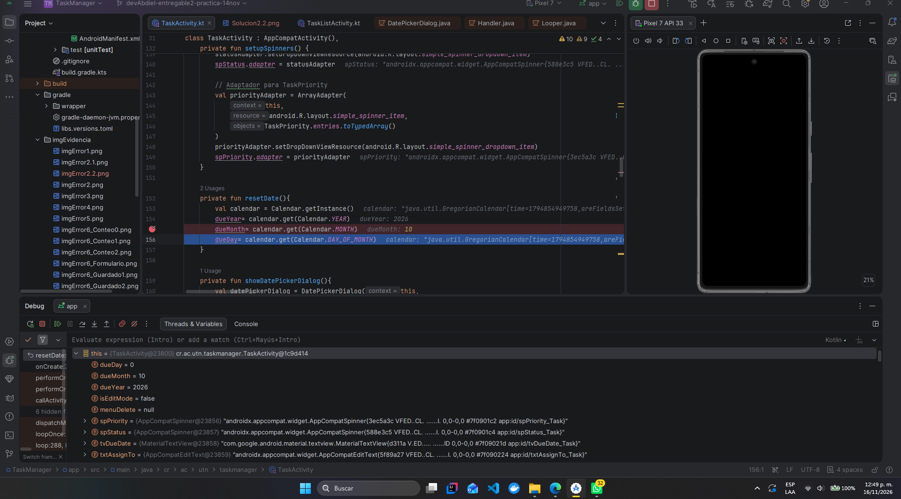

**Solución:** Se agregó `+1` a `Calendar.MONTH` en el método `resetDate()` para almacenar correctamente el mes actual.

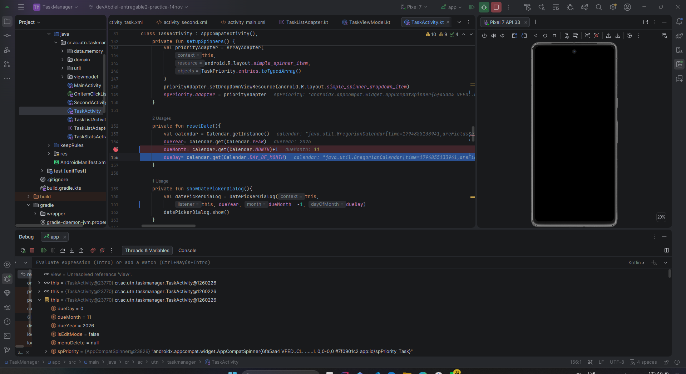

**Error 3: Tarea no encontrada al seleccionarla**

Se colocó un Breakpoint en `TaskListActivity.kt`, dentro del método `onItemClick()`. Al depurar, se identificó que `util.openActivity()` enviaba `task.title` en lugar de `task.id`, provocando que no se encontrara la tarea seleccionada.

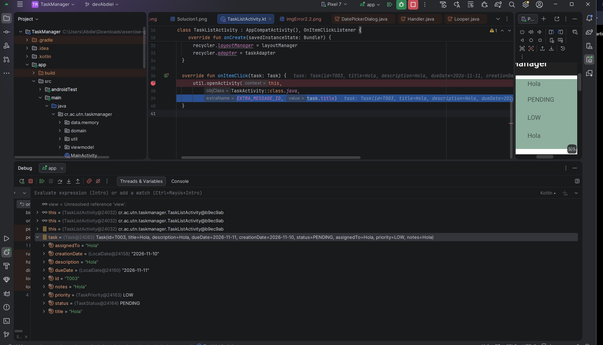

**Solución:** Se reemplazó `task.title` por `task.id` en la llamada a `util.openActivity()`.

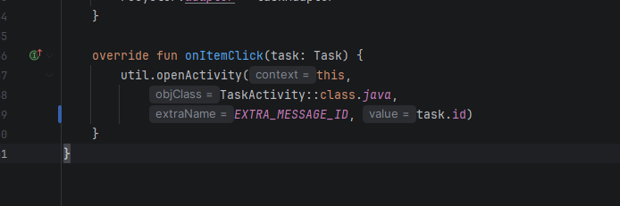

**Error 4: La pantalla permanece en modo edición**

Se colocaron Breakpoints en el método cleanScreen() de TaskActivity.kt. Al guardar una tarea nueva, se identificó mediante el depurador que isEditMode cambiaba a true después de limpiar los campos, dejando la pantalla en modo edición.

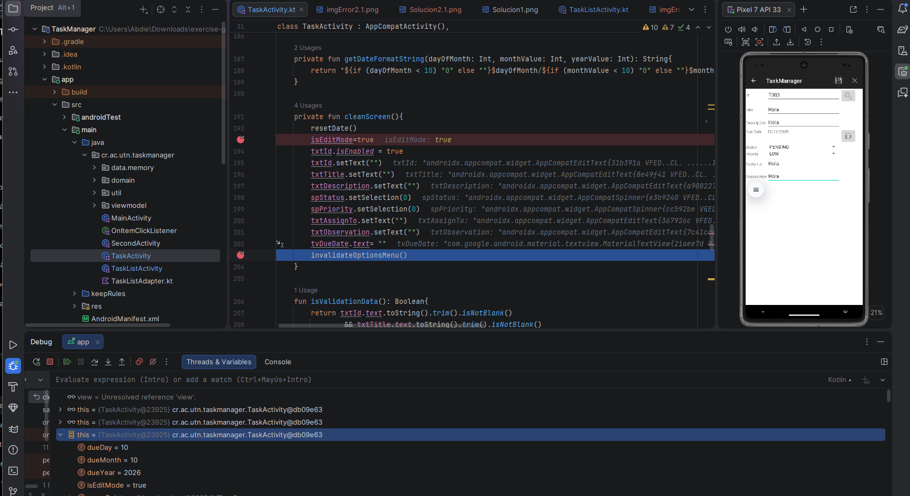

**Solución:** Se cambió `isEditMode=true` por `isEditMode=false` en el método `cleanScreen()`.

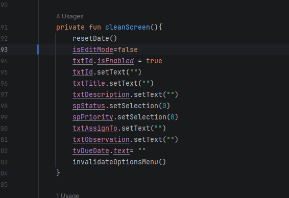

**Error 5: La lista repite la primera tarea**

Se colocó un Breakpoint en el método `onBindViewHolder()` de `TaskListAdapter.kt`. Al depurar, se identificó que cuando `position` era `1`, se obtenía nuevamente la primera tarea debido a `tasks[position - 1]`, provocando que se repitiera y no se mostrara la última.

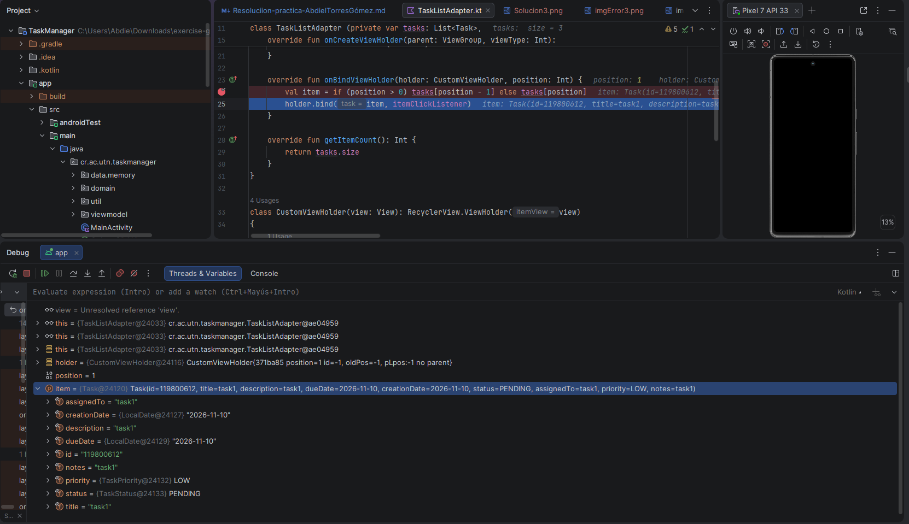

**Solución:** Se reemplazó la condición por `tasks[position]` para mostrar correctamente cada tarea.

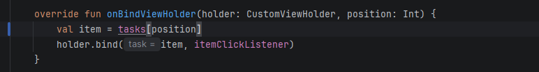

**Error 6: Falta de llamada al método de refresco del adaptador**

Se colocó un Breakpoint en `TaskListActivity.kt`, en la asignación `recycler.adapter = taskAdapter`. Mediante Debug, se comprobó que `taskAdapter.itemCount` contenía una tarea, pero no se llamaba explícitamente al método `notifyDataSetChanged()` después de asignar el adaptador.

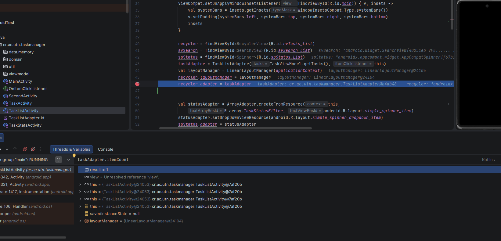

**Solución:** Se agregó `taskAdapter.notifyDataSetChanged()` después de asignar el adaptador al `RecyclerView`. Mediante Debug se verificó la ejecución de esta instrucción y se comprobó que la lista mostraba correctamente la tarea registrada.

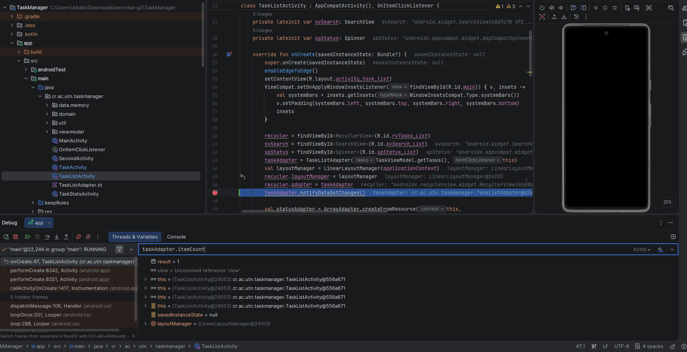

**Error 7: La búsqueda de tareas falla cuando el ID contiene espacios**

Se colocó un Breakpoint en `TaskListActivity.kt`, dentro de `onItemClick()`. Mediante **Evaluate Expression** se comprobó que `TaskViewModel.getTaskById("T777")` encontraba la tarea registrada.

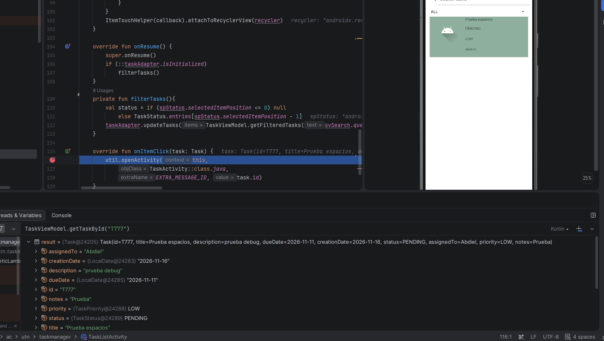

Al buscar la misma tarea con espacios, utilizando `TaskViewModel.getTaskById(" T777 ")`, el resultado fue `null`. Se identificó que `TaskMemoryManager.kt` comparaba los identificadores sin eliminar los espacios al inicio y al final.

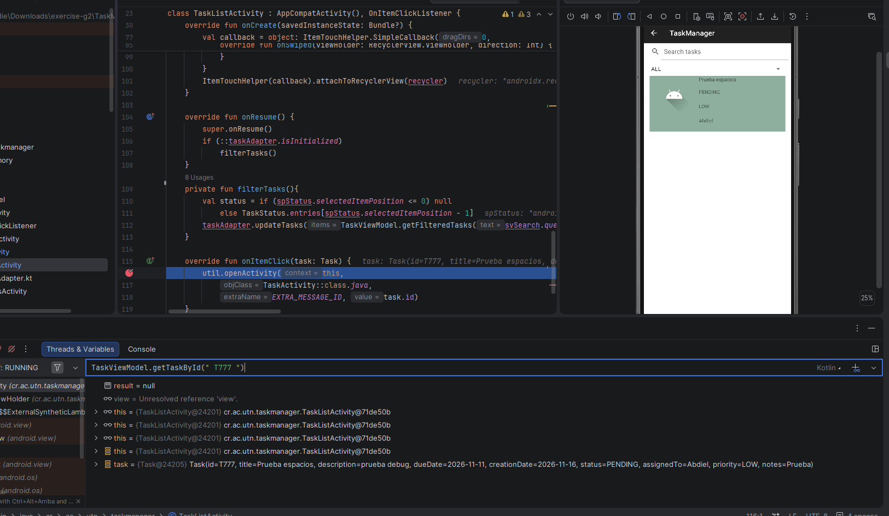

**Solución:** Se agregó `.trim()` a ambos identificadores en las comparaciones de `getById()` y `deleteTask()`.

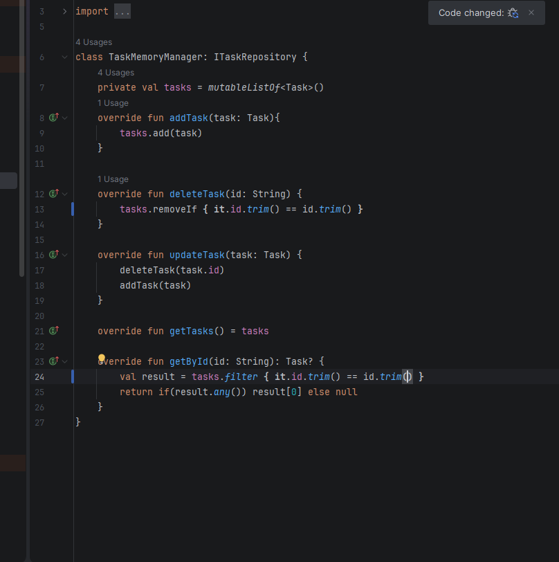

Se ejecutó nuevamente la aplicación mediante Debug y se comprobó que `TaskViewModel.getTaskById(" T777 ")` ahora encontraba correctamente la tarea registrada.

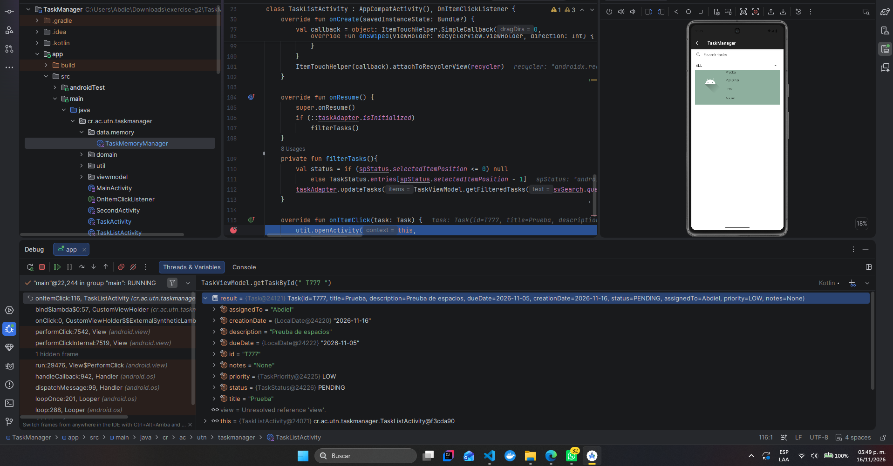

**Error 8: El profesor mencionó en clases que se podían dejar los errores hasta el número 7**

