**Error 1: Activity no registrada**

Se colocó un Breakpoint en `MainActivity.kt`, en la llamada a `util.openActivity()` del botón Task List. Al ejecutar `context.startActivity(intent)`, el depurador mostró una excepción `ActivityNotFoundException`, indicando que `TaskListActivity` no estaba registrada en `AndroidManifest.xml`.

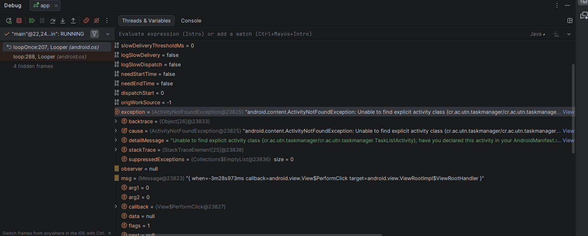

**Solución:** Se agregó `TaskListActivity` en `AndroidManifest.xml`.

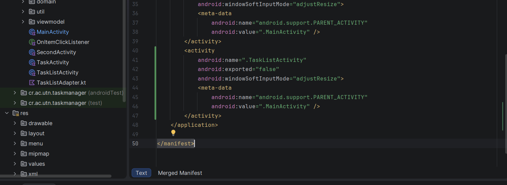

**Error 2: Formato de fecha incorrecto**

Se colocó un Breakpoint en `TaskActivity.kt`, en la llamada a `parseStringToDateModern()` del método `saveTask()`. Al depurar, se identificó que el método recibía el formato `dd/MM/yyyy`, pero utilizaba `MM/dd/yyyy`, provocando una interpretación incorrecta de la fecha.

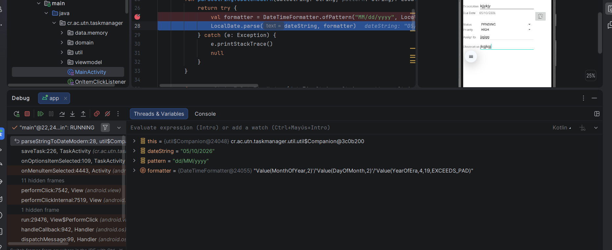

**Solución:** Se reemplazó `"MM/dd/yyyy"` por `pattern` en el método `parseStringToDateModern()`.

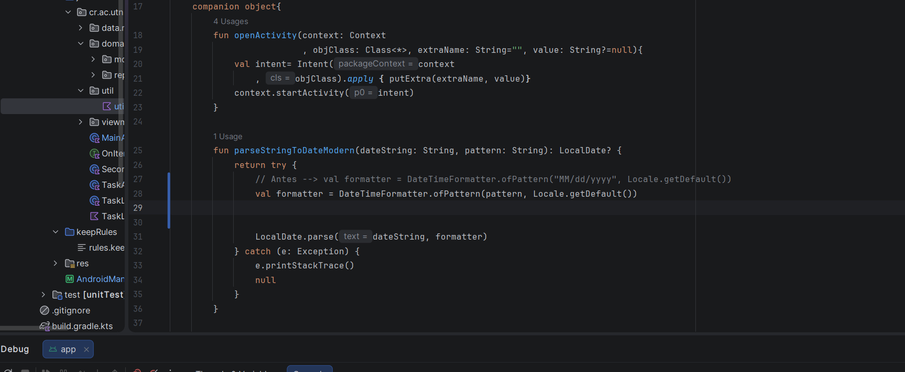

**Error 2.1: Mes incorrecto al seleccionar una fecha**

Se colocó un Breakpoint en `TaskActivity.kt`, dentro del método `onDateSet()`. Al depurar, se identificó que `month` recibía el valor `10` para noviembre, provocando que `getDateFormatString()` mostrara un mes anterior al seleccionado.

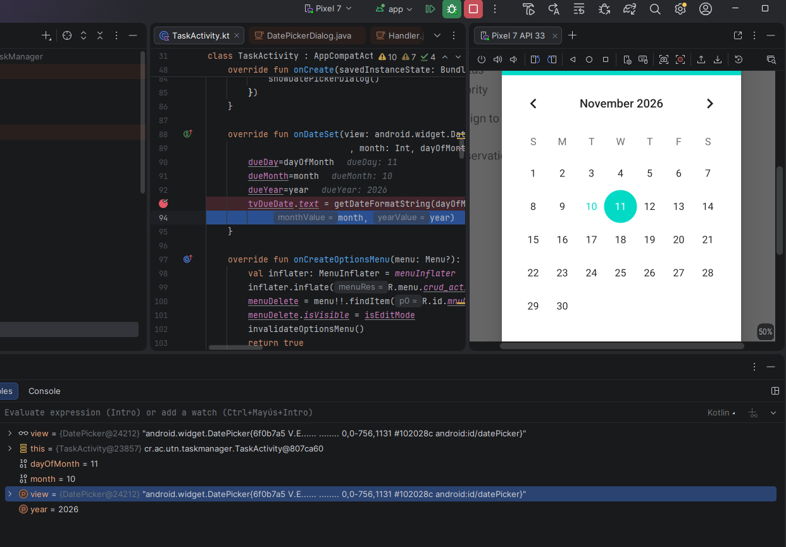

**Solución:** Se agregó `month + 1` en la llamada a `getDateFormatS`**`t`**`ring()` para mostrar correctamente la fecha.

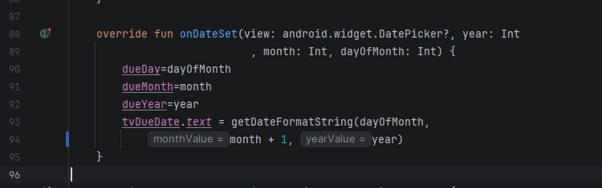

**Error 2.2: Mes incorrecto al editar una tarea**

Se colocó un Breakpoint en `showDatePickerDialog()` de `TaskActivity.kt`. Al depurar, se identificó que `dueMonth` recibía el valor `11` para noviembre desde `searchTask()`, pero `DatePickerDialog` lo interpretaba como diciembre.

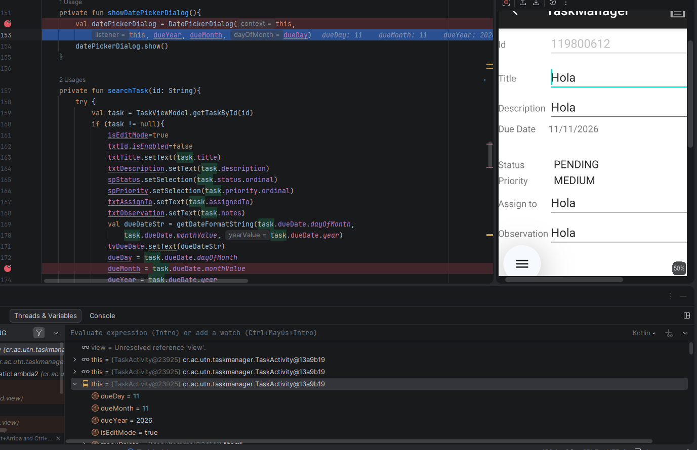

**Solución:** Se agregó `- 1` a `task.dueDate.monthValue` en el método `searchTask()`.

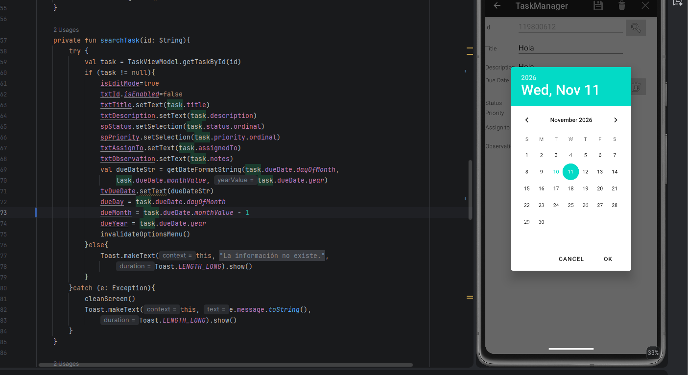

**Error 3: Tarea no encontrada al seleccionarla**

Se colocó un Breakpoint en `TaskListActivity.kt`, dentro del método `onItemClick()`. Al depurar, se identificó que `util.openActivity()` enviaba `task.title` en lugar de `task.id`, provocando que no se encontrara la tarea seleccionada.

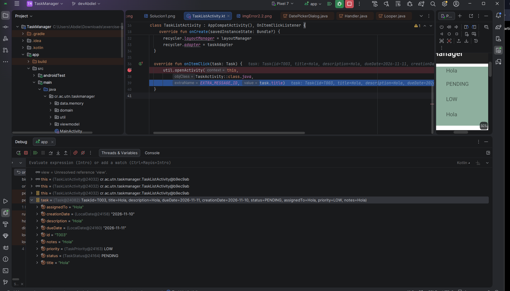

**Solución:** Se reemplazó `task.title` por `task.id` en la llamada a `util.openActivity()`.

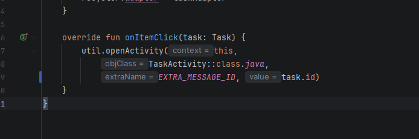

**Error 4: La pantalla permanece en modo edición**

Se colocaron Breakpoints en el método cleanScreen() de TaskActivity.kt. Al guardar una tarea nueva, se identificó mediante el depurador que isEditMode cambiaba a true después de limpiar los campos, dejando la pantalla en modo edición.

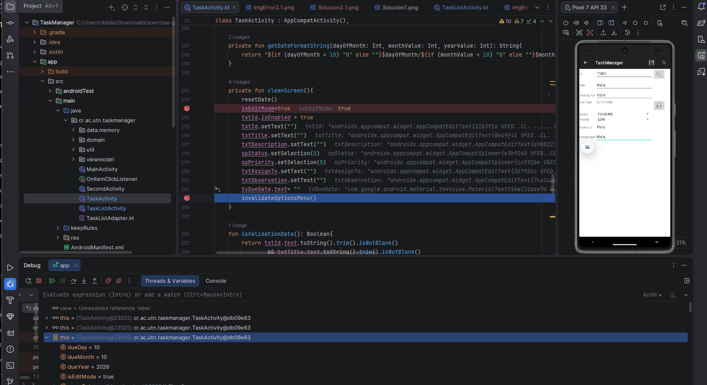

**Solución:** Se cambió `isEditMode=true` por `isEditMode=false` en el método `cleanScreen()`.

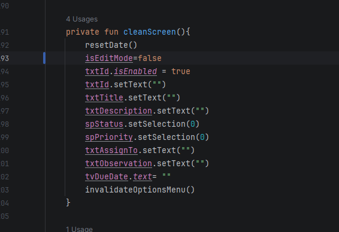

**Error 5: La lista repite la primera tarea**

Se colocó un Breakpoint en el método `onBindViewHolder()` de `TaskListAdapter.kt`. Al depurar, se identificó que cuando `position` era `1`, se obtenía nuevamente la primera tarea debido a `tasks[position - 1]`, provocando que se repitiera y no se mostrara la última.

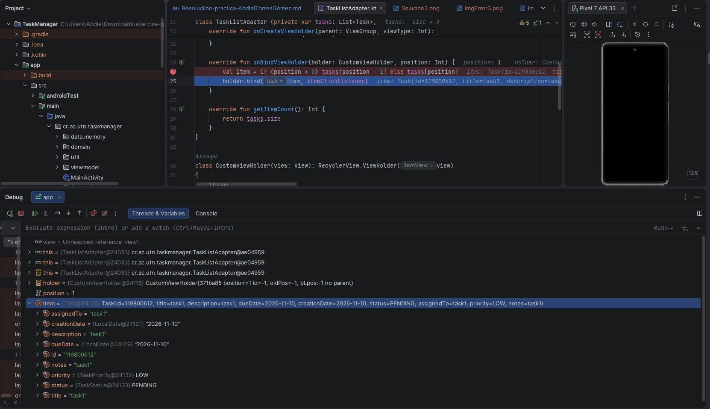

**Solución:** Se reemplazó la condición por `tasks[position]` para mostrar correctamente cada tarea.

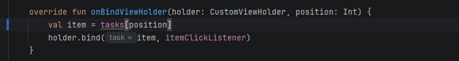

**Error 6: El ViewModel permite guardar tareas con el mismo ID**

Se detuvo la aplicación con un Breakpoint en el método `onItemClick()` de `TaskListActivity.kt`. Desde **Evaluate Expression** se probó directamente `TaskViewModel.saveTask()`. El problema se encuentra en `TaskViewModel.kt`: el método ejecuta `repository.addTask(task)` sin comprobar primero si el ID está registrado.

**Comprobación mediante Debug:**

Primero se verificó que no existieran registros con el ID `DBG006`. El resultado fue `0`.

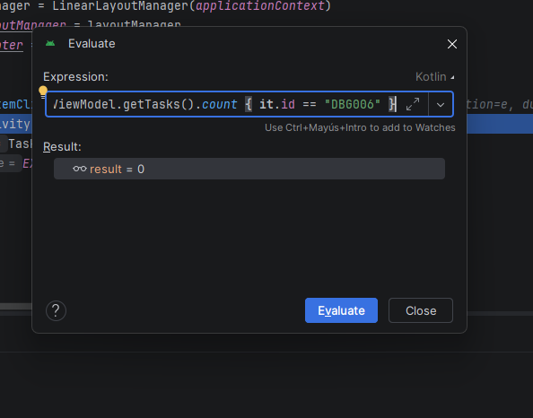

Se ejecutó `TaskViewModel.saveTask(task.copy(id = "DBG006", title = "Prueba Debug"))`. Después, la consulta mostró `1` registro.

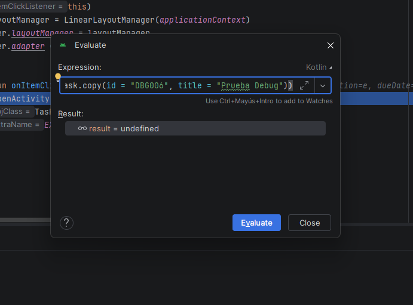

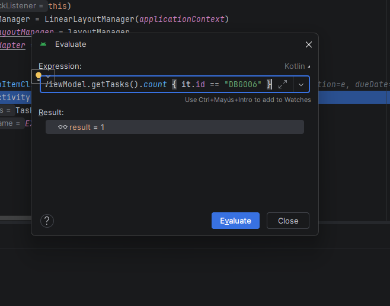

Luego se ejecutó nuevamente `TaskViewModel.saveTask()`, con el mismo ID `DBG006` y el título `Prueba Duplicada`. La consulta devolvió `2`, demostrando que el ViewModel permitió almacenar dos tareas con el mismo identificador.

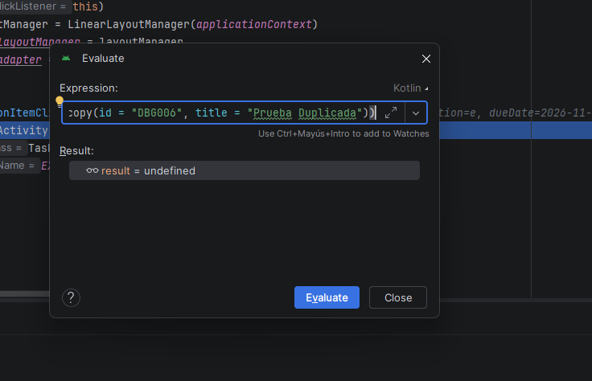

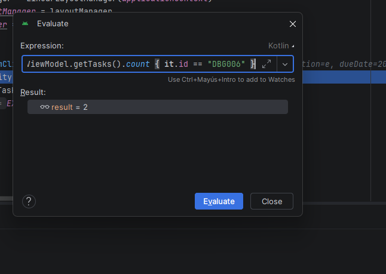

**Solución:** Se modificó el método `saveTask()` de `TaskViewModel.kt` para verificar si el ID ya existe mediante `repository.getById()`. Si la tarea está registrada, se lanza una excepción para evitar que se guarden tareas duplicadas.

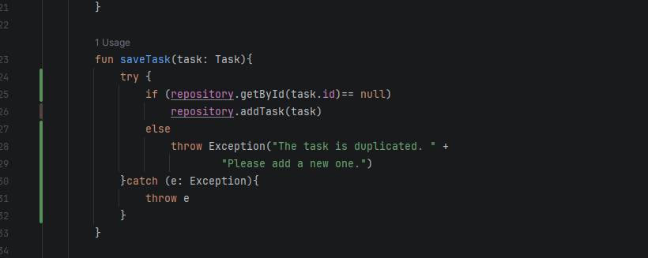

**Error 7: Se crea una tarea al intentar actualizar un ID inexistente**

Se detuvo la aplicación con un Breakpoint en el método `onItemClick()` de `TaskListActivity.kt`. Desde **Evaluate Expression** se probó directamente `TaskViewModel.updateTask()`.El problema se encuentra en `TaskViewModel.kt`: el método ejecuta `repository.updateTask(task)` sin comprobar primero si el ID existe.

**Comprobación mediante Debug:**

Primero se verificó que no existieran registros con el ID `DBG007`. El resultado fue `0`.

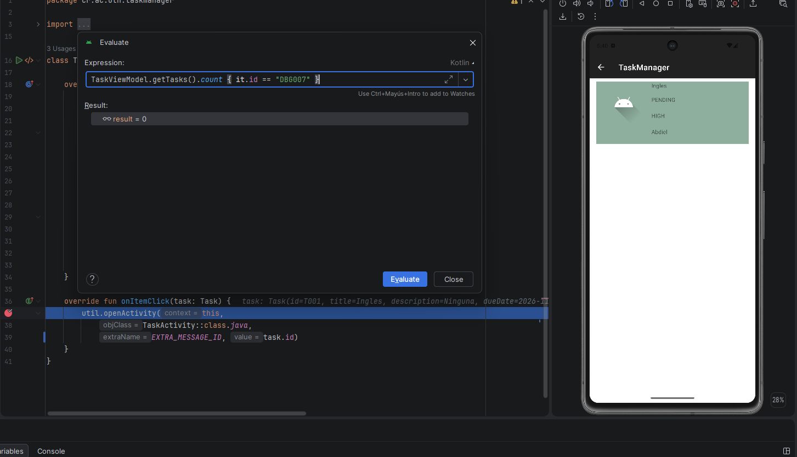

Luego se ejecutó `TaskViewModel.updateTask(task.copy(id = "DBG007", title = "Prueba Actualizacion"))`, intentando actualizar una tarea inexistente.

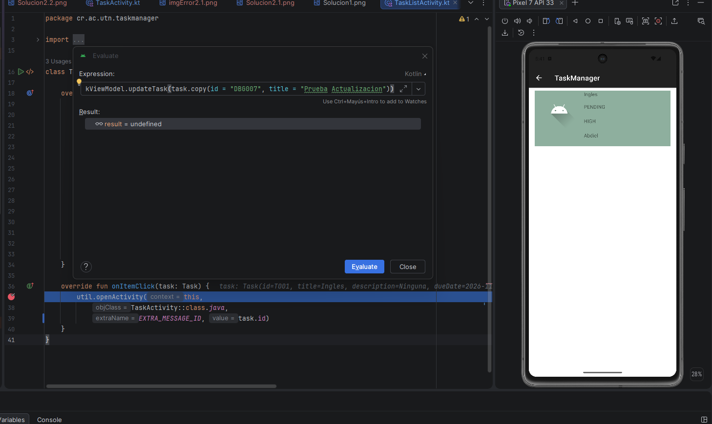

Al repetir la consulta, el resultado fue `1`, demostrando que el ViewModel creó una tarea nueva cuando solamente debía actualizar una existente.

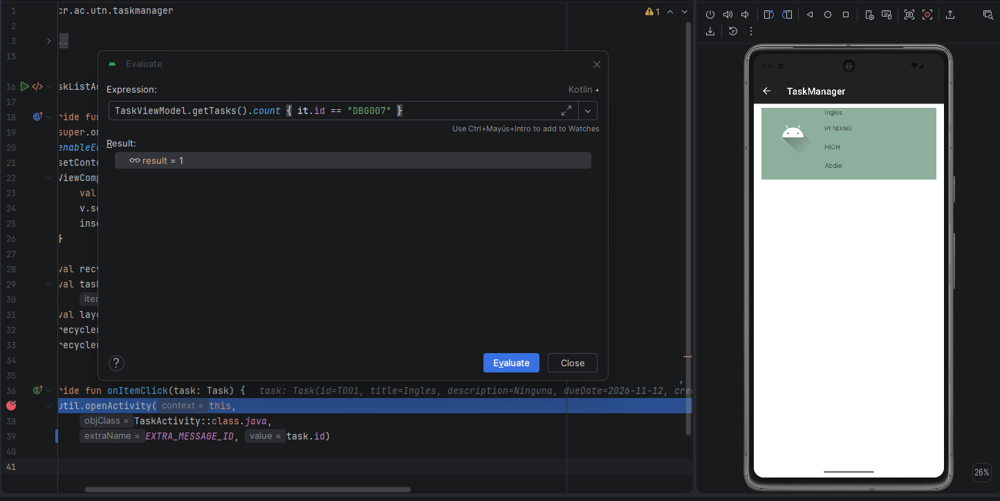

**Solución:** Se modificó el método `updateTask()` de `TaskViewModel.kt` para verificar si la tarea existe mediante `repository.getById()`. Si no se encuentra el ID, se lanza una excepción para impedir que se cree una tarea nueva durante la actualización.

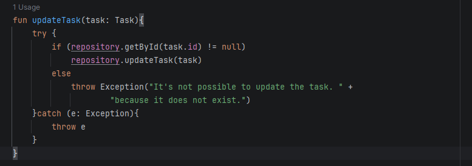

**Error 8: El ViewModel permite eliminar una tarea inexistente sin informar el error**

Se detuvo la aplicación con un Breakpoint en el método `onItemClick()` de `TaskListActivity.kt`. Desde **Evaluate Expression** se probó directamente `TaskViewModel.removeTask()`. El problema se encuentra en `TaskViewModel.kt`: el método ejecuta `repository.deleteTask(id)` sin comprobar primero si el ID está registrado.

**Comprobación mediante Debug:**

Primero se verificó que no existieran registros con el ID `DBG008`. El resultado fue `0`.

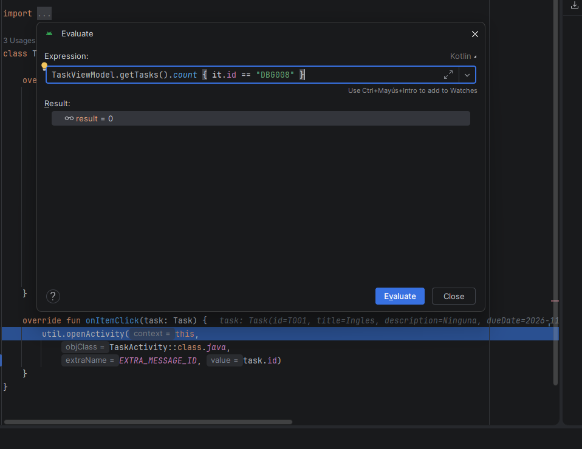

Luego se ejecutó `TaskViewModel.removeTask("DBG008")` desde Evaluate Expression. El resultado fue `undefined`, sin que se mostrara ninguna excepción, a pesar de que la tarea no existía.

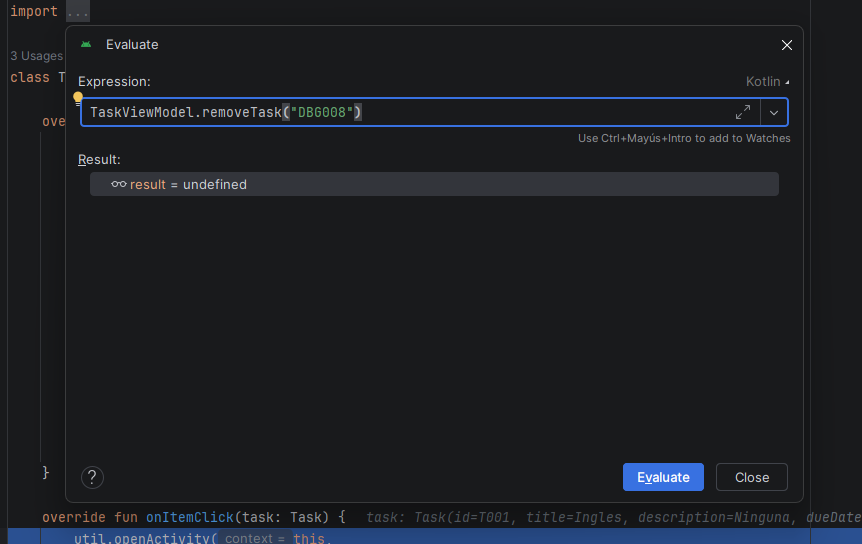

Al repetir la consulta, el resultado siguió siendo `0`, demostrando que no había ninguna tarea que eliminar y que el método terminó sin informar el problema.

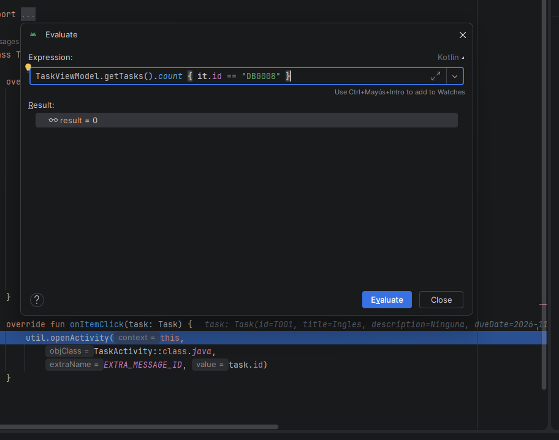

**Solución:** Se modificó el método `removeTask()` de `TaskViewModel.kt` para verificar mediante `repository.getById()` si la tarea existe antes de eliminarla. Si no se encuentra el ID, se lanza una excepción para impedir que la eliminación termine como si fuera exitosa.

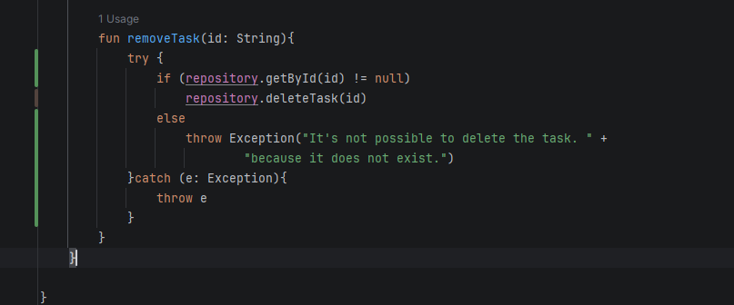

