# Errores y correcciones

## Error 1. Cierre al abrir la lista de tareas

**Problema:** Al ingresar a `TaskListActivity`, la aplicación se cerraba porque la actividad no estaba declarada en `AndroidManifest.xml`.

**Corrección:** Se agregó `TaskListActivity` al manifiesto, siguiendo el formato de las demás pantallas. Después del cambio, la pantalla pudo abrirse correctamente.

### Evidencias

**Error observado en Android Studio**

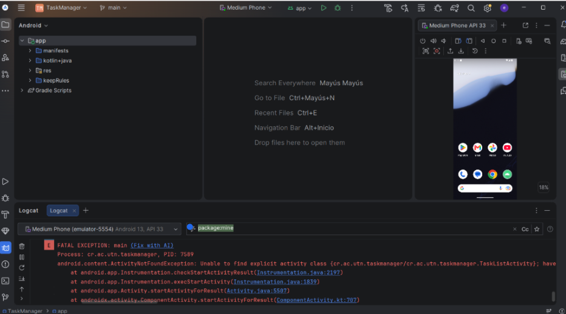

**Registro de la actividad en el manifiesto**

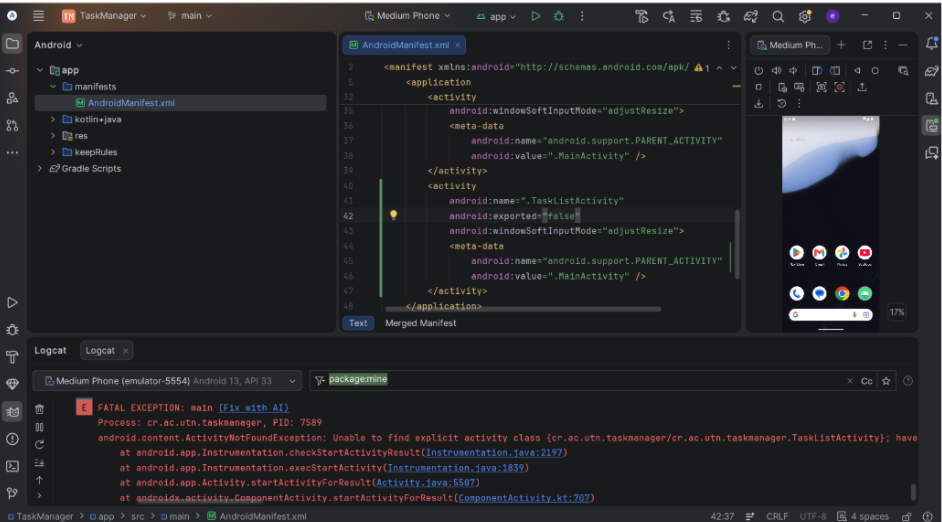

**Resultado: pantalla de lista abierta**

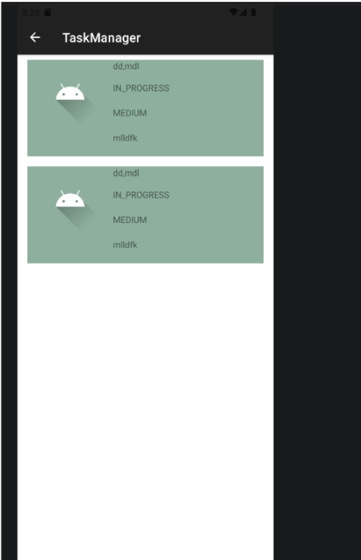

---

## Error 2. La tarea seleccionada no cargaba sus datos

**Problema:** Al seleccionar una tarea desde la lista, la pantalla de edición no mostraba sus datos.

**Causa y corrección:** En `TaskListActivity.kt`, el método `onItemClick()` enviaba `task.title` en lugar de `task.id`. Se cambió a `task.id` para buscar la tarea por su identificador.

### Evidencias

**Lista de tareas**

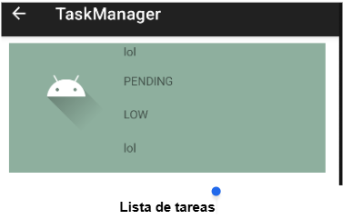

**Formulario sin datos**

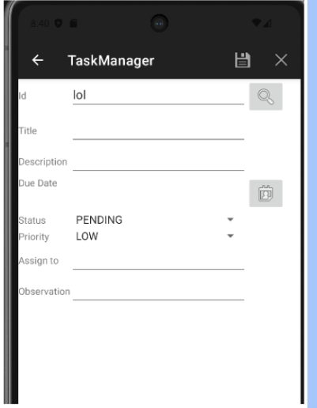

**Antes: task.title**

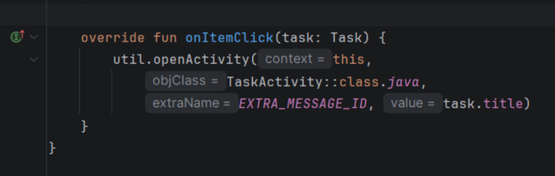

**Después: task.id**

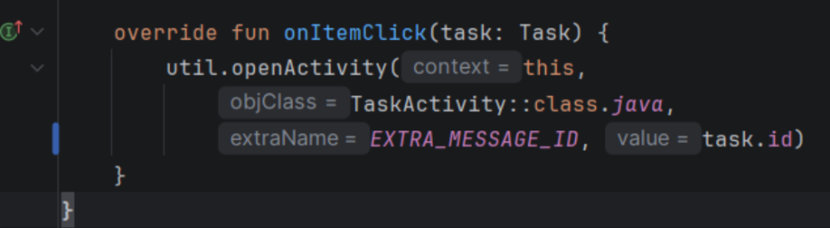

---

## Error 3. Tareas duplicadas en la lista

**Problema:** Al crear dos tareas, la lista repetía la primera y no mostraba correctamente la segunda.

**Causa y corrección:** En `TaskListAdapter.kt` se utilizaba `tasks[position - 1]`. Se reemplazó por `tasks[position]` para mostrar el elemento que corresponde a cada posición.

### Evidencias

**Antes: tarea duplicada**

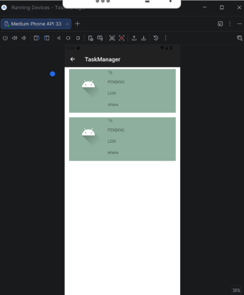

**Después: tareas diferentes**

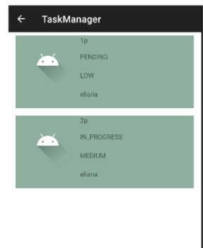

**Código anterior**

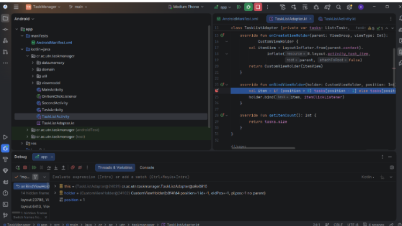

**Código corregido**

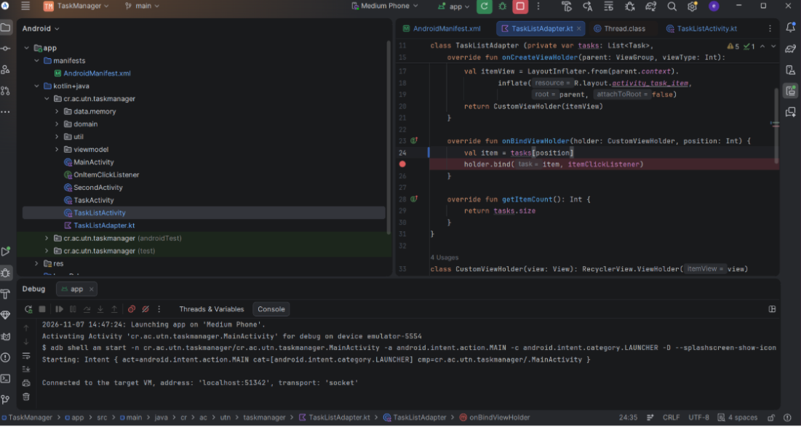

---

## Error 4. Fecha incorrecta y problema al guardar

**Problema:** El formulario mostraba un mes anterior al seleccionado y aparecía un mensaje `null` al intentar guardar. Además, al abrir nuevamente el calendario, aparecía un mes posterior al que estaba guardado.

**Corrección:** En `TaskActivity.kt` se agregó `+1` al mes recibido en `onDateSet()` para mostrar y almacenar el mes correcto. También se ajustó el formato de fecha en `util.kt`.

Además, en `searchTask()` se agregó `-1` al valor de `dueMonth` para que, al abrir nuevamente el calendario, apareciera el mes correspondiente a la fecha guardada.

### Evidencias

**Antes: fecha y mensaje de error**

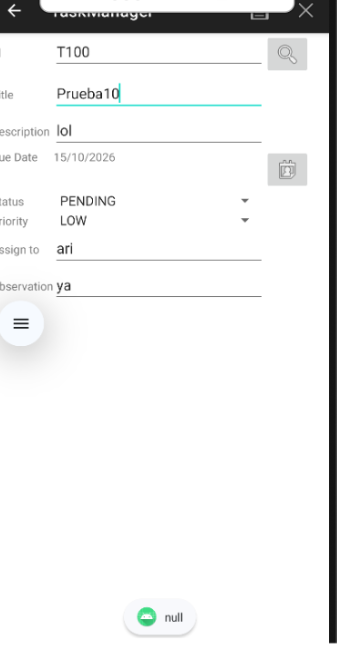

**Código del selector de fecha**

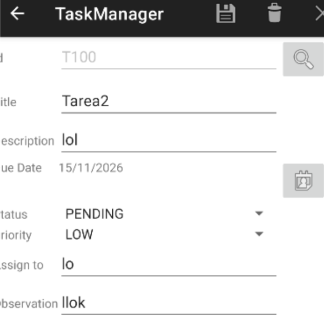

**Código anterior de onDateSet()**

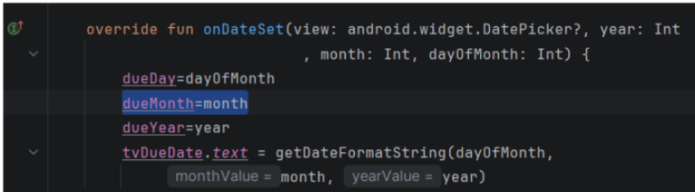

**Código corregido de onDateSet()**

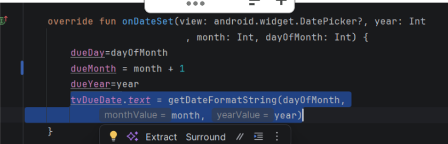

**Ajuste del mes**

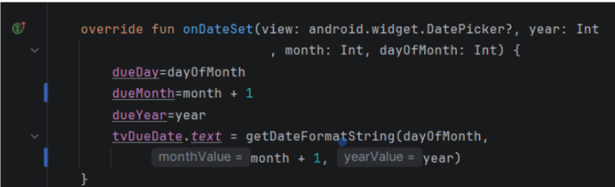

**Formato de fecha anterior en util.kt**

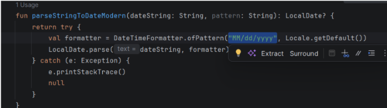

**Formato corregido en util.kt**

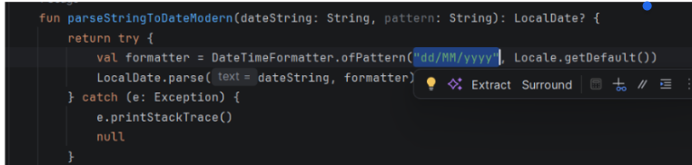

**Resultado en el formulario**

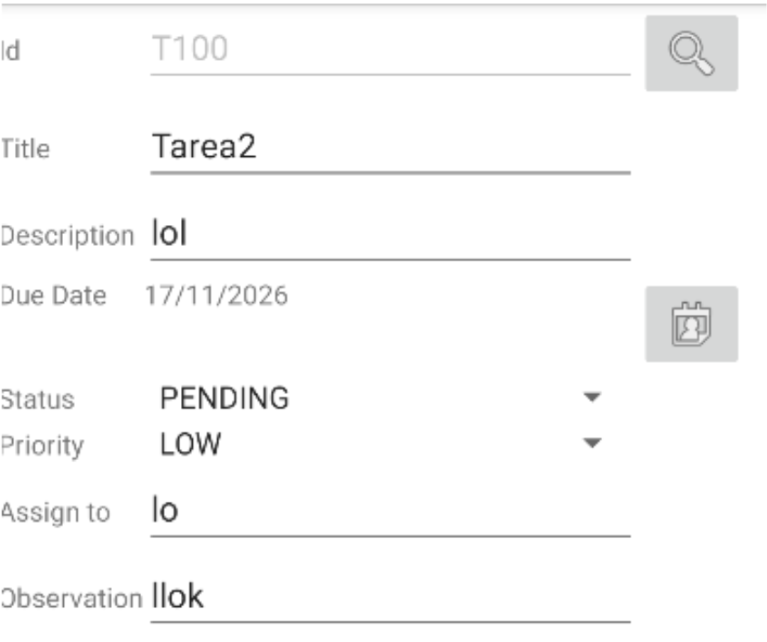

**Corrección en searchTask() y ajuste de dueMonth**

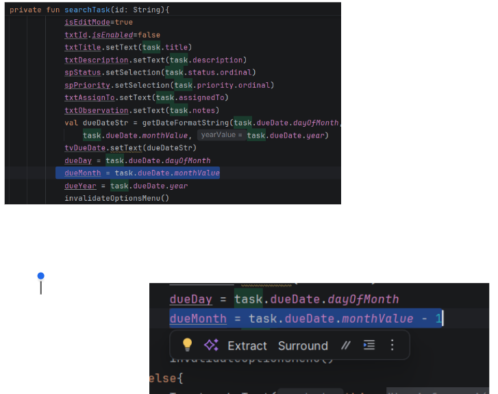

---

## Error 5. El formulario no salía del modo edición

**Problema:** Al presionar Cancelar, el formulario debía limpiarse para poder registrar una nueva tarea, pero en el código la variable `isEditMode` quedaba en `true`, haciendo que siguiera en modo edición.

**Corrección:** Para identificar el error, se utilizó el Debugger y se colocó un breakpoint en el método `cleanScreen()` de `TaskActivity.kt`. Al revisar el valor de `isEditMode`, se observó que cambiaba de `false` a `true`, cuando debía mantenerse en `false`.

Para solucionarlo, se reemplazó `isEditMode = true` por `isEditMode = false`. De esta manera, al presionar Cancelar, el formulario se limpia y regresa al modo de registro de nuevas tareas.

### Evidencias

**Antes de ejecutar la línea con el error**

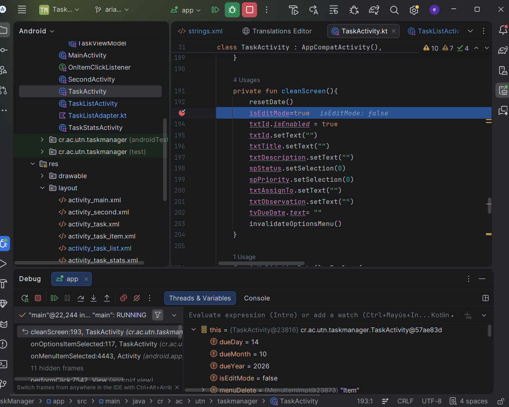

**Después de ejecutar la línea con el Debugger**

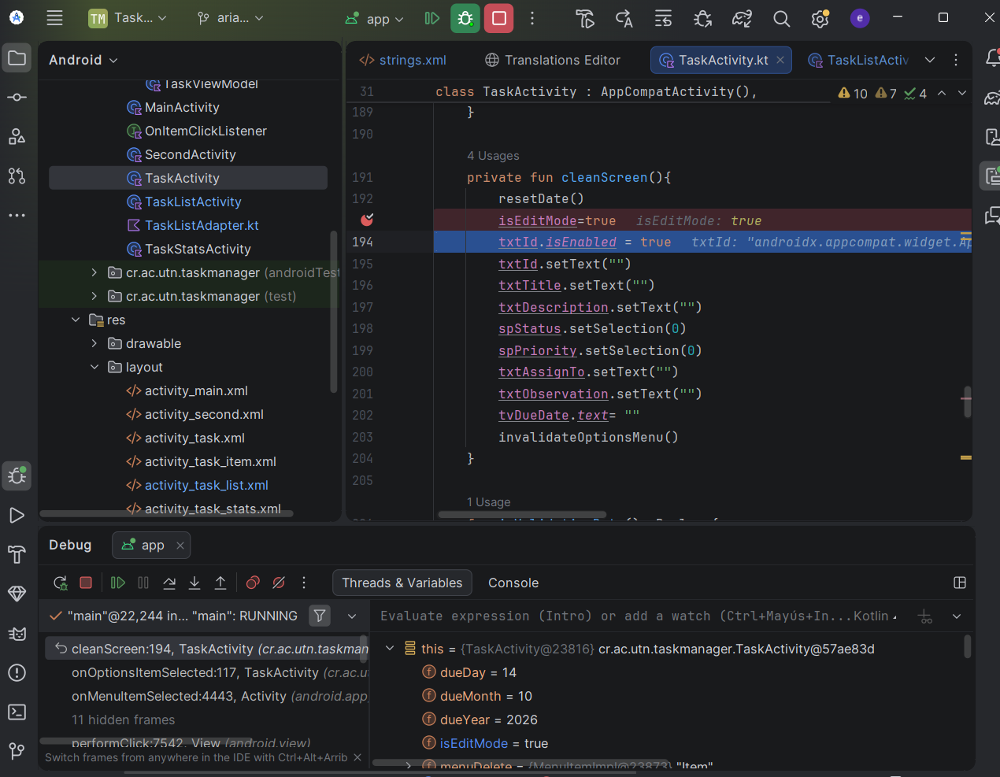

**Código corregido**

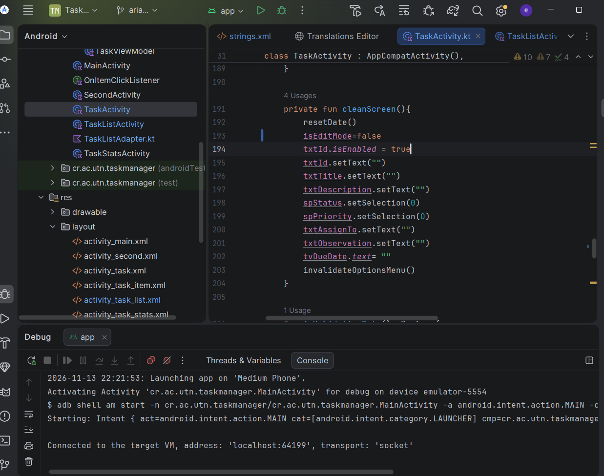
