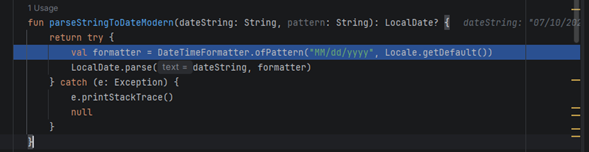
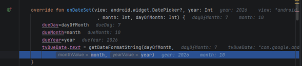
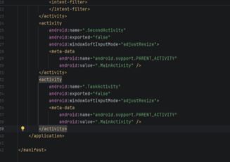
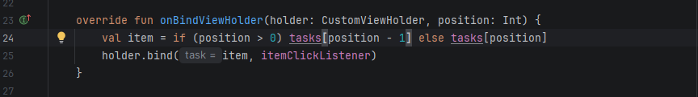
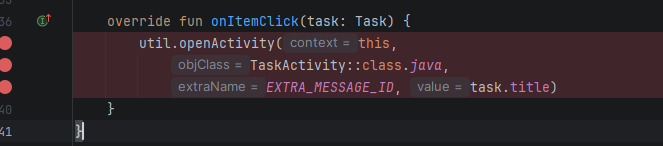

### Error1:Formato de fecha incorrecto

EL error era por como estaba el formato MM/dd/yyyy para solucionarlo se debe de poner asi dd/MM/yyyy

### Error1.2:El valor del mes refleja el anterior al seleccionado

debido a que por defecto se inica en "0" los meses estan erroneos,se agrega un +1 al month para solucionarlo

### Error2:TaskListActivity no estaba en el manifest

al no estar esa activity en el manifes al darle click al boton la app se cae,se soluciona agregandolo

### Error3:Se duplica el id en la task list

es debido al -1 luego de position,para solucionarlo se elimina el -1

### Error4:utiliza el nombre en vez de id

debido a que utilizaba el task.tittle en vez del id al buscar no llegaba a nada,se soluciona cambiando el task.tittle por task.id